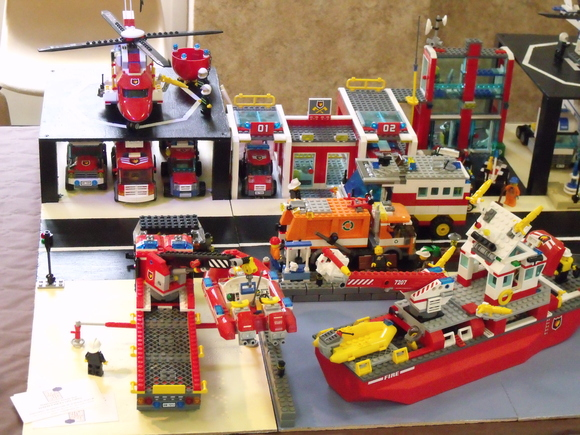
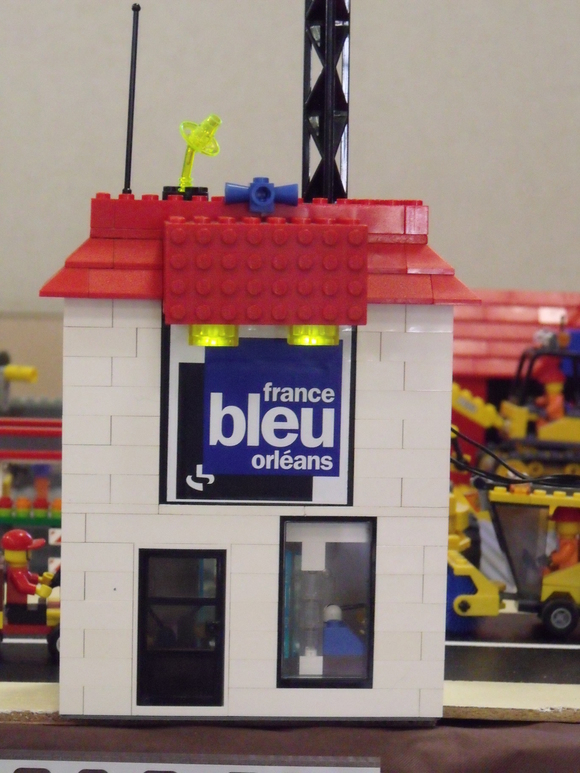
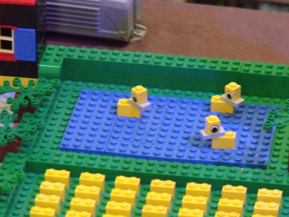

J’ai demandé au président du comité des fêtes si je pouvais réaliser une petite exposition de mes LEGO avec l’accord du CA qui était pour.

J’ai fait deux semaines de préparation pour une première exposition et je fus très contant de ma petite exposition, qui s’est déroulée le 9 mai 2010.

Elle a attiré énormément de spectateurs et surtout des enfants qui étaient tout épanouis, et même les anciens étaient tout émerveillés en voyant les réalisations, leur rappelant leurs enfance.

**France Bleu Orléans**

En cour d’après-midi, Sébastien Hamon m’a rejoint pour voir un peu mon exposition et m’expliquer certains trucs que je pourrais améliorer pour la prochaine.

**Les canards**

**Remerciements :**  
**–** Je remercie le CA d’avoir accordé que je représente l’association en exposant mes LEGO.  
**–** Je remercie le président du comité des fêtes de m’avoir accordé cet petite exposition.

Je vous donnes rendez-vous l’année prochaine pour une nouvelle exposition LEGO le second dimanche de mai.

[Galerie photos](http://photos.freelug.org/main.php/v/davidkurys/)
