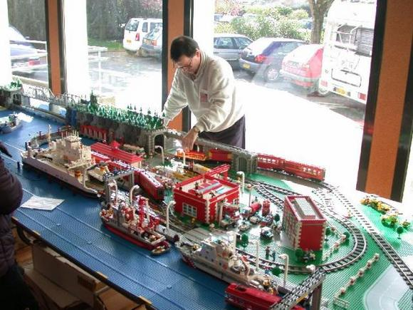

L’association Arts et Collections de Pontivy a organisé son 9ème salon de la maquette avec succès , le dimanche 11 mars 2007.

Cette manifestation a duré une journée, trop juste à mon goût (ils vont étudier par la suite leur salon sur 2 jours). Les organisateurs, qui m’avaient repéré à Lorient en novembre dernier, souhaitaient vivement ma présence, chose promise, chose due.

Je les remercie beaucoup pour leur travail avec la presse (quatre quotidiens, deux articles avec photo pour l’instant).  
Je remercie également la secrétaire de l’association pour l’hébergement. Son mari est collectionneur de voitures miniatures comme moi...

Avant de se quitter, le président du salon m’a dit : "sans vous, pas de salon !!!"

Parmi les exposants habituels du Grand Ouest, il faut noter la participation exceptionnelle de Rémi Lancien, mon voisin breton, qui nous a montré en exclusivité ses engins agricoles. Le public était très intéressé par nos LEGO.  
Tous les exposants ont reçu une belle médaille de la ville de Pontivy.

Votre serviteur morlaisien, Jean-Marc maintenant poursuivi par la célébrité...

[La galerie de photos (par Rémi)](http://gallery2.freelug.org/main.php/v/barr__/sous+le+soleil/)
