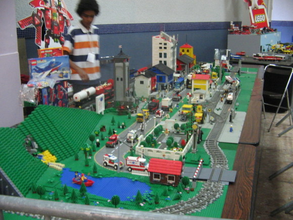

Les 26 et 27 mai 2007, nous participions à l’exposition de Quissac.

Lors de l’exposition de modélisme de Cournon en Novembre 2006, j’ai eu le plaisir de faire la connaissance des membres d’un club du sud qui m’ont proposé de participer au cinquième festival de modélisme ferroviaire de Quissac, dans le Gard.

Mais pour cette fois, c’est avec l’aide de Johan, jeune membre actif de l’association FreeLUG en Auvergne, que le réseau de 5m de long a pu être construit.

Nous avons eu quelques problèmes techniques à résoudre pour pouvoir transporter personnel et matériel dans un seul véhicule. Mais cela a été réparé par le prêt d’une petite remorque.

Tout le trajet c’est bien passé, et c’est après 5 heures de route et 6 heures d’installation que nous avons pu présenter notre réseau au public.

La concurrence a été rude. Il y avait en même temps la féria de Nîmes, mais aussi la mer toute proche pouvait nous enlever quelques visiteurs. Malgré cela et avec le temps qui n’était pas très clément, nous avons fait la rencontre de quelques visiteurs ébahis et venus exprès constater l’ampleur d’un réseau entièrement construit en briques LEGO.

**Johan, chef de réseau.**

L’ambiance générale de l’exposition était sensationnelle. Il faut souligner le dévouement des membres du club "Carrefour du rail" qui ont assurés les trois repas principaux, le choix de l’hébergement offert, et la remise des prix. Cette dernière fut faite dans une ambiance joyeuse, et à la manière d’une remise officielle des prix d’un festival, avec des nominations et le choix du vainqueur. Seulement tout était à l’envers, c’est à dire que le réseau a reçu le prix du taux de plastique le moins important, et bien sûr, tous les clubs présents ont reçu un prix !!!

Le retour fut sans histoire, le lendemain, après une bonne nuit de repos. Le passage dans l’entreprise 1001briques reste mémorable, mais désolé, il s’est fait à titre privé...

Nous sommes invités pour la sixième édition qui fêtera les 20 ans du club. Nous referons le trajet avec plaisir.

Ces expositions sont fatigantes pour nous, les véhicules... Mais vraiment, le contact du public est toujours génial, et la rencontre entre les divers exposants se fait dans la bonne humeur.

[Toutes les photos sur ma galerie BS](http://www.brickshelf.com/cgi-bin/gallery.cgi?f=256635)
