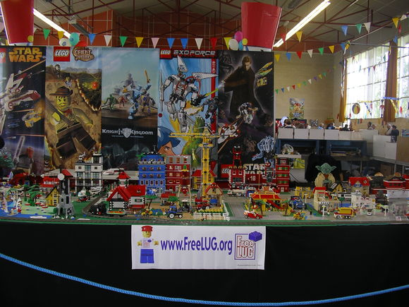
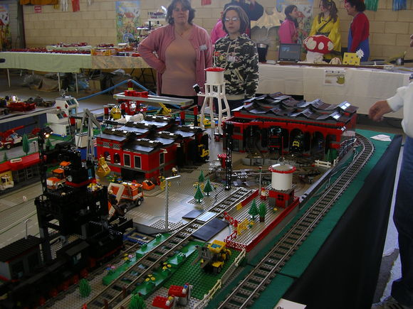
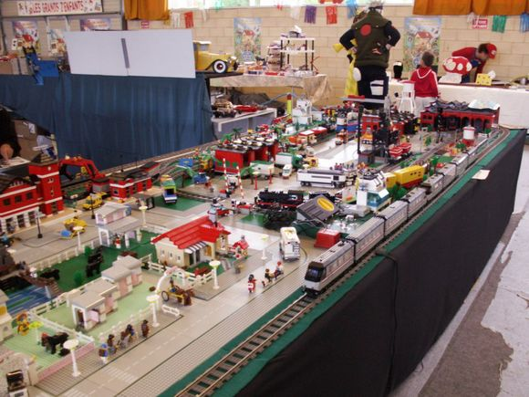
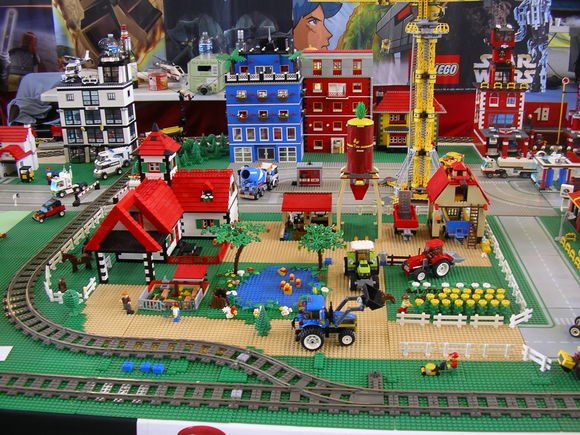

Cette exposition s’est déroulée le 15 et 16 mai 2010 à Razac-sur-l’Isle (24 en Dordogne prés de Périgueux).

Ce salon a eu lieu pour la troisième année consécutive et une fois de plus organisée par l’association "Les Grands z’enfants".

Pour cette troisième édition, FreeLUG était représentée par moi même et Pascal (venu d’Angoulème). Nous avons ensemble réalisé un diorama de 8m de long par 1,80 de profondeur ou chacun a laissé place à son imagination.

Pascal nous a fait le plaisir d’emmener sa rotonde qui en a bluffé plus d’un (surtout les grands). A chaque fois, il s’est prêté au jeu du chef de gare pour expliquer son fonctionnement tout en faisant des démonstrations.

Une petite vue d’ensemble coté Pascal

Une petite ferme où il fait bon vivre...

Ces deux jours sont passés beaucoup trop vite... je remercie Pascal et sa petite femme qui ont tenu le stand durant les deux jours car moi étant organisateur j’ai été trop souvent sollicité à droite et à gauche...

Mais 2011 arrive pour refaire une quatrième édition, avec je l’espère plus de FreeLUGiens.

* * *

Merci Laurent pour ce super week-end, j’ai apprécié le stand des exposants et leurs différentes animations, j’avoue que je me suis très bien amusé sur le notre, et en plus nous avions un super petit cheminot en la personne de David.

J’espère recommencer l’année prochaine.

_Pascal_
