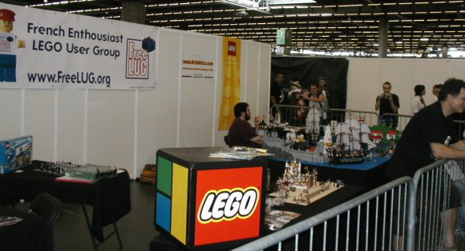
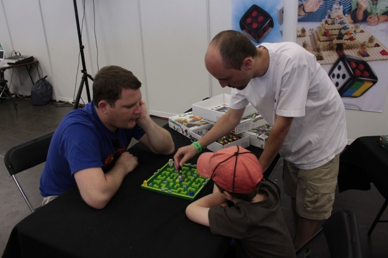
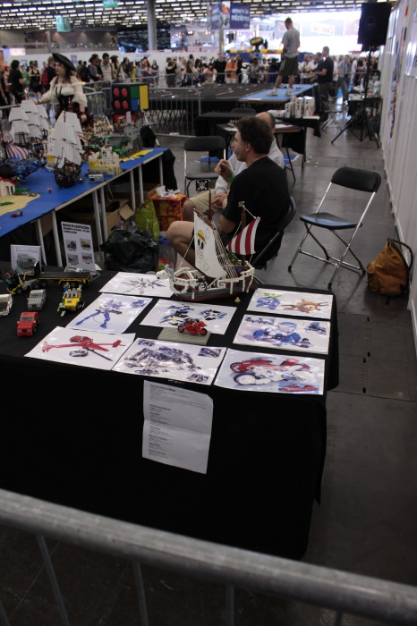
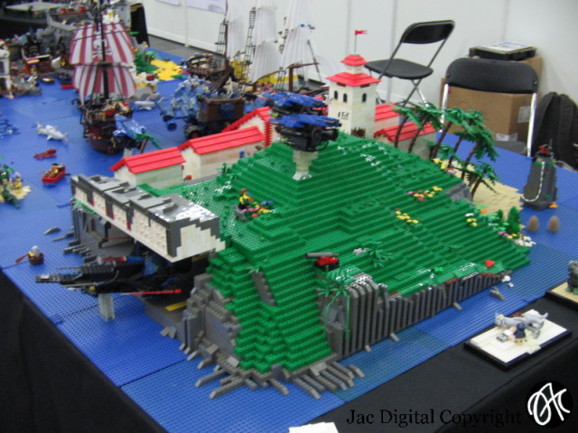
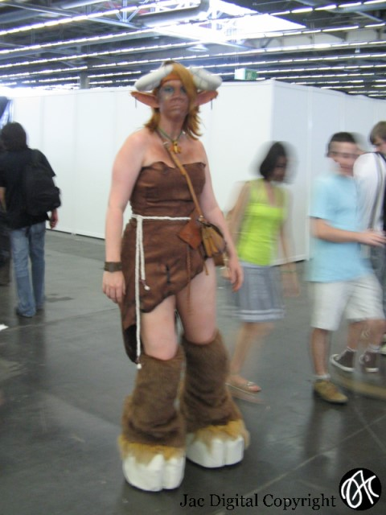
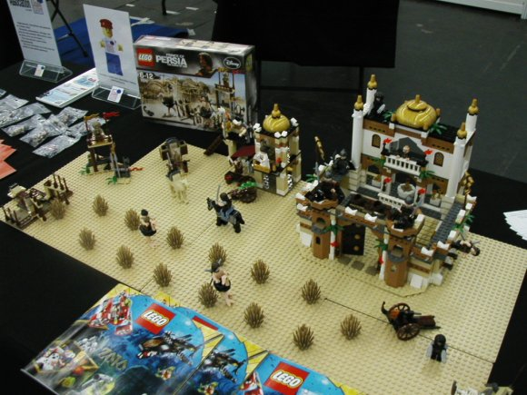

Cette année encore, FreeLUG était présent à Japan Expo, pour la 11ème édition du salon, et la deuxième édition du salon Comicon, dont nous dépendons, et qui s’est déroulée du 1er au 4 juillet 2010.

Avec plus de 180000 visiteurs, c’est un immense salon qui réunit les fanatiques de jeux vidéo, culture japonaise, cosplay et fans de SF en tout genre.

Cette année nous avons présenté principalement un diorama mélangeant deux genres, le pirate, et le Space pirate ; pour un résultat étrange mais qui a beaucoup plu.

Le voici en vidéo (je conseille de couper le son, le micro de mon appareil photo fait mal aux oreilles !)

[Vidéo de la publication d’origine](http://www.youtube.com/v/91HYV2iPpk8&hl=fr_FR&fs=1)

Outre ceci, nous avons présenté quelques nouveaux sets Prince Of Persia, des créations personnelles de tout poil pour Jac et moi, ainsi qu’un peu de Toy Story et les minifigs à collectionner. Il était aussi prévu un petit espace pour que les gens puissent essayer les jeux de société LEGO, quelques visiteurs s’y sont essayés, et se sont bien amusés.

J’ai aussi, comme l’année dernière, présenté des créations de gens du monde entier basées sur des Manga/Anime Japonais, me disant qu’après tout, c’est le thème principal de ce salon.

Pour vous rendre compte de l’ampleur de l’exposition, voici une petite vidéo prise lors d’une affluence moyenne dans l’exposition :

[Vidéo de la publication d’origine](http://www.youtube.com/v/tZsrcXokSS8&hl=fr_FR&fs=1)

C’était ma première exposition en tant que "coordinateur FreeLUG", et je pense que malgré qu’au final, je n’ai pas amené/fait grand chose, elle s’est bien passée. Un grand merci à Erik et Jac pour le matériel !

Au vu du nombre de contacts et de retour positifs que nous avons eu, j’espère que nous pourrons l’année prochaine pouvoir présenter un stand plus étoffé, qui, je suis sûr, attirera encore plus de monde.

_Guss_

* * *

Enchaîner plusieurs salons à la suite, ce n’est pas facile. Quand en plus, ils sont pratiquement à l’opposé l’un de l’autre, c’est dur de ne pas craquer, surtout quand on passe 2h à chercher l’hôtel. Heureusement, les amis savent attendre et franchement, tout ce qu’il y a à voir, découvrir et revoir pendant ces 3 jours de salon, m’a fait oublier le trajet !

Ma base Space/Pirate, fraîchement remise dans les cartons après Fana’Briques est ressortie pour mon plus grand plaisir. Sur place, Guss et Erik présentaient un diorama pirates qui s’est vu attaqué par des vaisseaux spatial. C’est ce qui est bien dans ce genre de salon, le mélange de genre ne choque pas. On peut laisser libre cours à notre imagination et présenter les choses comme on le veut, au grès de nos humeurs.

**L’Ile Space Pirate**

Du monde, du monde, certaines allées étaient impraticables aux heures de pointe. Mais, nous avons quand même pu faire les provisions de bonbons et sodas offerts en dégustation !

Un très beau salon qui donne envie d’être revisité l’année prochaine.

**Des déguisements de ouf, juste devant le stand !**

_Jac_

* * *

Ma participation à cette édition fut modeste. Avec le Mondial du Modélisme et Fana’briques les week-ends précédents, je n’avais pas pris le temps de préparer quelque chose.

Je suis ainsi venu avec le vaisseau amiral (construit la veille de l’installation après 600km de route), le fort du gouverneur et une version adaptée en phare, construits il y a quelques années, et une partie de la gamme Prince of Persia.

Ceci dit, j’ai quand même amené du matériel (merci Manu pour le prêt des tables) et les jeux de société pour les présenter au public.

J’espère pouvoir mieux préparer notre prochaine participation, sur le thème du steampunk !

_Erik_

## Galeries photos

Mais pour mieux se rendre compte de l’ambiance décalée de la Japan Expo, jetez donc un oeil aux galeries photos. Les images parlent d’elles-mêmes. Si discuter LEGO avec un orc, un stormtrooper, un zombie, ou une princesse sortie d’un manga ne vous effraie pas, n’hésitez pas à nous rejoindre !

**–** [Galerie d’Erik](http://photos.freelug.org/main.php/v/brickerik/expositions/2010/japanexpo/)  
**–** [Galerie de Guss](http://photos.freelug.org/main.php/v/guss/evenements/JE2010/)  
**–** [Galerie de Jac](http://photos.freelug.org/main.php/v/JAC/Exposition/Expositions2010/JE/)
