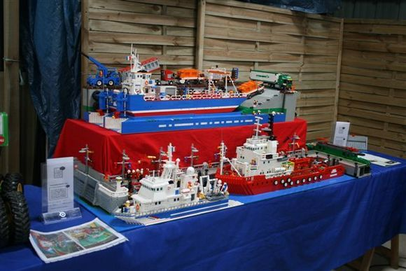

Devant plus de 6500 visiteurs pour la seule journée du dimanche (26 juillet), j’ai présenté un stand identique à celui de Tréflez : diorama animé avec la barge de l’Ile de Batz et le nouveau port de mon grand réseau en cours de rénovation.

Comme pour les précédentes éditions, l’accueil pour les petites briques a été très positif. Toute la journée, j’ai fait ma publicité pour mon prochain salon international de la maquette (LEGO compris) le dernier week-end de mai 2010.

La minifig bretonne a rencontré un très joli succès auprès des Parisiens, Dijonnais, Bretons. Elle va faire l’objet d’un nouveau tirage à la rentrée.

Sur place, j’ai rencontré un petit garçon de 10 ans qui promet d’après ses créations (il sera mon élève à la rentrée aussi) et un ancien de FreeLUG, modérateur d’un forum. Nous avons des projets...

Prochaine visite : [forum des associations à Saint Martin des Champs](/articles/forum-des-associations-saint-martin-des-champs-le-5-septembre/), le samedi 5 septembre 2009.

Jean-Marc

[Photos avec la journée du petit breton chez les cousins de la marine et du chemin de fer](http://photos.freelug.org/main.php/v/barr__/expositions/2009/Mespaul2009/)
