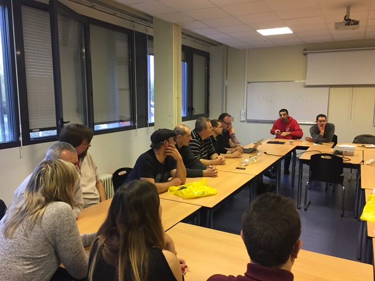
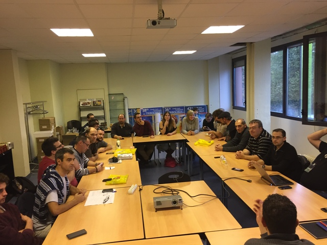
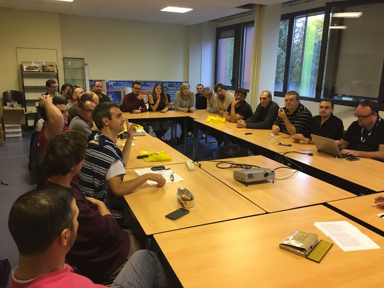
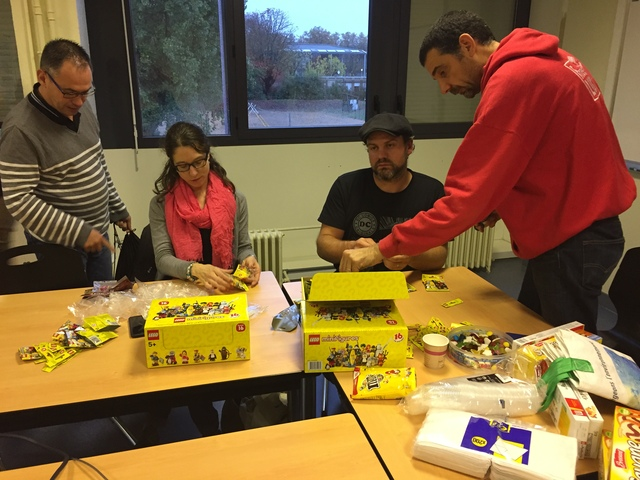
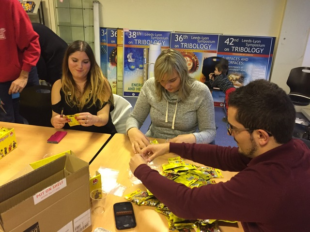
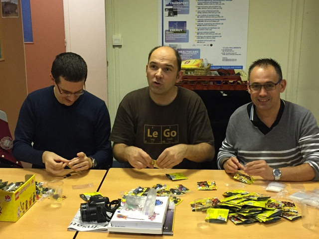
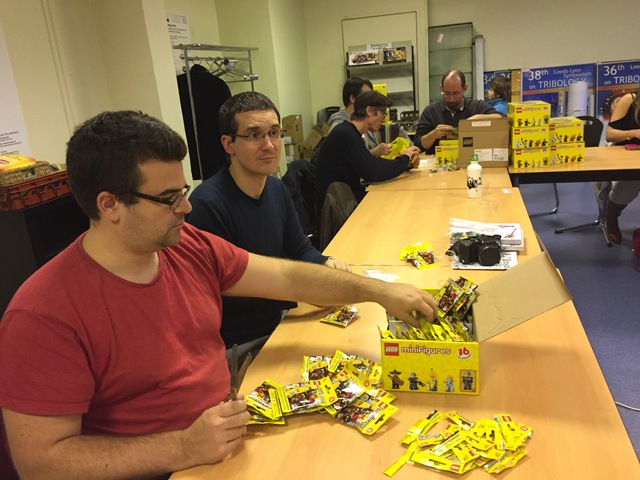
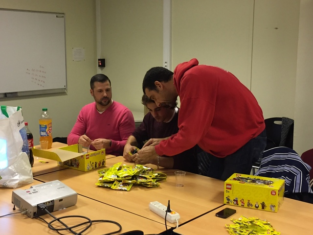
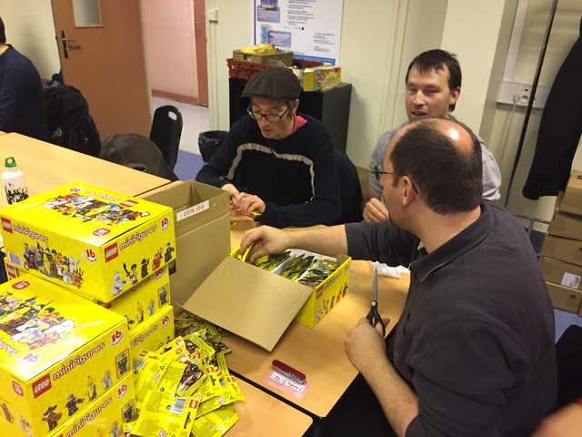

Le samedi 5 novembre 2016, jour d’Afol Day, nous avions organisé une réunion du COR (VoldeCor).  
Nous étions dans les locaux de l’INSA (Merci à Fabrice) pour cette réunion.  
Le but de la réunion était une rencontre entre plusieurs membres de l’association situés dans le COR. Nous étions un peu plus d’une vingtaine.

Nous avons fait le point sur ce qu’était un COR, le but et les enjeux à venir. Nous avons essayé avec Pierre et Xavier de répondre au mieux aux questions des adhérents. Le planning des expositions sur l’année 2017 a aussi été dévoilé.

Un goûter avec un concours et un tri de minifigs (Série 16) ainsi qu’une remise de pièces et la brique spéciale VoldeCor a eu aussi lieu ce jour là.

_Antoine_

## Remarques des Afols présent

Une réunion qui s’est avérée nécessaire et qui a été très appréciée auprès des nombreux adhérents présents.

A renouveler régulièrement !

_Pierre_

* * *

Une après-midi bien sympa, plein d’infos intéressantes sur les événements à venir dans notre région. C’est rare d’avoir l’occasion de voir autant d’adhérents au même endroit, en dehors des expos, alors il faut en profiter !

_Yann_

* * *

C’est toujours aussi sympa de se retrouver. Perso j’y ai appris plein de  
choses. À refaire avec plaisir.

_Sandra_

* * *

Excellente journée avec plein d’Afols et plein d’informations. C’est ce genre de réunion qui fait vivre le CoR.

Il faut en organiser plus souvent pour relater les informations et accueillir les nouveaux.

Ça permet à tout le monde de se voir et partager des bons moments, profiter de cette journée pour le tri des mini-figurines permet aussi de montrer aux gens le boulot réalisé par les bénévoles.

Perso j’ai adoré les M&M’s ^^

_Pierrick_

* * *

Comme d’habitude, un excellent après-midi à trier les fameuses minifigures que tout le monde attend avec impatience. 1800 minifigures, et bien, il faut un certain temps. Je trouve que l’on est de plus en plus nombreux à le faire et cela va plus vite. On peut donc discuter du COR et de ses différentes actions plus longtemps (Resto-Lego, expositions à faire et/ou à organiser, etc.) En tout cas, c’est très sympa de voir de nouvelles personnes.

_Arnaud_

* * *

Pour moi c’était mon premier tri de minifigs... mes bouts de doigts s’en souviennent..

_P’tit Syl_
