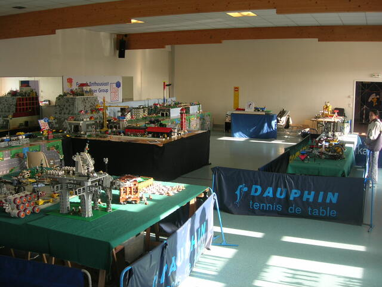
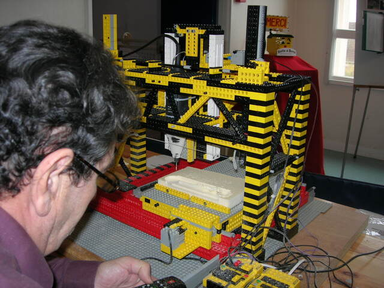
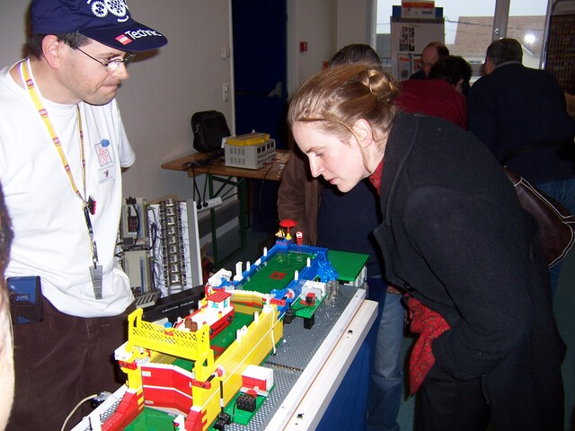
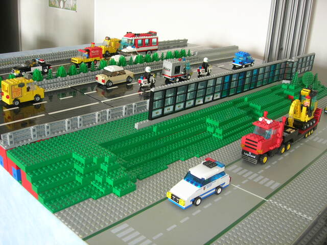
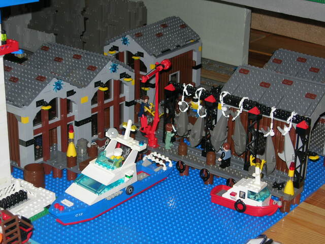
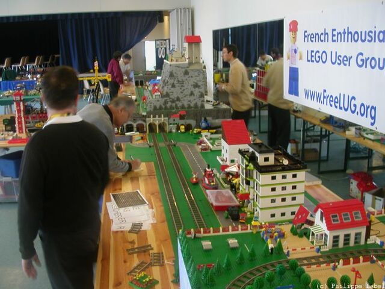
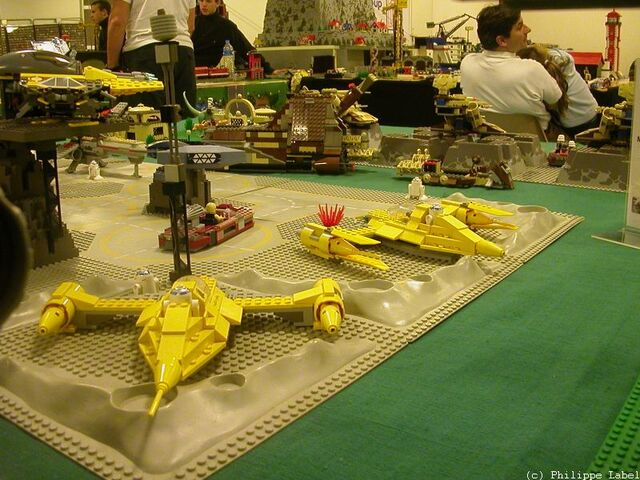
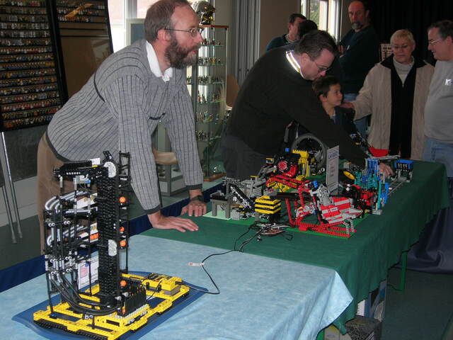
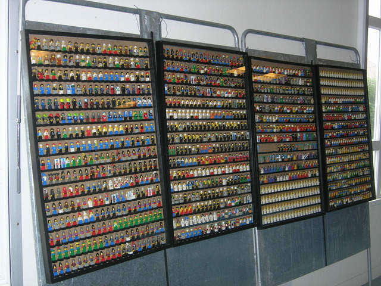
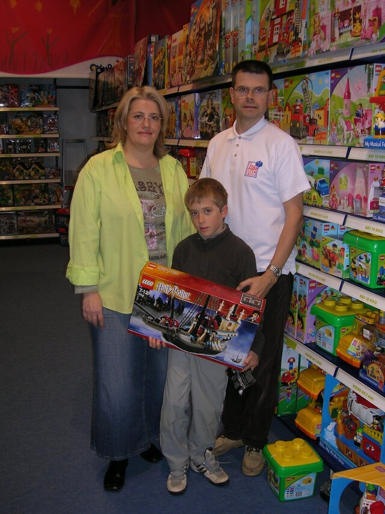

FreeLUG a participé au Salon des passionnés de La Ville du Bois les 19 et 20 novembre 2005.

Cette manifestation organisée par "le Club des Roussettes" (association locale) vise à faire partager les passions des exposants par un contact direct et chaleureux avec le public.

Nous étions une dizaine de fanas de la brique à nous être donnés rendez-vous pour un week end de rencontres et de jeux.

Nous étions installés sur 140 m² avec 6 stands.

**Vue d’ensemble**

La fraiseuse de Vauban a émerveillé petits et grands, mais ... on avait oublié les boules QUIES !

**Vauban et sa fraiseuse**

L’écluse de DenisL a passionné les marins d’eau douce.

**Madame la Député semble interessée**

Le Diorama de 13 mètres (DenisL, Didier M, Frogleap, Gilles, Nicolas) aux paysages variés fût très apprécié.

**L’autoroute de Gilles**

**La sècherie de Frogleap**

**La montagne et le téléphérique de Nicolas**

Le diorama Star Wars de Jeff et JLB plongeait les visiteurs dans ce monde trouble et futuriste si obscur.

**Base Star Wars**

La table "High Tech" avec GBB et autres attractions animées de Philo a été particulièrement assaillie.

**Le grand bidule et l’horloge à balles**

La collection, déjà imposante, de Minifigs de Pascal a suscité l’étonnement.

**La collection de Minifigs**

Toutes ces tables ont subjugué le public venu en grand nombre (environ 700 visiteurs) découvrir comment les petits et les grands s’offrent des moments de détente en collectionnant, construisant, décorant, réalisant...

Un concours de Bandes Dessinées avait été organisé. Douze participants se sont affrontés et un jury de 7 personnes (des membres de FreeLUG, des spécialistes BD et des organisateurs) a désigné les gagnants :

**Catégorie moins de 8 ans :**

_1er :_ Axel - 7 ans - 1er des petits (Gagne un sac à dos LEGO)

_2ème :_ Thibault - 6 ans (Gagne un set Jack Stone)

**Catégorie 8 ans et plus :**

_1er :_ Thomas - 9 ans et demi - Gagnant du gros lot

Le gros lot a été offert par le magasin Oxybul de Ballainvilliers (91) \[Bateau Harry Potter 4768\]

**Remise du 1er prix offert par le magasin Oxybul**

_2ème :_ Romain - 14 ans (Gagne un sac à dos LEGO)

Ci-dessous, le lien vers les BD gagantes :

[http://gallery.freelug.org/main.php...](http://gallery.freelug.org/main.php/v/dlaurencon/Expo-La-Ville-du-Bois-2005/Concours/)

Galeries de photos :  
**–** [Photos de Frogleap](http://gallery.freelug.org/main.php/v/Frogleap/ExpositionsLego/La-Ville-Du-Bois-2005/)  
**–** [Photos de Didier](http://gallery.freelug.org/main.php/v/La-Gallerie-de-qdm/Expositions/2005-La+Ville+du+Bois/)
