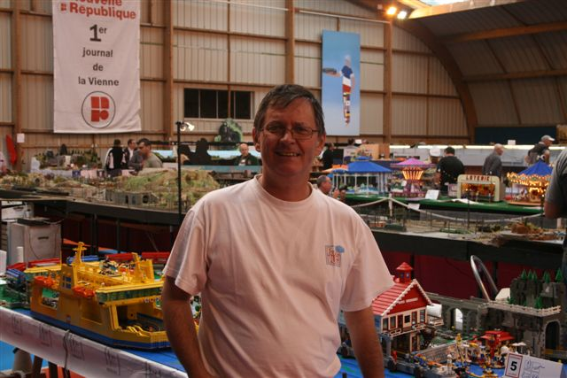
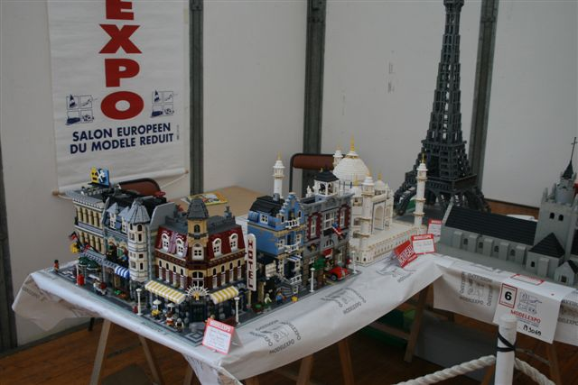

Vendredi, après 6 heures de route, je décharge ma voiture, je remonte sans plus tarder mon grand diorama car à 20h30, les vigiles fermaient la salle, ceci était valable pour tout le complexe. Évidement, il m’a manqué 2h de montage, mais j’étais prêt à l’heure H, je me demande toujours comment j’y arrive à chaque fois !

Dehors, je n’avais rien prévu, j’espérais dormir dans la salle, NIET ! J’ai donc dormi à l’hôtel à Poitiers, un peu cher mais bon.

Le lendemain matin, je terminais les derniers éléments, procédais au rodage des réseaux ferroviaires et maritimes, R.A.S, ouf du premier coup.

Petit bémol, les tables n’étaient pas plates, le ferry blanc s’arrêtait à 20cm du quai à cause d’une variation de niveau non résolue ! J’ai l’habitude de ces problèmes. A l’heure prévue, tout le monde jouait avec moi et signait le livre d’or, ceci était valable pour la durée du salon (samedi, de 10h à 20h et dimanche de 9h à 19h).

Samedi soir, soirée de gala (pas de smoking pour moi) de 20h à minuit avec spectacle (voir menu ), le tout à, vous ne devinerez jamais, 5 euros.

Après le repas, pour économiser l’hôtel de la veille, j’ai dormi dans ma polo. Toc. A 7h, il faisait déjà 15 degrés. Mais le soir, déluge.

Les repas fort copieux de samedi et dimanche midi se faisaient dans une grande salle pouvant contenir 600 personnes et une armée de serveurs nous servait, du jamais vu.

Dimanche matin, j’ai fait un tour du salon, j’ai rencontré un gars de Poitiers présent sur Legopirate, je vais essayer de le récupérer.

A 19h, fermeture, démontage, et soirée chez un ami qui m’a hébergé. En conclusion, très beau salon, beaucoup de créations mais complexe trop grand, il faut courir partout, pas de prix...

[Galerie photos](http://photos.freelug.org/main.php/v/barr__/expositions/2010/ModelExpo/)

_Votre serviteur breton_
