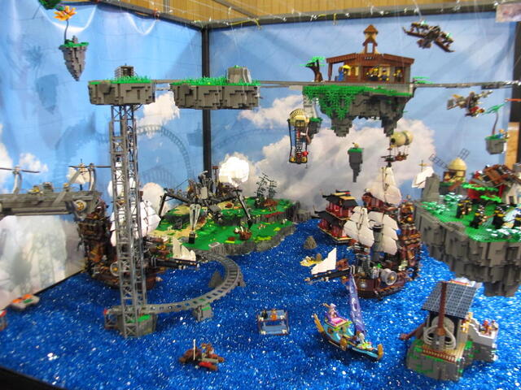
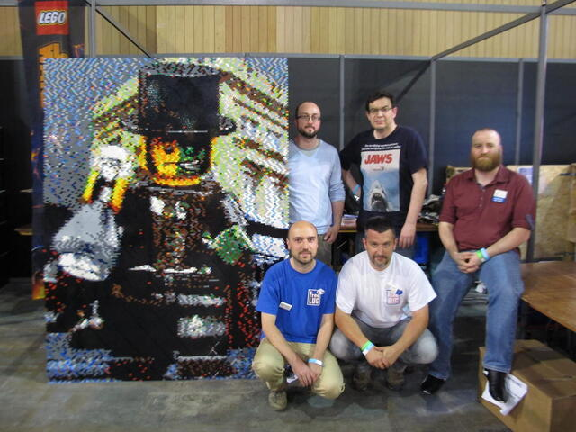
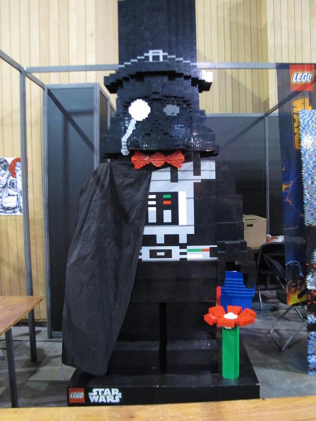

Et de trois. Les 23 et 24 mai se tenait Geekopolis, salon autour de la culture geek auquel nous participons. Cette année, le thème général de l’exposition était les génies du mal.

Nous nous sommes donc retrouvés pour présenter un diorama Steampunk.

Situé dans le quartier Nautilus, nous avons proposé une animation mosaique collant au thème, avec la reproduction d’une illustration de la figurine Mister Good and Mister Evil. Merci à Simon pour la préparation de la notice et à l’organisation pour le don des briques à l’association !

LEGO avait également mis à disposition l’animation Dark Vador, personnage avec lequel nous avons pris quelques libertés pour mieux le coller au thème de notre quartier.

Encore un joli succès pour notre stand !

[Quelques photos supplémentaires](http://photos.freelug.org/main.php/v/brickerik/expositions/2015/Geekopolis/)
