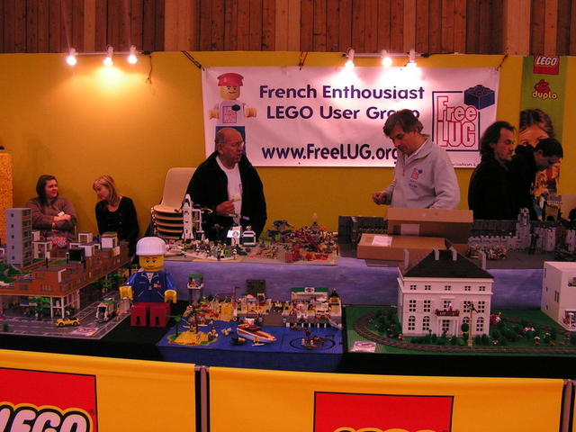

Pour la cinquième année consécutive, FreeLUG a répondu présent à l’invitation de LEGO France pour tenir un stand à Kidexpo, salon de l’enfance se déroulant au parc des expositions Paris-Porte de Versailles.

Cette année, le diorama était multi-thème.

Le diorama débutait d’un côté par quelques éléments issus de notre exposition à la Cité de l’Architecture et du Patrimoine.

Suivait une petite zone maritime présentée par Christophe avec un essai de requin mangeur.

En surplomb, les enfants de Sylvie mettaient en scène quelques anciens modèles issus de la gamme Life on Mars. A côté, Gilles présentait un gouffre d’Helm. L’équipe de tournage prévue s’est déplacée sur le diorama StarWars voisin.

En contre bas, Jean-Claude exposait sa mairie de Parigné-L’Evêque.

Enfin, Daniela terminait l’ensemble avec son diorama Friends.

Et toujours beaucoup de rencontres, d’amusement à "saboter" les dioramas des copains.

* * *

Côté stand LEGO, beaucoup de choses.

En plus de l’espace traditionnel de construction libre, LEGO a fait venir du Canada l’espace Friends, où les jeunes filles pouvaient construire sur de chouettes tables tout un univers à l’aide de briques de la gamme.

Pour les garçons, sur l’espace Technic, la reproduction du camion Technic accueillait les pilotes apprentis du nouveau 4x4 sur un terrain de jeu varié.

Quelques jeux LEGO Games étaient en démonstration dans l’espace jeux de société du salon.

## Galeries Photos

**–** [Christophe](http://photos.freelug.org/main.php/v/tottoff/Expositions/Kidexpo+2012/)
