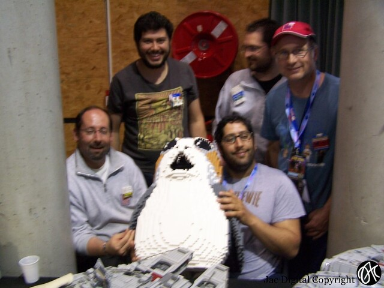
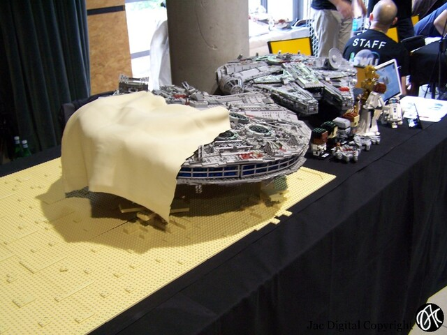
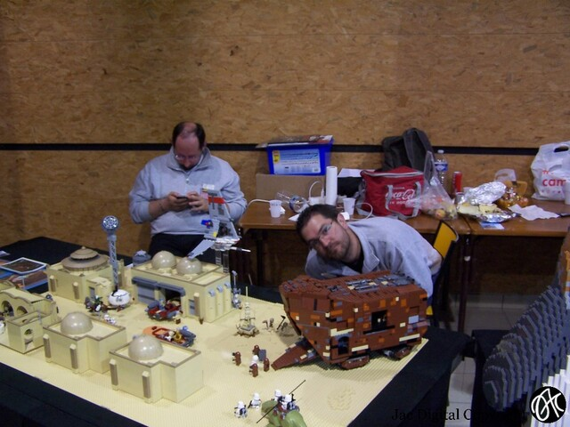
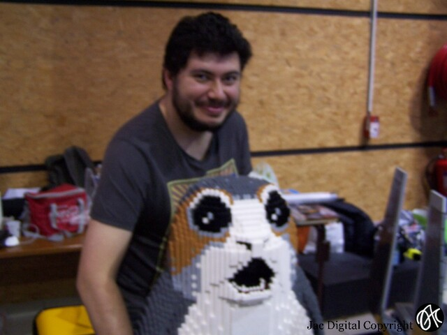
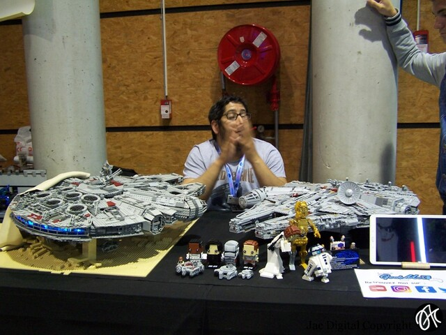

Compte-rendu de ce week-end au milieu des fous de science-fiction en tout genre qui a eu lieu les 12 et 13 mai 2018.

Et voilà, nous arrivons à la vingtième édition de cette magnifique convention, qui grandit d’année en année, en fréquentation et en surface d’exposition. Nous étions 5 exposants de l’association. Sur le week-end la convention a accueilli entre 13000 et 15000 visiteurs. L’entrée est gratuite, il est très difficile de compter correctement.

Voilà 3 ans maintenant que tout le site qui s’étend de l’espace Chambon à la salle Tabarly de Cusset (03), est occupé par des fans des films de SF, avec des maquettes, des cosplays, des dessinateurs, des jeux et surtout le public.

Nous conservons notre espace d’exposition, c’est à dire au fond à droite de la salle. Mais surtout notre présence est vivement demandée. Ça fait énormément plaisir, ça c’est sûr.

Cette année j’ai réussi à motiver encore un nouvel exposant, il se reconnaîtra, je pense. Du coup nous étions 5 : Laurent, Samir, Pierre, Dimitri et moi-même. Chacun a su apporter sa nouveauté sur ce stand de la vingtième.

J’ai pu présenter pour la deuxième fois sur cette exposition mon Millenium Falcon UCS. Par contre, il y en avait deux, puisque Dimitri avait pu monter la toute nouvelle version de ce vaisseau. Cela prenait déjà une belle place sur le stand. En plus des modifications que j’avais déjà apportées au mien, j’ai pu placer des leds LEGO PFS pour simuler le réacteur en fonction. Je voulais montrer un décollage de Jakku, avec en pilote Rey toute seule et Finn aux commandes du canon. Certaines personnes m’ont demandé pourquoi le vaisseau avait un chiffon sur un côté... J’ai expliqué justement que ça correspondait à cette scène importante du film.

Encore un très bon cru que cette exposition. Il ne reste plus qu’à préparer celle de 2019.

Une photo de mon diorama :

Ma galerie :  
[Conventions SW et SF 2018](https://photos.freelug.org/main.php/v/JAC/Exposition/2018/generationSW/)

Jac

* * *

M’étant inscrit un peu au dernier moment (à l’AG pour tout dire), mon diorama de Mos Eisley n’est pas aussi abouti qu’il aurait pu l’être.

Cependant, les scènes, vaisseaux, speeders et autres personnages présents ont su contenter le public, avec en particulier la scène entre Greedo et Han Solo que l’on retrouve bien sûr à la Cantina.

Tout comme Jac, j’ai été content de rencontrer de nouveaux exposants, notamment Samir dont les créations sont impressionnantes !

Laurent

* * *

Une troisième année à Génération Star Wars et l’occasion de sortir mon Porg. C’était aussi l’occasion de rencontrer Laurent et de revoir Jac, Pierre et Dimitri !

Samir

* * *

Pour cette édition, Pierre L. était venu les mains vides. Mais il est excusé, ça c’est sûr. Nous le remercions tous pour sa présence.

Jac pour _Pierre_

* * *

Cette première participation à la convention Star Wars et science-fiction de Cusset m’a vraiment plu. J’y reviendrai avec plaisir l’année prochaine.

Dimitri
