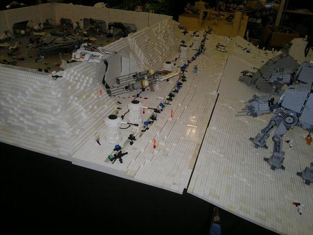
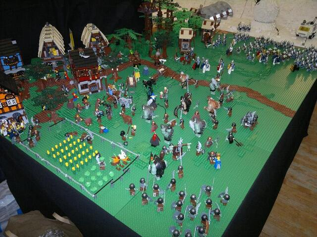
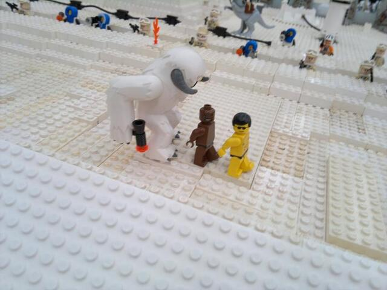

Voici le résumé de notre participation au salon multi-colections de Migennes, qui a eu lieu le week-end des 25 et 26 février 2012.

**Salut les LEGOmaniacs !**

Encore un salon effectué.

Comme il y a trois ans nous avons été reçus par Migennes Collector.

Ce salon a été augmenté par un marabout qui rajoute plus d’exposants et du coup rend le salon un peu moins commercial. Cela crée aussi plus d’espace.

En revanche nous avons eu un peu moins de place qu’il y a 3 ans... alors que plus les années passent, plus nous sommes capables d’envahir ce dit espace.

Pas grave on a fait avec.

Perso j’ai du retourner chez moi en catastrophe pour aller chercher une table car je n’avais que la place de mettre la base ECHO et pas d’espace pour l’attaque de l’empire.

Le HIC c’est que du coup les tables n’étant pas à la hauteur il y avait une pente trop dure au AT AT pour avancer correctement ! ( comme quoi il suffisait aux rebelles de faire leur base en haut d’une côte pour contrer l’attaque terrestre de VEERS ;-)

**La base ECHO de Fréd**

Un décor mûrement réfléchi sur le thème médiéval héroïque fantasy pris forme ainsi qu’une course de pod racer un peu particulière !

**Le décort Castle des Pierres**

Le soir nous fûmes invités au repas avec du bon CHABLIS local !

Le lendemain fut déjà la fin et voilà une exposition avec une super ambiance et un retour aux sources...

Merci à ma p’tite équipe de fidèles à laquelle s’est rajouté un jeune, très jeune nouveau pour lequel on a dû faire du babysitting ;-) ... Le seul point faible fut l’absence de mon Maître QUI GON JAC.

Amicalement,

**Fred (Phenix21000)**

* * *

Je tenais à remercier Fred et à sa petite famille pour l’accueil qu’ils nous ont réservé.  
Merci aussi à mes autres compagnons d’expo, PierreL et son (petit) frère Etienne, avec qui c’est toujours aussi plaisant d’exposer.

**On se la coule douce à Migenne !**

Et pour finir, merci à Erik d’être venu nous dire bonjour et d’avoir passé une partie de la journée avec nous à l’exposition.

**PierreC (Tribolego)**

* * *

Après avoir récupérer mon frère, on est arrivé bien tard chez Fred, mais toujours debout pour nous accueillir !  
Et dès le lendemain c’est parti pour 2 jours d’expo...

On s’est encore bien amusé, la base Hoth plait toujours autant, une course de Pod pour mon frère.  
Pour ma part, j’ai aidé Pierre pour la partie Castle, un peu improvisée sur place...  
 ;-)

Encore merci à Fred et Audrey pour leur acceuil.  
Et ptet à la prochaine..?

**Pierre L. (Pierrolego)**

* * *

**Galeries photos :**

-   [Galerie de Fred "Phoenix"](http://www.brickshelf.com/cgi-bin/gallery.cgi?f=498852)
-   [Galerie de PierreC "Tribolego"](http://photos.freelug.org/main.php/v/Pierre_13/Expos/2012/Migennes/)
-   [Gelrie d’Erik](http://photos.freelug.org/main.php/v/brickerik/expositions/2012/migennes/)
