Cet évènement avait lieu au Double Mixte à Villeurbanne (69) sur les 10000 m² du vendredi 1er au dimanche 3 octobre 2021 en non stop.  
Composé des différents espaces dédiés aux jeux de plateau, jeux de cartes, jeux de rôle, un espace imaginaire, un espace famille, des boutiques, des conférences et des visiteurs pratiquant le cosplay, c’est l’endroit où il fallait être.

Alors quelques membres de FreeLUG ont répondu à l’invitation de Stéphanie, responsable du pôle famille et AFOL pour venir exposer et proposer aux nombreux visiteurs le montage d’une mosaïque reprenant l’affiche de la convention.

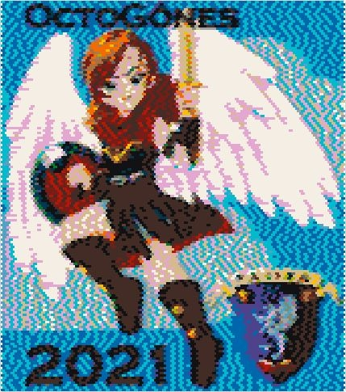

**Parmi les exposants**

Sylvain J proposait un diorama Egypte, sa fille un univers Friends où se cachait des personnages Disney :

[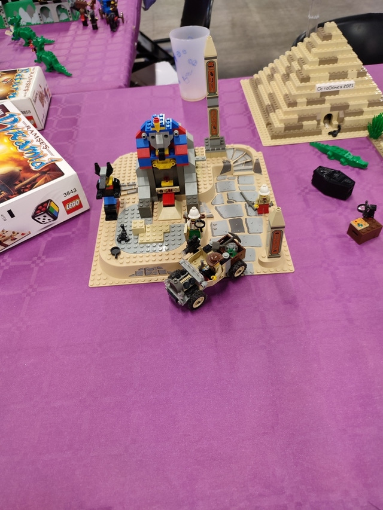](https://www.freelug.org/IMG/jpg/1641832117478.jpg)

[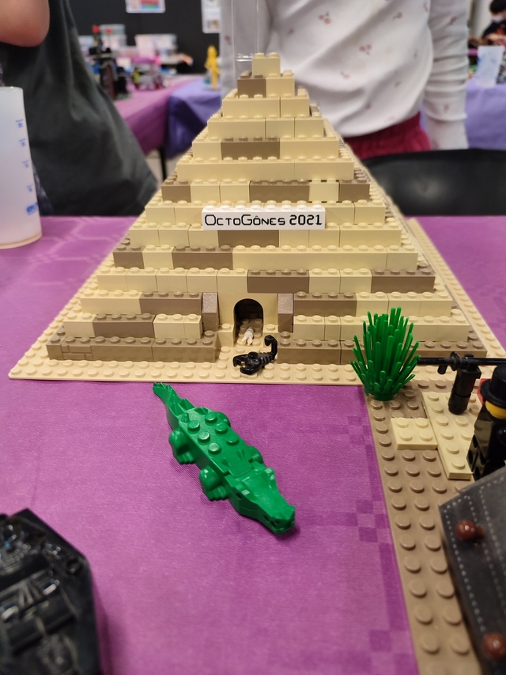](https://www.freelug.org/IMG/jpg/1641833173451.jpg)

[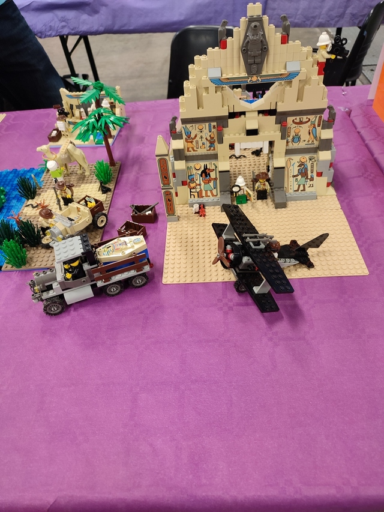](https://www.freelug.org/IMG/jpg/1641833173464.jpg)

[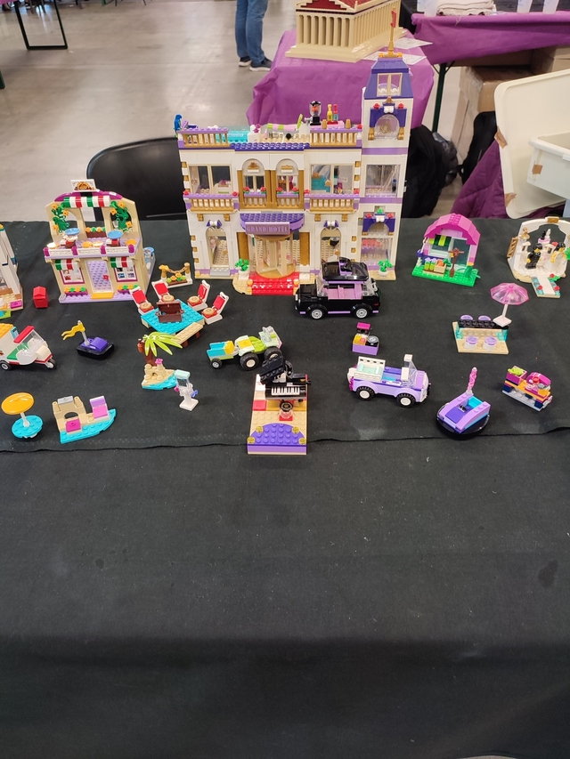](https://www.freelug.org/IMG/jpg/1641832083234.jpg)

Xavier Claudel nous a sorti sa grande base Black-Tron avec le monorail assorti :

[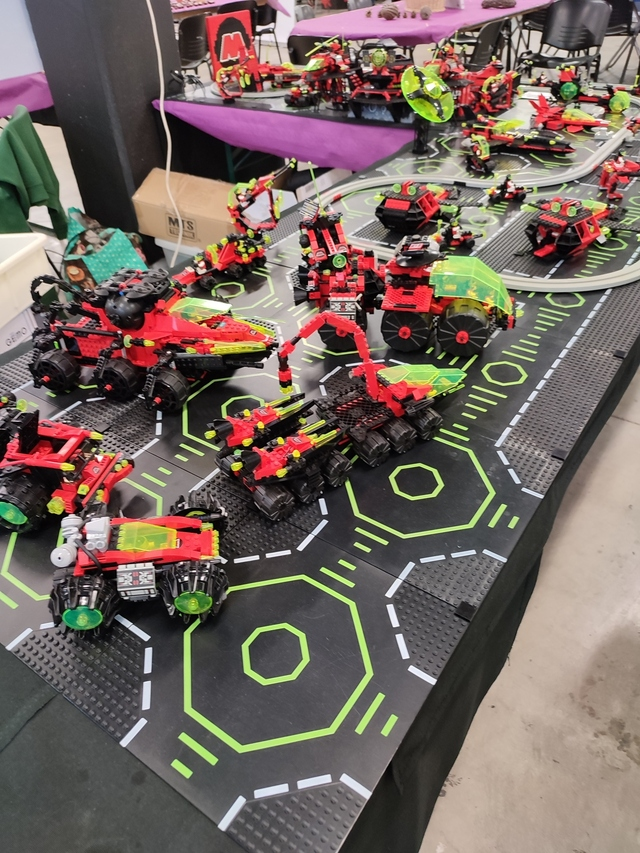](https://www.freelug.org/IMG/jpg/1641832763926.jpg)

[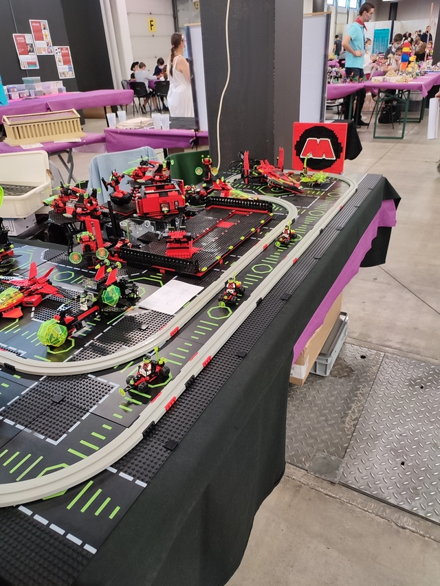](https://www.freelug.org/IMG/jpg/1641832736363.jpg)

[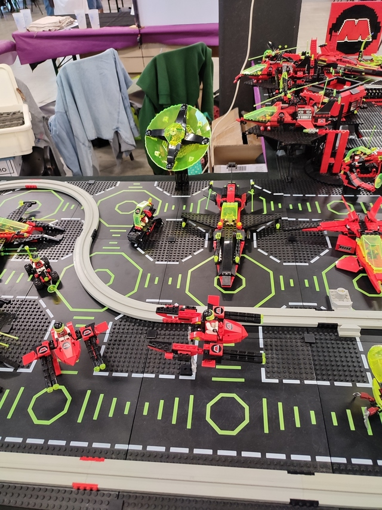](https://www.freelug.org/IMG/jpg/1641832775953_1_.jpg)

Yves et son frère présentait une Batmobile aux dimensions impressionnantes devant un décor très réaliste :

[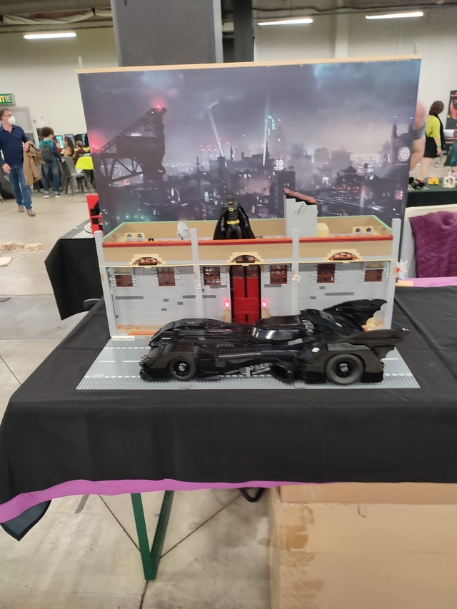](https://www.freelug.org/IMG/jpg/1641831897502.jpg)

Stéphanie avait amené quelques Aquanaut :

[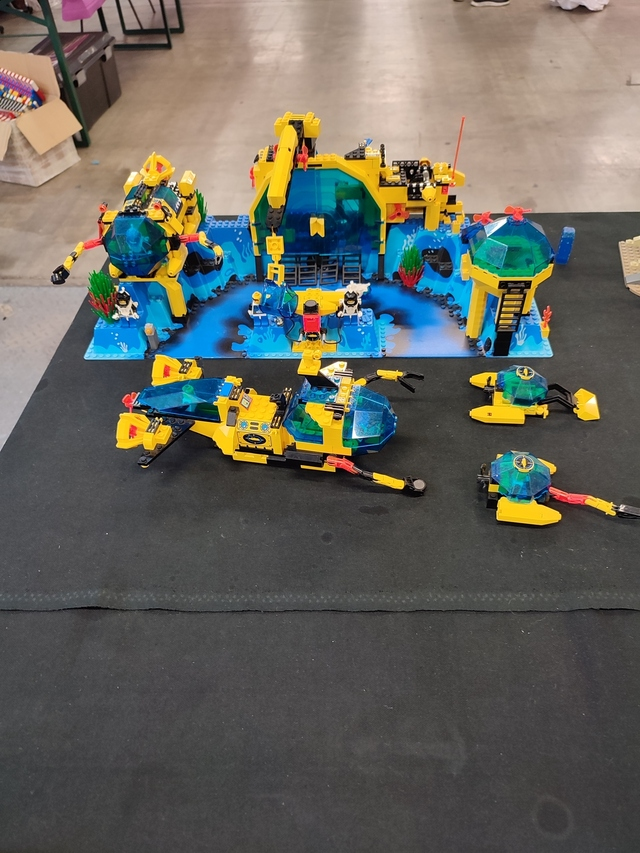](https://www.freelug.org/IMG/jpg/1641832083223.jpg)

Pierrick présentait le Parthénon :

[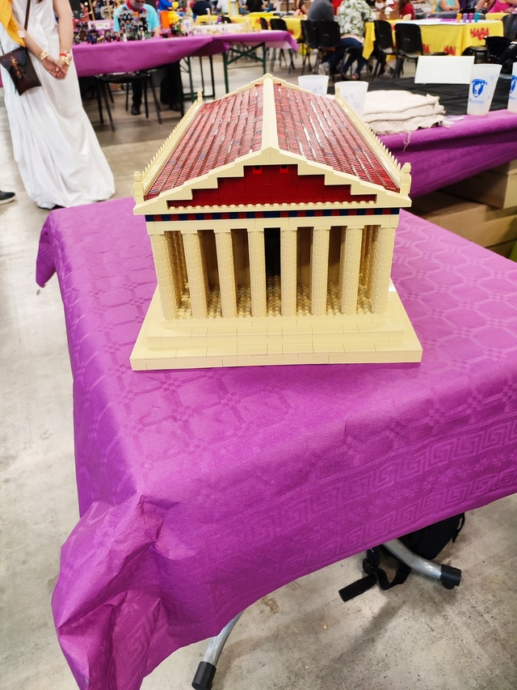](https://www.freelug.org/IMG/jpg/1641832083206.jpg)

Et pour ma part, les Micro Fighters ont rencontré un joli succès, les fan de StarWars étant toujours présents à Octogones.

_Sylvain D._
