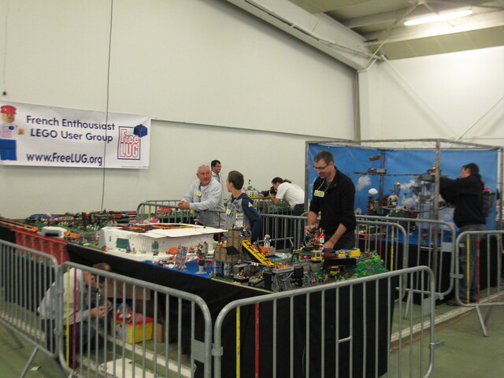
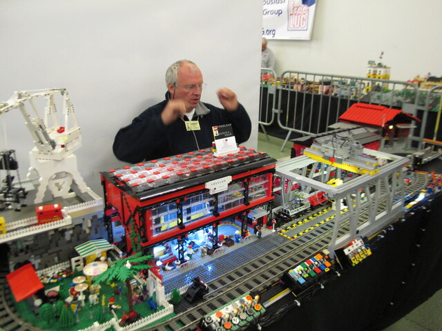
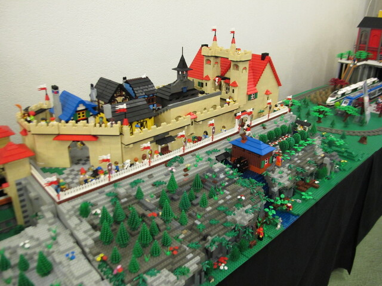
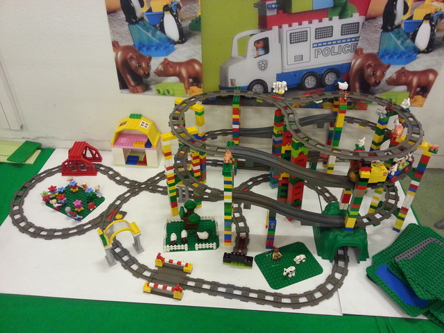
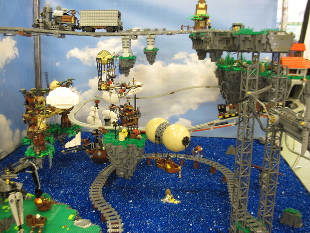
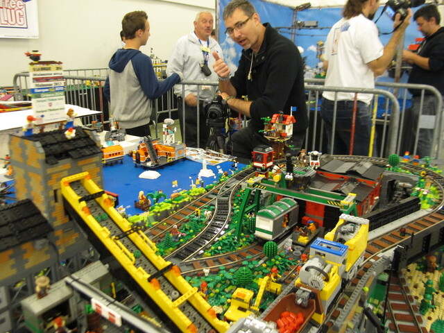
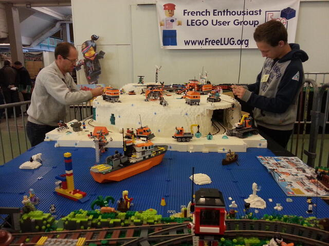
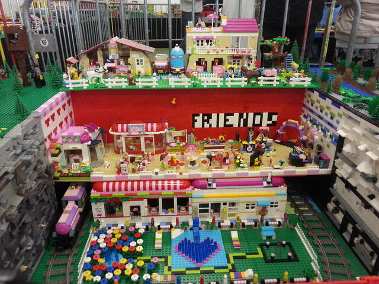
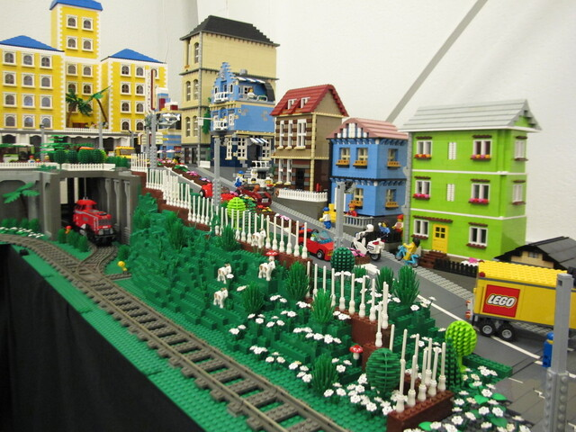
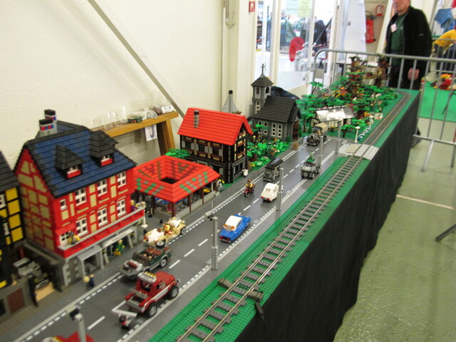

Petit résumé de chaque participation au stand FreeLUG lors de la quatorzième édition du Salon du Train Modélisme d’Orléans qui se déroulait les 8 et 9 novembre 2014.

Le Salon du Train Modélisme d’Orléans est devenu une tradition dans le calendrier des expositions où FreeLUG participe. Cela fait 10 ans que FreeLUG a participé pour la première fois à ce salon : [résumé de l’édition de 2004](/articles/exposition-modelisme-ferroviaire-amfc-orleans-2004/), depuis nous avons été présents à toutes les éditions.

Cette année, nous avons présenté quatre parties distinctes : un diorama classique, un réseau de train indépendant où les visiteurs pouvaient faire bouger certains éléments comme les grues, un atelier de construction orienté pour les tous petits avec du Duplo et enfin du Steampunk.

* * *

Arrivée vendredi soir sous la pluie, ça s’affaire depuis le début de l’après-midi sur le stand. Nous sommes placés dans un angle juste sur le circuit principal du public. Ça va se bousculer autour du stand pendant deux jours. Le diorama de zone industrielle et ferroviaire que je présente sortait pour la dernière fois. Hé oui, faut bien se renouveler, et je manque de place à la maison pour garder ça et construire autre chose. On aurait dit que les visiteurs le savaient tant ils étaient nombreux. Comme c’est un diorama jouable avec toutes les commandes sur l’extérieur, les enfants de tous âges se sont pressés autour du diorama sans interruption jusqu’à la fermeture.

Obligé d’aller refaire le plein de bonbons pour le dimanche et je suis tombé en panne sèche une demi-heure avant la fermeture de l’exposition... ouf ! Faut dire que des exposants gourmands venaient aussi rôder autour du wagon "marchandise" pour y prélever leur part. Beaucoup d’amusement, encore une ambiance très sympathique entre tous les exposants du stand FreeLUG, de l’entraide et de la bienveillance. Organisation parfaite assurée par Sébastien et l’équipe de l’AMFC qui nous accueillait. Bref, je reviens dans deux ans pour jouer encore au LEGO !

_Philippe "frogleap"_

* * *

Reprise d’activité en ce qui me concerne, après quelques mois (ans) d’absence sur les expos, mais mes liens avec la communauté ferrovipathe et l’opportunité de venir renforcer l’équipe suite à l’annulation de la participation de quelques-uns à la dernière minute m’ont décidé à relever le chalenge que représente la réalisation d’un diorama en moins de 3 semaines. Chalenge relevé avec l’aide de l’ami Denis Laurençon venu me donner un petit coup de mains pour finaliser la décoration.

Donc globalement content de ma reprise d’activité et de reprendre le contact avec les copains AFOL que je n’avais pas vus depuis un bail, les nouvelles têtes et un président bien fatigué ;-)

Toutes les photos sur ma galerie.

_Didier "qdm"_

* * *

Suite aux différentes animations dédiées aux enfants venant s’intégrer au fil des éditions de ce salon, cette année, nous sommes venus pour jouer et aussi pour faire jouer les plus petits avec les briques Duplo. Une petite zone de l’espace FreeLUG était dédiée aux trains Duplo où les plus jeunes visiteurs pouvaient faire rouler des trains et assembler des briques.

Nous avions préparé un petit réseau que les enfants pouvaient compléter avec des petites constructions venant de leur imagination. Ceci a abouti à un réseau de train sur plusieurs niveaux décoré en zoo, ferme et où les wagons faisaient voyager toutes sortes d’animaux. Les enfants ont adoré et les parents aussi.

Vous pouvez visualiser d’autres photos sur ma [galerie](http://photos.freelug.org/main.php/v/Waga/Expos/2014/Orleans/).

L’ambiance entre Freelugiens a été très sympathique comme d’habitude même si nous n’étions pas souvent avec vous sur le stand car bien occupés avec les plus petits.

Merci à L’AMFC pour leur accueil, à Sébastien pour l’organisation et à dans deux ans.

_Daniela et Sylvain_

* * *

Du train suspendu. Cette étrange idée que nous exposons depuis quelques années maintenant se devait d’être présentée à ce salon incontournable du train miniature. Nous sommes donc venus à l’invitation de Sébastien présenter le diorama Steampunk, qui a été enrichi par la participation de Pascal et Xavier. Car en plus du train, Pascal a eu la belle idée de suspendre un circuit monorail avec un rocher tunnel juste énormissime pour lequel nous avions de gros doutes quant à sa tenue !  
Xavier, lui, n’a pu quitter ses StarWars et a transformé le village Ewok en un village sur rochers suspendus.

Je pense qu’une fois de plus, le succès était au rendez-vous :)

_Erik et Manu_

* * *

Concernant le grand diorama, celui-ci débutait par le module de Stéphane avec son système en circuit fermé de transbordement de granulés.

Pierrick suivait un avec un module sur le thème Arctic, recouvrant la boucle de retournement du train. Le TGV s’accordait parfaitement avec les couleurs de la gamme :)

Daniel et Béatrice présentaient ensuite en contrebas un ensemble de modules Friends et mine, surplombés par un viaduc et un module médiéval.

Didier suivait avec sa ville fortifiée reposant sur une montagne à travers laquelle les trains passaient, puis Nicolas nous offrait une rue en pente façon San Francisco :)

Les Havrais terminaient la boucle avec maisons et drôle de forêt.

