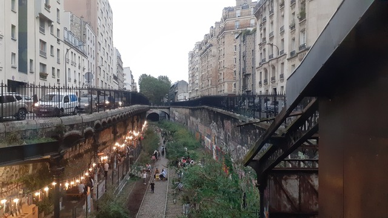
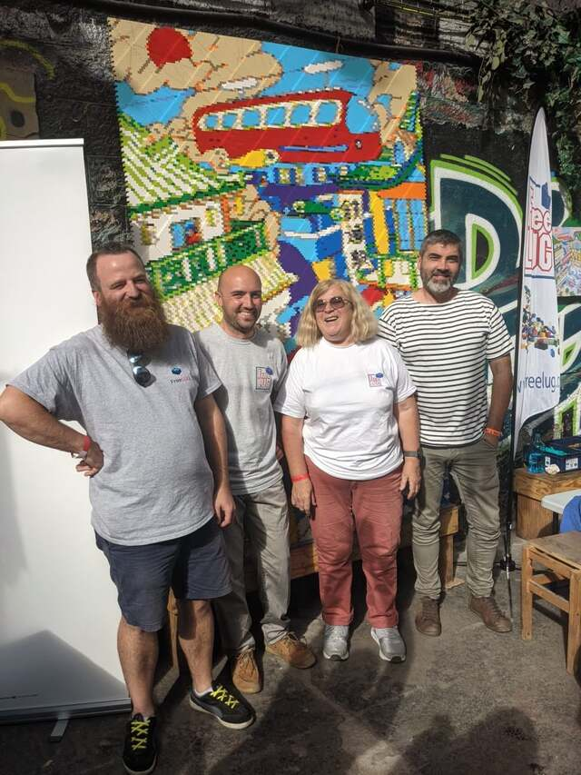
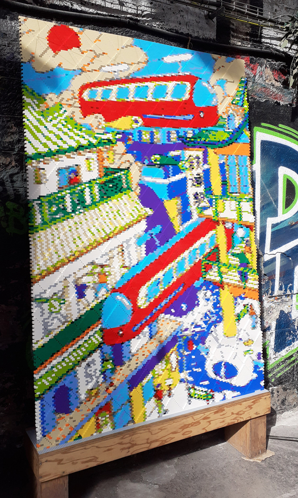
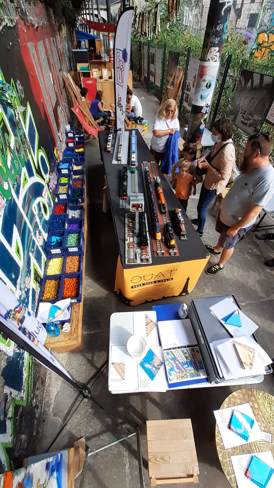
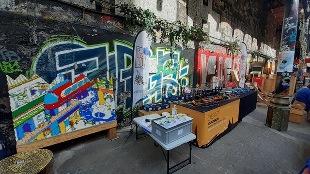
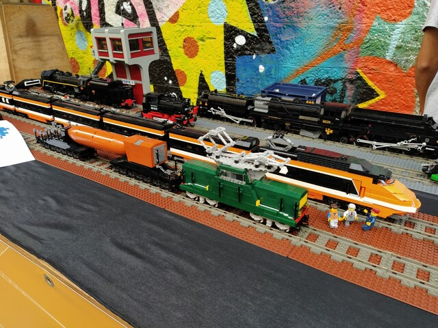
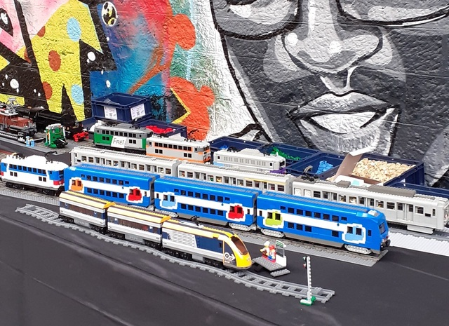
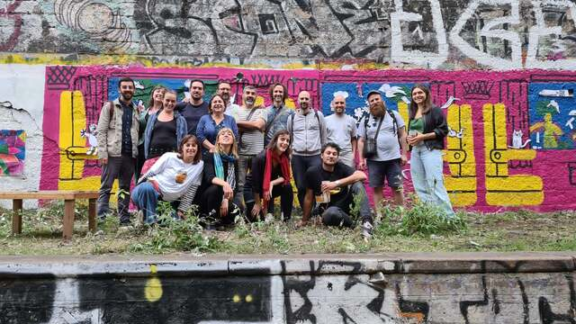

OUAT, Once Upon A Train, est une jeune association promouvant les voyages en train. A l’occasion de son premier festival, _Des rails & vous_, les 18 et 19 septembre 2021, FreeLUG a été invitée pour y présenter une animation autour des briques LEGO et du train. Nous en avons profité pour y présenter quelques créations autour du train.

Nous sommes quatre adhérents à avoir répondu à l’appel pour cette exposition particulière puisqu’elle se tenait sur les quais de l’ancienne [Gare de l’Avenue de Saint-Ouen de la Petite Ceinture](https://petiteceinture.org/gares-petite-ceinture/avenue-de-saint-ouen/), Paris intra-muros.

Au programme des deux demi-journées, il y avait notamment la réalisation d’une mosaïque collaborative à faire construire par le public, dont l’illustration est extraite de l’oeuvre "**Tokyo Station**" de l’[artiste Gessica Maio](https://gessicamaio.com/japan) présente sur place.

**Photo de groupe**

De gauche à droite : Pierre, Erik, Simone, Richard

Côté exposition, pour cette première édition au contexte particulier, pas de réseau, mais juste quelques créations autour du train pour évidemment coller au thème.

Exception, la présence de l’[Horizon Express](https://www.freelug.org/spip.php?article1563) directement inspiré de notre TGV national qui fêtait justement à l’occasion de ces Journées du Patrimoine ses 40 ans.

Enfin, Simone proposait au plus jeune public de l’accompagner dans la construction du [train City 60197](/articles/revue-revue-du-train-passager-60197/).

On remercie l’association OUAT pour son chaleureux accueil.

**L’équipe OUAT et FreeLUG**

Et rendez-vous est pris pour une future édition où nous pourrons proposer un vrai réseau !
