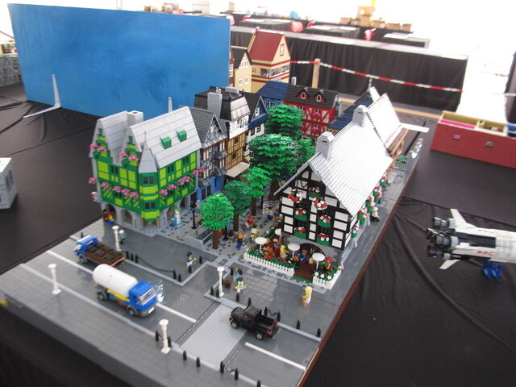
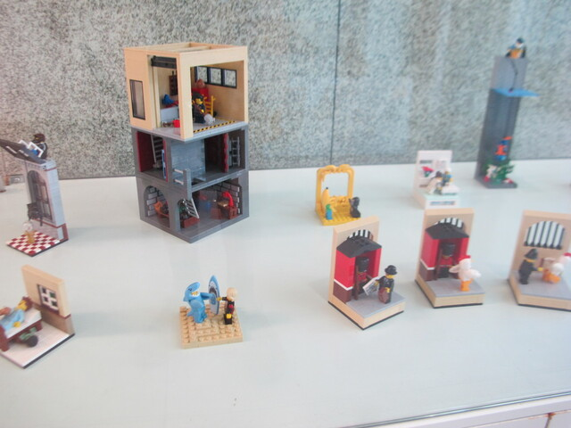
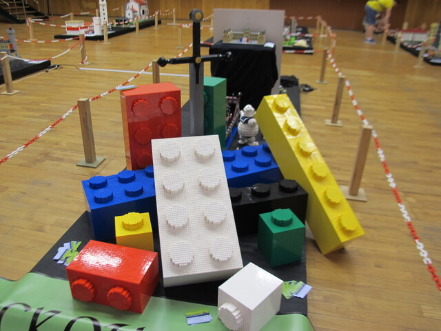
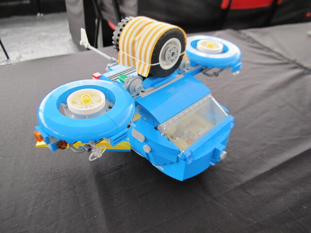
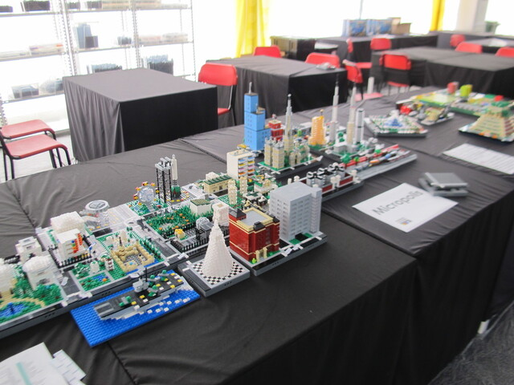
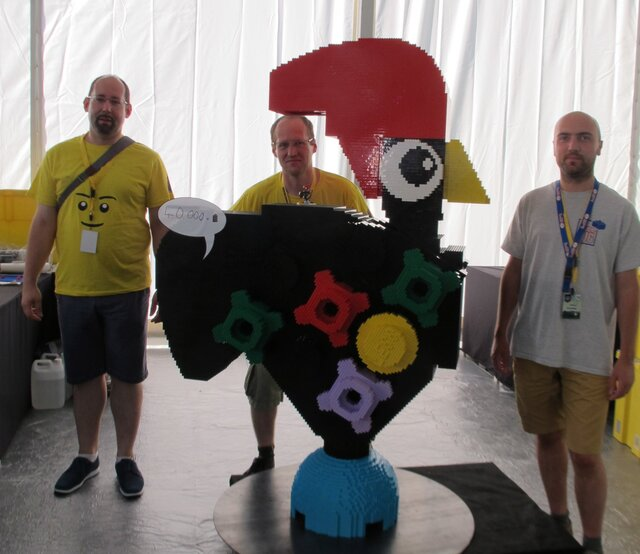

Après les inscriptions, les désistements et les déboires de dernière minute, nous sommes trois à partir, destination Paredes de Coura.  
A l’arrivée, un grand chapiteau, accolé au centre culturel de la ville nous attend.

A l’accueil, les membres de l’organisation nous remettent le package exposant (badge, tour de cou, T-shirts jaunes, cadeaux...) et c’est parti pour un tour des lieux. En plus du chapiteau, différents endroits du centre culturel sont utilisés : une grande salle au rez-de-chaussée (avec les présentations installées presque au sol), le hall d’entrée et un couloir. Également à disposition des exposants et organisateurs, le lounge : une salle réservée pour les rencontres, discussions, et dégustations de produits locaux et autres apportées par les exposants, ainsi que l’amphithéâtre pour les différentes présentations et diffusion de brickfilms.

## L’intendance

Côté repas et logement, le LUG _Comunidade 0937_ à l’origine de l’évènement gère la chose de bout en bout. Nous réglons à l’inscription un forfait, et sont mis à notre disposition un gite (taille variable suivant le nombre de participants au sein du LUG) ainsi que les repas. Les repas du midi sont servis dans une cantine scolaire tandis que le repas gala du samedi soir avait lieu dans un restaurant à une vingtaine de minutes du lieu de l’exposition.

Reste à gérer par nous-même le transport. Pierrick et Erik ont fait le choix de covoiturer, tandis que Laurent a pris l’avion depuis Lyon et loué une voiture sur place.

## L’exposition

Avec plus de 300 participants, il y avait de nombreuses à choses à voir, du tout petit MOC à de grands ensembles collectifs.

Côté FreeLUG, Erik est venu avec sa ville présentée en différents lieux en 2016.

Laurent, venu en avion, a opté pour la présentation de vignettes mettant en scène les figurines à collectionner.

Quant à Pierrick, victime d’un incendie quelques jours avant le départ, il a du se résigner et venir sans ce qu’il avait prévu.

Parmi les LUGs présents, on retrouvait de nombreuses têtes connues, francaises (FestiBriques et Brickouest) ou étrangères déjà rencontrées sur d’autres expositions internationales.

## Les activités et rencontres

Mais l’évènement ne s’arrête pas à une exposition.  
Durant les trois jours, de nombreuses activités, sur inscription ou libres, sont proposées, permettant ainsi de nous occuper et de faciliter les discussions.

On regrettera que les activités sur inscription (due à un nombre de place limité) ont été très vite prises, surtout qu’il faut surveiller le forum sur lequel elles sont annoncées et où il faut s’inscrire.

Pour les autres activités, il y avait à disposition des exposants tout un ensemble de petites pièces pour produire des modules Micropolis, des boites de la Beetle pour réaliser un MOC en n’utilisant que les pièces de la boite, des petits concours d’agilité ou rapidité... Mais également des présentations faites par des AFOLs.

**Transformation de la Beetle**

Côté rencontres, nous avons pu discuter - l’anglais est nécessaire - avec des AFOLs venus de différents endroits, Angleterre (et notamment Huw de Brickset), Espagne, Pays-Bas, Italie... et Portugal bien sûr :)

**Avec la mascotte de l’événement !**

## Les off

Bien sûr, il serait dommage de faire tout ce voyage et se limiter exclusivement à l’exposition.

Nous avons pris quelques moments de repos en nous promenant dans la ville et dans son marché de produits traditionnels, et nous avons consacré le lundi à la visite de la côte dans la ville de Viana do Castelo.

Pierrick et Erik ont profité de la route du retour pour passer à Saint-Jacques de Compostelle, à La Corogne (faire un saut dans le magasin spécialisé LEGO - _Juega bien_ - d’un Espagnol rencontré sur l’exposition) et enfin à Espelette où Serge, adhérent Havrais, passait quelques jours en vacances ! A l’aller, la halte avait été réalisée dans la ville balnéaire de Laredo.

## Conclusion

Un week-end très enrichissant, avec un accueil très sympathique, chaleureux et bien rodé de la part de _Comunidade 0937_ et de notre hôte.

L’édition 2018 aura lieu du 7 au 10 juin.

* * *

_Le mot d’Erik_

Pour avoir participé à de nombreuses éditions du LEGOWorld à Zwolle aux Pays-Bas et à deux éditions du Fan Week-end de Skaerbaek au Danemark, je dois dire que _Comunidade 0937_ place la barre haute. Soulagés des problématiques de logement ou de repas, et avec un très bon accueil, nous avons pu profiter pleinement de ces 3 jours sur place.

Le fait d’être un petit groupe (seulement 3 au final) nous a permis de nous mêler plus facilement aux autres participants plutôt que de rester dans notre groupe.

Nous avons aussi pu profiter du voyage (plutôt que de faire la route d’une traite, parfois de nuit, pour Zwolle ou Skaerbaek) pour découvrir deux pays, de façon improvisée (recherche des hôtels directement sur place), avec une météo des plus agréables.

[Galerie photos](http://photos.freelug.org/main.php/v/brickerik/expositions/2017/Paredes/)

_Le mot de Laurent_

J’ai beaucoup apprécié ce voyage, même s’il reste parfois difficile d’engager la discussion une fois les groupes formés. Afin de profiter au maximum de cet événement, il faut un (très) bon niveau d’anglais car au final, les discussions et rencontres sont le plus important, la partie exposition restant en retrait.

Et on a montré que les français sont plutôt bons en rapidité de construction, tâtage de minifig et construction de tour :D
