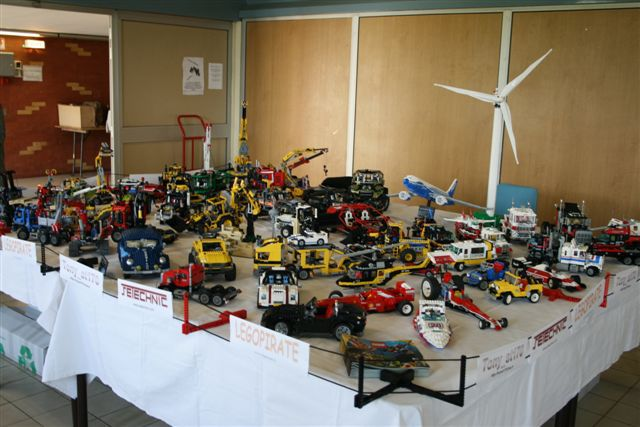
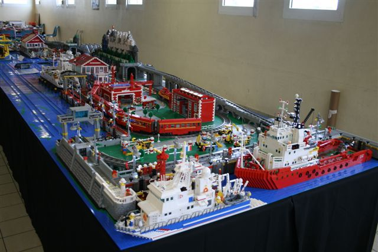

Voyage de la petite brique au pays des petites bulles de Champagne, pour le salon de Tinqueux, du 15 et 16 mai 2010.

_Jeudi_

Après 700 km de route environ sans histoire, je suis accueilli par un formidable paysage rémois aux couleurs jaune et vert (ce n’est pas le brésil !) et je suis arrivé enfin à Tinqueux (ville jouxtant Reims).

J’ai repéré immédiatement les salles du salon déjà occupées par une communauté turque pour leur fête, le parking était occupé par de grosses cylindrées BMW, Audi, VW, Ford, la classe, quoi... (je faisais petit avec ma polo).

_Le lendemain matin (vendredi)_, je suis reçu par les organisateurs qui me montrent nos emplacements, je commence le montage.

A midi, apéro au champagne et buffet froid. Fin du montage, repas du soir au champagne avec les membres du salon.

_Samedi matin_

Arrivée de Tony demeurant à 20 km d’ici, membre du forum SeTechnic, qui nous présentera sur 8m2 une trentaine de modèles : Model Team, Technic et éolienne Vestas.

A midi, vin d’honneur au... champagne, et repas. A 14h, début du salon ; à 15h tapantes, Mr le Maire de Tinqeux visite le stand LEGO et à cette occasion, je lui ai offert, à sa grande surprise, une brique gravée TINQUEUX 2010. Même chose pour deux organisateurs très touchés par mon geste. Vers 17h30, une équipe télé locale me réclame une interwiew en long et en large. Leur question principale est : d’où vient cet intérêt de jouer aux LEGO après 20 ou 30 ans ou plus ?

A 19h, les exposants quittent leur stand pour se reposer et manger, pour ma part, je suis resté et inévitablement, je suis invité pour un repas au... champagne.

Après le repas, j’ai fait la maintenance de mon matériel passablement secoué par une différence de niveau entre 2 tables, ca reste correct quand même, j’en ai vu d’autres...

_Dimanche matin_

Après le petit déjeuner sans champagne (il ne faut pas abuser !), nouvelle journée de salon jusqu’au soir. A 18h, démontage du stand LEGO et après, apéro/compte-rendu au... champagne.

A 20h, dernier repas au... champagne. A 22h, je quitte mes amis très satisfaits de notre prestation et espèrent nous revoir en 2012. Direction l’hôtel offert par le salon, impossibilité de dormir dans la salle. Motif : la nettoyeuse passe à 5h du matin !

_Le lendemain matin_

Retour au bercail...

En conclusion, le public a été conquis par nos LEGO, beaucoup de convivialité et accueil chaleureux envers nos petites briques.Merci à quelques adhérents de se technic d’etre venus nous voir .

Jean-marc, qui a ramassé des capsules de champagne pour la suite de la collection de ma regrettée femme (plus de 450 capsules différentes à ce jour).

**–** [Photos du salon](http://photos.freelug.org/main.php/v/barr__/expositions/2010/tinqueux/)  
**–** [Topic sur SeTechnic](http://www.setechnic.com/Forum/topic3087.html)
