Comme les deux éditions précédentes ([2004](/articles/exposition-modelisme-ferroviaire-amfc-orleans-2004/) et [2006](/articles/compte-rendu-de-l-exposition-de-modelisme-ferroviaire-d-orleans-2006/)), FreeLUG a participé à l’exposition de modélisme ferroviaire d’Orléans. Un grand moment pour les participants comme pour le public qui a bien apprécié.

Le salon du modélisme ferroviaire d’Orléans a lieu tous les deux ans sur les samedi et dimanche les plus proches du 11 novembre. Cette année c’était les 8 et 9 novembre au parc des expositions de la ville d’Orléans. Cette exposition est organisée par l’[Association des Modéliste Ferroviaire du Centre (AMFC)](http://amfc-orleans.fr/).

Cette grosse exposition nationale d’environ 5000 mètres carrés, dont 130 pour notre stand, se prépare longtemps à l’avance. C’est en janvier 2007 que notre association a été sollicitée par l’AMFC pour déposer un dossier de candidature. FreeLUG a répondu présent et délégué la coordination du stand à Philippe "frogleap", régional de l’étape. Chaque participant était membre de FreeLUG en 2008, condition _sine qua non_ pour permettre sa présence. Outre cette adhésion, deux associations régionales d’adultes fans de LEGO ont été représentées, BàB et Festi’briques. Pour la préparation en commun, les outils du site web ont été mis à contribution : la liste de diffusion freelug-amfc, [le site de photos photos.freelug.org](http://photos.freelug.org/) et bien sûr le bavardage sur irc (canal #freelug) pour les passages d’informations en temps réel.

[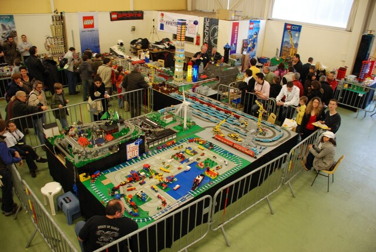](https://www.freelug.org/IMG/jpg/A-3.jpg)

**L’ensemble du stand FreeLUG**

Une fois la liste des participants bouclée, nous avons concocté un [plan de stand](http://photos.freelug.org/main.php/v/Frogleap/ExpositionsLego/2008-AMFC-Orleans/PlanB_AMFC2008004fev08.jpg.html) pour maximiser à la fois la surface proposée aux participants et la vue dégagée pour le public. Rapidement la question des tables sur lesquelles faire tenir les LEGO prévus s’est posée. L’AMFC nous proposait des tables pliantes de banquets et nous en connaissions les avantages, disponibles et grandes, et les inconvénients, dimensions non LEGO et délicates à mettre de niveau. Pour cette troisième participation, l’association régionale BàB nous a proposé ses tables modulaires. Imaginez un peu la logistique pour la fabrication, le stockage et le transport de ces 80 tables. Cette contribution a été décisive pour l’organisation du stand.

Ce sont 26 personnes de FreeLUG qui ont été prises en charge par l’AMFC pour les repas sur deux jours et demi et 10 personnes pour l’hébergement sur deux nuits. Le repas de gala du samedi soir a demandé une participation aux frais. Remarquez que les frais de déplacement étaient à la charge des participants, ce qui représente une dépense importante et non-remboursée pour ceux qui viennent de loin et encore plus lorsqu’ils louent une camionnette pour tout leur matériel, n’est-ce pas les rhône-alpins ? Le montage avait lieu dès le vendredi après-midi pour une ouverture au public le samedi à partir de 10h00. Il nous a fallu près de 12 heures de montage avec l’aide d’accompagnateurs pour présenter quelque chose de correct au public à l’ouverture de l’exposition.

Durant le salon, une équipe de TF1 est venue sur le stand pour filmer la participation de Daniela et Sylvain et faire un reportage sur la façon de jouer au LEGO ensemble entre une maman et son fils. Retrouvez les [images de ce reportage](http://photos.freelug.org/main.php/v/La-Gallerie-de-qdm/Actualit_-et-Presse/Reportage+TF1_divx.html) qui est passé au journal de TF1 le mardi 2 décembre 2008.

Enfin, quelques chiffres pour résumer cette édition 2008. Les entrées payantes ont été comptabilisées à 9984, sans compter les enfants de moins de 5 ans, ce qui laisse penser à plus de 10000 visiteurs sur les deux jours. Quarante sept mètres carrés entièrement couverts de LEGO, c’était la surface des tables. Cent trente mètres de voie ferrée LEGO développée, 31 aiguillages télécommandés. Comme vous le verrez sur les photos, de nombreux trains en circulation simultanément, nous en avons compté jusqu’à 10. Du train 9V DCC mais aussi du 9V classique, du 9V télécommandé, du monorail, du 4,5V rails bleu, du 12V rails gris. Une vingtaine de rames disponibles pour la circulation et quelques-unes présentées en statique (parfois de force... gabarit, gabarit...). Bref, un festival de trains pour une exposition de train. Normal non ? Un dernier chiffre, plutôt anecdotique, mais tellement discuté lors de la préparation que je ne résiste pas à l’envie de le communiquer. Grâce à Gilles qui avait apporté l’appareil qui va bien, nous avons mesuré la consommation électrique secteur du stand : 370W au maximum. Pas de quoi faire sauter le compteur.

Laissons la place aux récits des participants qui soulignent chacun à leur façon ce qui les a le plus marqué et retrouvons les galeries de leurs photos en fin d’article.

Juste avant cela, un petit mot pour citer ceux qui n’ont pas témoigné dans cet article mais qui étaient pourtant bien présents. Eric a apporté une ville à l’échelle micro astucieusement intégrée à l’ensemble sous la forme d’un parc miniature pour les loisirs des minifigs. Nicolas et Christophe se sont lâchés et ont construit une "Tour de Babel" avec boîte de nuit au rez-de-chaussée et mariage au sommet. Daniel a adapté son pont roulant ferroviaire au module 96x96 (bel effort) et son fils Frédérick a proposé une piste de ski avec télésiège fonctionnel. Gilles a fait dans le gratte-ciel et les anti-démolition (si si regardez bien les photos). Enfin, Médérick est venu avec un pont transbordeur de containers commandé en PFS, très jouable. Une pensée pour Alban qui a virtuellement participé en fournissant les plans d’un module à monter par d’autres et concrètement en offrant à chaque participant une brique 1x8 rouge-brique gravée _Orléans 2008_ en souvenir de l’évènement.

_Philippe (frogleap)_

* * *

Troisième participation de FreeLUG à cet évènement et troisième invitation de l’AMFC, qui n’invite généralement pas deux fois de suite les mêmes clubs afin d’offrir de la diversité au public. Evidemment nous ne sommes pas concernés, car à chaque fois nous présentons des réalisations inédites, même si pour ma part, contraintes familiales et professionnelles obligent je n’ai fait qu’une brève reconfiguration de mon ensemble médiéval, déjà présenté à Kultima et à Kidexpo.

Présent uniquement le dimanche, j’ai néanmoins été bluffé à la fois par l’organisation de l’ami Philippe (qui avait même pensé à brancher son téléphone), le super professionnalisme des organisateurs de l’AMFC et évidemment par l’enthousiasme du public.

Concernant notre stand, même quand on en était éloigné on en entendait parler : Commentaires des visiteurs dans les allées "_Non, c’est une association de fans, pas des professionnels !_". Commentaires des cadres de la FFMF "_Vous avez encore fait très fort_" et puis surtout, ce qui restera ce sont les yeux de l’équipe de tournage de TF1 quand ils ont découvert le stand "_Non, on ne s’attendait pas à ça en venant ici !_" et tous les commentaires laissés par les enfants sur notre "Livre d’Or" : "_C’est trop bien, je suis au pays des rêves_" (Thomas) et par quelques parents : "_Si ma femme voyait ça, elle qui se moque de moi quand je légote avec mes 45 balais..._" (Stéphane).

_Didier (qdm)_

* * *

Comme à chaque exposition, on me reproche d’avoir terminé de m’installer au moment où il faut commencer à ranger, cette fois-ci, les choses ont changé.

J’ai donc décidé de préparer mes modules sur leur tables, et de les faire voyager "complets"... Deux tables doubles sont donc arrivées, supportant leur partie de montagne, et il ne restait plus qu’à placer les maisons sur leur emplacement, et les quelques détails (poteaux, minifigs, véhicules, barrières...), assez rapidement au final.  
Du coup, mon module était complètement terminé le samedi à 14H. Un exploit pour ceux qui me connaissent...

[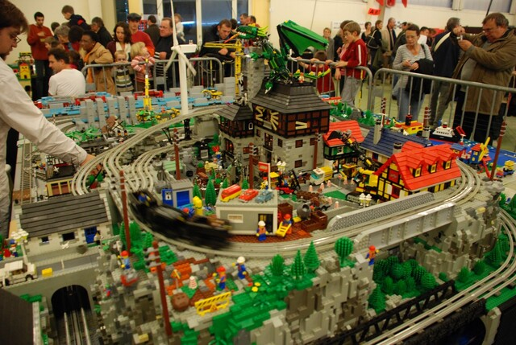](https://www.freelug.org/IMG/jpg/DSC_2071.jpg)

**Module de la Mine d’Indy**

Dommage, mes wagonnets qui tournaient à merveille chez moi durant le montage, refusaient de prendre les virages sous la montagne. Les rails ont bougé au transport, et je n’ai pas réussi à les replacer _(note de Didier : c’est bien ce qu’on dit, ton module n’était en fait pas fini d’être monté...)_.

[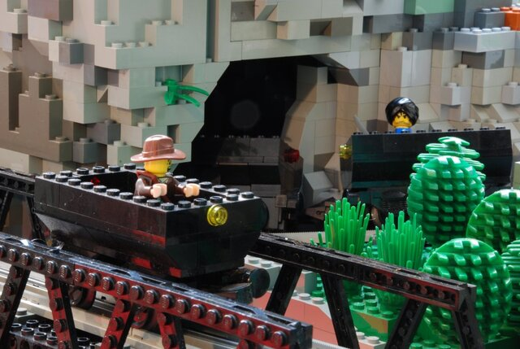](https://www.freelug.org/IMG/jpg/0.jpg)

**Les wagonnets**

De plus, les RCX (gourmands en piles) branchés sur secteur ont décidé de me lâcher le dimanche, jour de la visite de l’équipe de tournage de TF1. On attend leur reportage au 13H d’ici Noël, avec impatience. Espérons que Daniela se retrouvera dans celui-ci, et qu’ils ne chambouleront pas tout au montage pour faire dire l’inverse, comme un certain reportage de M6... ;)

Un autre événement est survenu, et a "surpris" tout le monde (quoique...) : La chute spectaculaire de la flèche de la tour de Nicolas. Cette tour monumentale se terminait par une flèche d’environ un mètre, le long de laquelle une chapelle montait et descendait (au 7eme ciel diront certains). Une erreur humaine semble être à l’origine de la défaillance mécanique de cet ascenseur, qui a entrainé la chute de l’ensemble, arrachant au passage les manèges, et créant un cataclysme au niveau de la rue principale très fréquentée. Aucune minifig ne semble avoir été blessée durant cet événement. Des pièces ont été retrouvées jusque dans le public surpris. Malheureusement, aucune caméra n’a filmé cet accident.  
Dis Nicolas... Tu nous la refais pour l’AG ? Promis, on aura tous nos caméras...

Je cite Nicolas : "J’étais le premier, et me voila en troisième position...". En effet, depuis cette chute, Denis se retrouvais être l’architecte de la tour la plus haute, suivi de près par Gilles.

Quand à Philippe, il s’est lâché en fin de salon. Vers 17H45 le dimanche soir, avant la fermeture et le démontage, celui-ci s’est permis de "vraquer" les trains, le tout sous l’oeil de la caméra de TF1... (en aura-t-on les rushs ?).

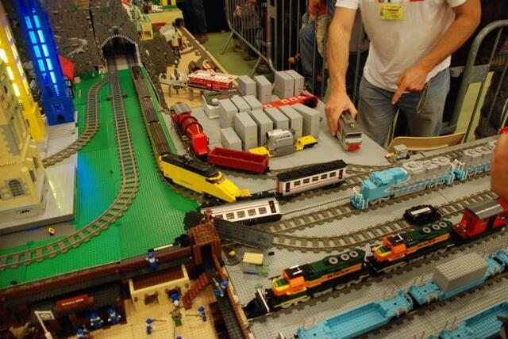

**17h 45, bientôt la fin !!**

C’est malin... Après cela, il faut penser à tout remonter.

Notons aussi la présence dans l’espace réservé aux boursiers, d’un brocanteur spécialisé en LEGO, avec de nombreuses boîtes rares dont du 12v, des trains 9v, du monorail, du technique, et du space classic... Je me suis laissé tenter par le LL928 galaxy explorer, dont je rêvais depuis tout petit. Surprise en arrivant chez moi au montage... Il est Neuf ! Si ! Seuls deux minifigs blanches semblent avoir complété cette boîte ouverte à mon avis une seule fois.

Bref, dans deux ans, il sera à mon avis là, et de nouveau pris d’assaut !

En résumé, une exposition sur deux jours, trop courte, tellement nous pouvions être plongés dans notre univers. Je ne vous raconte même pas les nuits dans l’auberge de jeunesse où les exposants les plus lointains résidaient. Deux nuits assez courtes en fait. Dont une pour Jean-Gérald à remonter ses 4 locomotives Maersk, cassées lors de l’arrivée le vendredi.

Vivement dans deux ans, que ça recommence ! :)

_Pascal (LeGnome)_

* * *

Pour ma première participation à l’exposition d’Orléans j’ai voulu réaliser mon premier MOC de train.  
Étant originaire de Lorraine j’ai souhaiter réaliser une création en rapport avec l’histoire ferroviaire et industrielle de ma région. C’est comme cela que m’est venue l’idée d’un train transport de fonte en fusion.

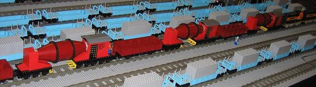

J’ai donc réalisé une série de quatre wagons-torpilles (appelés aussi wagons "Torpédo", wagons "cigares", wagons-poches, ou encore wagons-foudres), qui servaient à transporter la fonte ou l’acier en fusion sur (ou entre) les sites sidérurgiques.

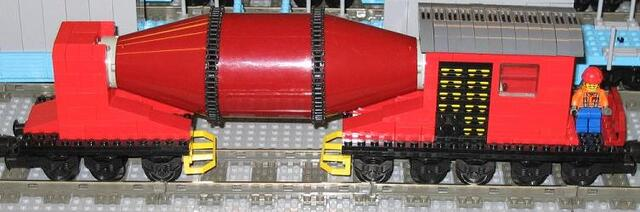

Après l’avoir constaté sur photo et en avoir parlé avec mon oncle, ancien mécanicien à la SNCF, j’ai aussi réalisé une série de quatre wagons-freins qui servaient à compenser le manque d’essieux par rapport à leur poids des wagons-torpilles.  
Ces wagons étaient en général des wagons plats ou des wagons tombereaux remplis de sable.

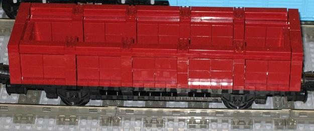

Le seul bémol est que mes wagons-torpilles sont encore hors gabarit (trop longs et trop larges... mais ça va changer !) donc mon train à péniblement fini un tour du réseau d’Orléans avant de revenir sur sa voie de garage.

En tout cas quel bon moment que cette exposition d’Orléans, car il est toujours agréable de pouvoir discuter LEGO, et de revoir les autres Freelugiens pour un _week-end_, autour d’un merveilleux décor qui me laisse encore pleins de souvenirs dans la tête !

_Pierre (Tribolego)_

* * *

Une nouvelle exposition à Orléans cette année ? Je suis partant !

C’est ma deuxième participation comme exposant à cette manifestation. Bien que limité en surface pour cause de transport en commun et de place. Je pense tout de même avoir fait un petit module sympathique ! Surtout qu’à ma grande surprise les piles de l’éolienne n’ont pas lâché : un seul jeu pour tout le week-end !

C’est avec grand plaisir que j’ai retrouvé tous les participants que je connaissais déjà tous ! Cela a été deux jours merveilleux. Un espace de jeu immense !  
Merci à tous.

_Eric ( SystemDbrick )_

* * *

Cette année, pour ma deuxième participation, j’ai décidé, moi aussi, de réaliser mon premier MOC sur le thème "Trains" (hormis le funiculaire d’il y a 2 ans). J’ai souhaité faire participer le public à l’animation d’une gare de ferroutage.

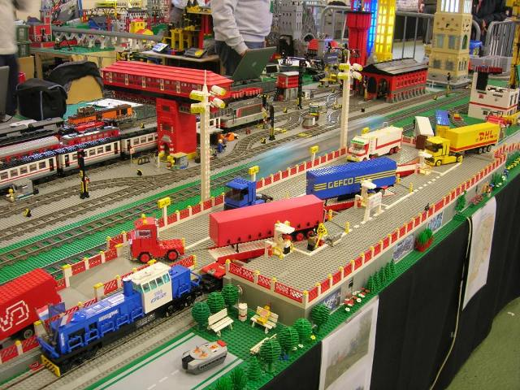

En effet, il s’agit d’enchainer deux actions : Immobilisation du wagon et rotation de celui-ci.

Avec l’aide de télécommandes PFS ou d’un bouton relié à une brique programmable RCX, le (jeune) public est devenu "assistant chef de gare" le temps de quelques minutes.  
La distribution de bonbons a permis d’encourager les plus timides et de récompenser les téméraires.  
Malheureusement, seule la locomotive de ce convoi a pu emprunter le réseau faute de respect du gabarit pour les wagons. En effet, c’est la largeur et la rotation des wagons qui imposent leur longueur !

Encore une fois, je suis enchanté par ce type de rencontre avec les Freelugiens et le public. C’est d’ailleurs ainsi que j’ai fait la connaissance d’un AFOL d’Angoulême, isolé, qui a l’intention de devenir adhérent suite à sa visite spécialement organisée pour nous rencontrer.  
J’ai rendez-vous avec lui, à Noël, dans notre région natale commune.

Rendez-vous dans deux ans pour encore plus de délire.

_DenisL_

* * *

Orléans 2004 en tant que visiteur et Orléans 2008 en tant qu’exposant, entre, toute une histoire de briques et autres. Avant seuls les sets me faisaient rêver maintenant j’en suis à Mocer... et à peindre aussi...

Mon projet de faire Orléans a donc mûri pendant 4 ans et je ne me voyais pas venir sans un train un peu spécial à exposer. En 2007 ce fut une véritable révélation quand j’ai commencé à m’intéresser aux sets Maersk et à Maersk S.A. J’ai travaillé sur le [set 10152](http://www.bricklink.com/catalogItemPic.asp?S=10152-1) en passant à [un agrandissement de ce set](http://www.brickshelf.com/gallery/JeanG/Maersk/0_maersk_line.jpg) avec des containers Maersk de 4 tenons de large. En fouillant sur les images de google et de brickshelf j’ai découvert l’existence de 3 locomotives Maersk. J’ai choisi celle qui m’impressionnait le plus c’est à dire [l’ATSF GP 60 M](http://www.ppw-aline.com/images/decal-photo-maersk.jpg) . C’était donc décidé pour mon premier moc cela sera ce train là.

Pas moins d’un an pour réfléchir sur comment se rapprocher le plus possible d’un Moc réaliste. N’étant qu’un grand collectionneur, mocer était une action nouvelle dont je ne maitrisais pas grand chose. C’est grâce à ma rencontre avec Pierre Normandin et surtout Jac que j’ai pris confiance en moi pour oser l’impensable : faire des mocs. Ce train est donc mon premier moc train et je devais donc apprendre beaucoup de choses dont mettre mon train au gabarit FreeLUG.

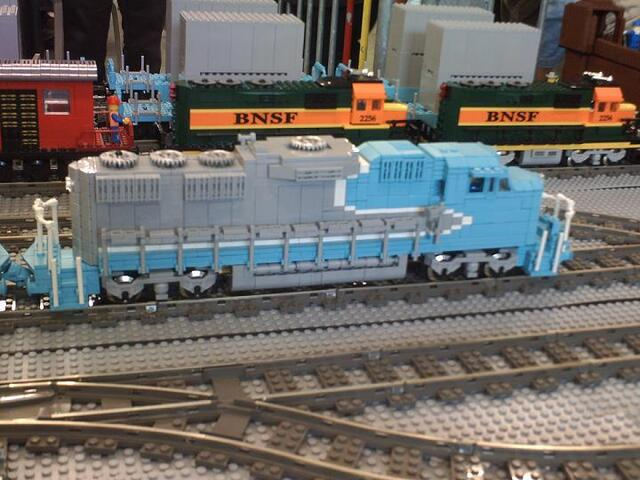

**ATSF GP 60 M (6 tenons X 52,5 tenons)**

Le choix de faire en 6 de large fut une évidence pour moi car cela me permettait de garder un pied dans les sets officiels qui sont eux aussi en 6 de large.  
Mais dans cette aventure j’ai décidé de ne pas y aller seul. Après avoir vu les banbanteries à [Saint Rambert](/articles/compte-rendu-de-l-exposition-de-saint-rambert-d-albon/), c’est-à-dire un AFOL habitant loin faisant du moc par l’intermédiaire d’un autre (Loys a créé grâce au plan MLcad de Banban un mini-golf), j’ai trouvé l’idée sympathique, en plus fait par l’un des meilleurs mocer au monde (Banban)... J’ai donc lancé un défi à Banban de faire la même locomotive (mais lui en 8 tenons de large). Cela m’a permis d’avoir une relation sympathique avec lui et d’apprendre à mieux se connaitre après une exposition trop courte à [Claix en 2005](/articles/exposition-de-claix-2005/).

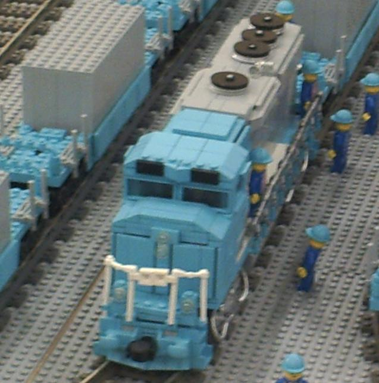

**Une banbanterie de plus**

Après avoir travaillé sur la qualité, la quantité ne s’est pas faite attendre... J’ai donc travaillé sur les trains américains et un convoi de marchandises peut faire plus de 2 km de long... mon train n’y échappe pas et en plus chaque wagon contient 2 containers l’un sur l’autre. Vu le gabarit FreeLUG j’ai donc fait des wagons pour containers de 6m au lieu des 12 m comme prévu dans la réalité. Pour les wagons j’ai décidé de faire un petit clin d’oeil au [set 4549](http://www.brickshelf.com/cgi-bin/gallery.cgi?i=2319953) son ancêtre... au total 53 wagons Maersk ce qui fait un convoi avec 3 locomotives (16.90m) qui correspond dans la réalité à un convoi de 700 m (le record du monde étant de [124 wagons](http://www.brickshelf.com/gallery/Ben/Shows/5th-event-fgltc/day2/pic03568.jpg) vous vous doutez bien que je ne vais pas en rester là...)

Seul petit bémol, la réalisation des autocollants Maersk qui n’ont pu se faire à temps mais qui je l’espère pourront être vite créés.

L’arrivée à Orléans fut un tout petit peu catastrophique : j’ai tourné 30 minutes autour du lieu d’exposition... (maintenant j’ai compris comment on y entre) et je n’ai pas si tôt enlevé le premier carton qu’il vient s’exploser au sol... Bilan : remonter les 4 locomotives Maersk sans plan jusqu’à 3h du matin le samedi.

Heureusement la suite du _week-end_ fut plus glorieuse puisque mon train passait partout mais seul petit hic le tunnel de Denis n’était pas aux normes et donc j’ai du enlever à contre-cœur un container sur chaque wagon... snif...

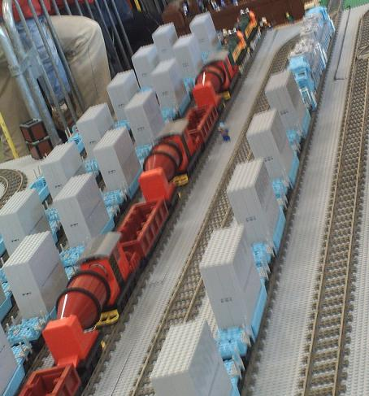

Mes premières pensées de remerciement vont à Philippe qui a dû supporter mes questionnements et mes envies qui parfois pouvaient l’énerver, à juste titre d’ailleurs, mais au final le résultat est là : mon train tourne.  
Je remercie Banban pour avoir accepté cette nouvelle Banbanterie (j’espère que tu continueras encore à en faire)... maintenant je vise une brickerikerie...  
Je remercie ma chérie Oriana, Jérome Booms et sa famille, DavidC et PierreC de m’avoir aidé dans la réalisation de ce projet.

Quant à ce _week-end_ toujours trop court pour voir l’ensemble de toutes les subtilités de construction de chacun... mais en tout cas ce fut impressionnant et d’une grande qualité.

L’ambiance humaine était telle que je commençais à regretter mon départ de FreeLUG mais bon au-delà des étiquettes les amitiés restent et de nouveaux projets LEGO s’ouvrent. En tout cas cela conforte mon idée que le principal ce sont les expositions car les rencontres d’AFOLs il n’y a rien de mieux pour vivre à fond sa passion. Festi’briques étant né j’espère faire parti de l’aventure d’Orléans 2010... en revenant aux sources et en présentant tous les sets train de marchandises depuis 1991.

Quant au public c’est toujours un régal d’extérioriser sa passion et de la transmettre aux autres... mais bon cinq lignes de personnes il était difficile parfois d’accéder à notre stand.

_JeanG_

* * *

Orléans ?

Que voici une belle destination pour un alsacien.  
La route fut un peu tristounette, seul (Malgré mes appels auprès des freealsacelugiens).

Le public a répondu présent ! Des whouah, des super, "des papa, papa, t’as vu". Les remarques sont nombreuses et gratifiantes.

J’ai profité du dimanche midi un peu plus calme pour faire le tour du stand et je me suis fait plaisir à regarder nos créations. Des petites scènes rigolotes, des maisons magnifiques, une gestion du réseau de train de haute volée, une piste de ski animée, des immeubles meublés, etc. C’est génial !

De mon côté, j’avais choisi de présenter un réseau "officiel" issu des "belles années" (je taquine) LEGO, à savoir les années 70. Pas loin de 50 sets trônaient face au regard tantôt amusé, tantôt interrogateur du public.  
J’ai entendu bon nombre de papa dire à leurs enfants "t’as vu, j’ai joué avec ça". Un très bon _week-end_ qui viendra nourrir mes souvenirs "LEGO".

Merci Philippe.

_Thierry_

* * *

Beaucoup de bois, beaucoup de LEGO, beaucoup de public et beaucoup de discussions avec des AFOLs... Un _week-end_ de rêve. Heu... Philippe pour 2010 on fait quoi ?

_Xavier/Brikolego_

* * *

Pour moi ce fut un _week-end_ de folie avec un nombre impressionnant de visiteurs (FreeLUGien(ne)s ou non), il y avait par moment 3 à 4 rangée de personnes devant notre stand.

[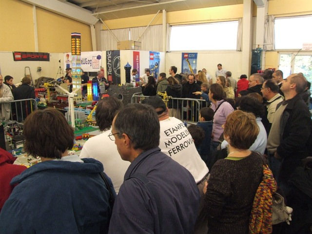](https://www.freelug.org/IMG/jpg/DSCF0062_SH1.jpg)

Le temps est passé très vite et le moment du démontage est vite arrivé, ça sentait la fin et un peu de tristesse se lisait sur tous les visages des participants.

_Sébastien_

* * *

**Le module BàB**

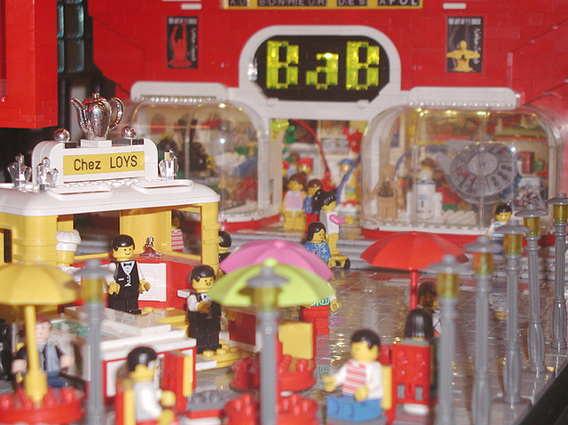

L’idée est simple : plutôt que d’essayer de raccorder au mieux nos modules personnels les uns aux autres, l’idée est de mettre en commun l’espace que nous avait affecté Philippe pour faire un seul ’MegaModule’ qui ’parle’ aux visiteurs.

L’équipe est formée et la décision est prise lors d’un petit apéritif-construction (Denis, Jac, Loys, Xavier) de se lancer effectivement dans cette aventure. Nous faisons donc une première maquette de notre module où une plaque 32\*32 = 4 modules standards réels.

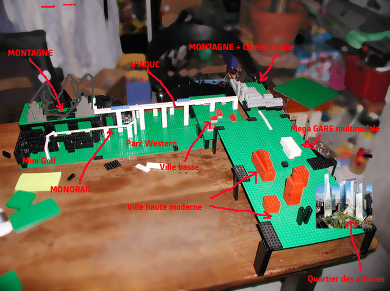

**La maquette originale du ’mega module’ BaB**

On se rend vite compte que c’est une réalisation assez complexe car non seulement le MegaModule est commun, mais la notion même de module standard 3\*3 plaques de 32\*32 est effacée : chacun doit positionner ses MOCs en fonction du résultat global souhaité et non pas en fonction ’de son module standard’. En clair : on mélange tout.  
De plus, nous avons 4 niveaux de plateau, ce qui en soit n’est pas un problème avec les tables modulaires xBaB, mais demande quand même de la précision pour nos constructions et leur position.

L’outil de base pour concevoir le projet est BB (BlueBrick pour les intimes) qui permet de gérer les niveaux, les textes, les zones, les tables, etc. En bref, il n’y a pas mieux ! Et puis aussi beaucoup de mails et d’échanges de photos.

Malgré tout, nous nous organisons aussi un _week-end_ pour ajuster en vrai les points délicats et pour finir de fabriquer les tables en aidant un peu Xavier (et aussi pour le plaisir de se retrouver).

C’est aussi à ce moment là que Julien nous contacte : oui, nous allons héberger son superbe immeuble de bureau errant (ça me fait un immeuble de moins à construire, vu que j’étais vraiment à la rue...) qui complète parfaitement le quartier des affaires du module BaB.

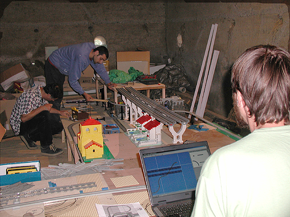

**Prémontage du Mega Module pour vérifications et mise à jour du layout sur BlueBrick**

Le jour J et... les 80 tables xBaB à charger très très très tôt le matin pour être les premiers (ou presque...) sur place à Orléans pour le montage des tables qui s’est finalement passé très vite car tout le monde s’y est mis.

(Après Fanabrique 2008 où nous avions 50 tables pour la LGV, Orléans et ses 80 tables nous ont permis de bien valider ce concept mais avec encore quelques améliorations à venir...)

[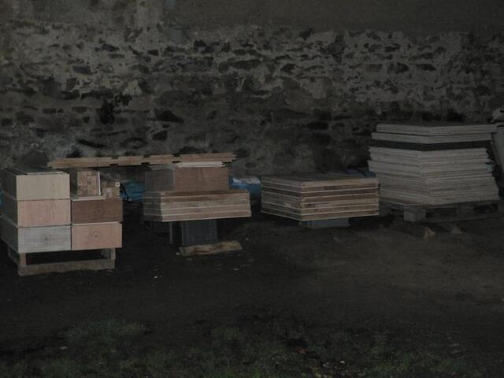](https://www.freelug.org/IMG/jpg/80tables.jpg)

Le reste de l’histoire ?  
Et bien un _week-end_ formidable et un MegaModule que nous avons réussi à monter dans les temps, n’est-ce pas Philippe ? : le métro aérien de Loys était le premier à circuler à 10h pile le samedi.

Ouf ! car sincèrement, nous n’étions pas sûrs à 100% de finir dans les temps ! :-)

Orléans 2010, c’est à quelles dates ?

_Denis H. (cdhd)_

* * *

Orléans est une grande exposition qui a lieu tous les deux ans. Grande par le nombre de visiteurs, par le nombre de participants présents, par le temps de préparation et le temps d’installation : 12 h, en comptant tout. Notre module BAB, prévu depuis Février a eu besoin de tout ce temps pour être préparé correctement. Mais, le résultat final en vaut le coup. C’est juste un peu dommage que cela soit si court. Car nous resterions bien un jour de plus dans cette ambiance. La joie de tous nous retrouver et de faire circuler des trains immenses. Alors que dès le rangement, la déception se lit sur tous les visages !! Je n’en dirai pas plus pour laisser la place à quelques photos.

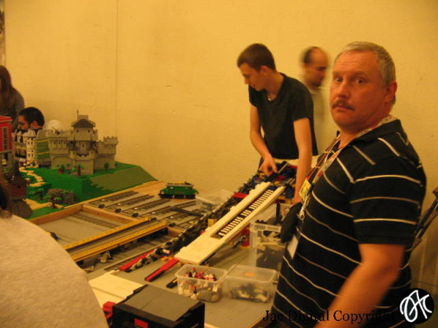

**C’est l’heure de ranger pour Daniel**

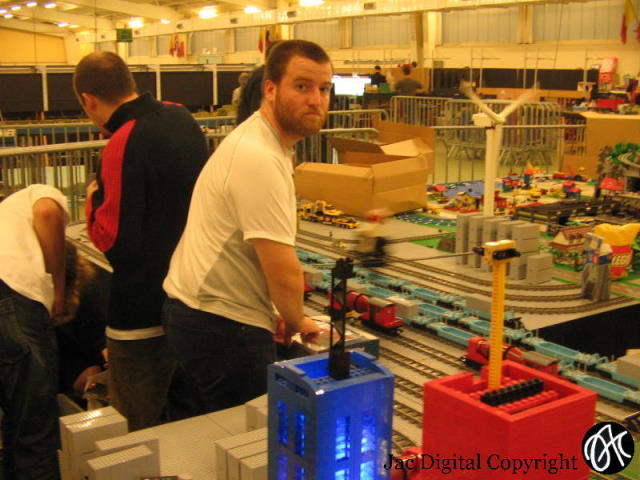

**Et aussi pour Pierre.....**

_Jérôme/JAC_

* * *

## Galerie photos

**–** [Galerie Le Gnome](http://www.brickshelf.com/cgi-bin/gallery.cgi?f=351757)  
**–** [Galerie Brikolego](http://www.brickshelf.com/cgi-bin/gallery.cgi?f=348608)  
**–** [Galerie JAC](http://photos.freelug.org/main.php/v/JAC/Exposition/Orleans-2008/)  
**–** [Galerie qdm](http://photos.freelug.org/main.php/v/La-Gallerie-de-qdm/Expositions/2008-Orleans/)  
**–** [Galerie Sébastien](http://www.brickshelf.com/cgi-bin/gallery.cgi?f=351444)  
**–** [Galerie Tribolego](http://photos.freelug.org/main.php/v/Pierre_13/Orleans2008/)  
**–** [Galerie DenisL](http://photos.freelug.org/main.php/v/dlaurencon/Expo/Orleans_2008/)  
**–** [Galerie JeanG](http://www.brickshelf.com/cgi-bin/gallery.cgi?f=349243)  
**–** [Galerie cdhd](http://www.brickshelf.com/cgi-bin/gallery.cgi?f=352877)  
**–** [Galerie d’Erik (démontage)](http://photos.freelug.org/main.php/v/brickerik/expositions/2008/Orleans2008/)
