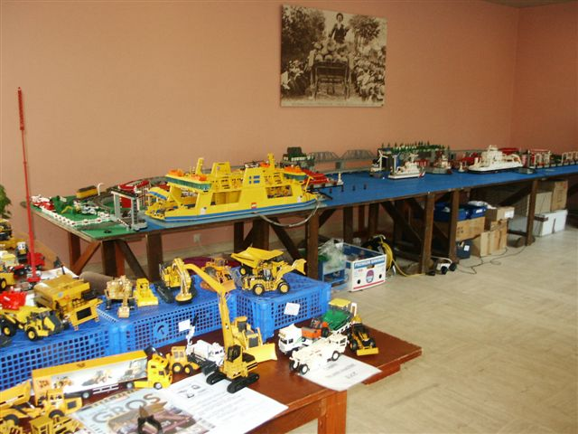
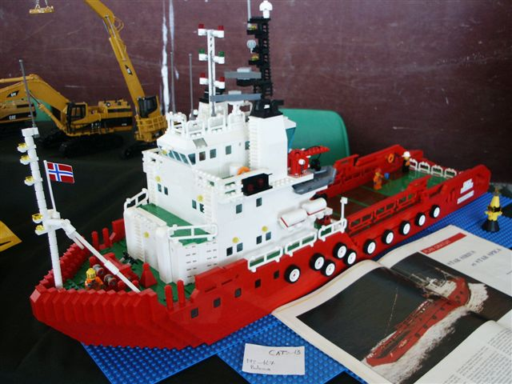

## Exposition à Huelgoat, 14 et 15 avril 2007

Mon club de la maquette de Saint Martin des Champs, près de Morlaix, a reçu une invitation surprise (je dirai plutôt de dernière minute) du Comité des Loisirs d’Huelgoat (29) pour leur 1er salon des modèles réduits (toutes catégories).

Malgré un salon éclaté en plusieurs lieux de la ville (lac pour les bateaux radio-commandés, mairie pour nous 80 mètres carrés...) ce fut un succès populaire surtout pour moi et mes LEGO, car j’ai été l’invité surprise. Avec les médias, ce fut la ruée le dimanche.

La salle, à certains moments, fut pleine à craquer. La gendarmerie n’était pas là pour canaliser la foule...  
Cette manifestation fut l’occasion pour moi d’inaugurer enfin la ligne de montagne et surtout le super ferry avec ses triples aiguillages, les résultats sont prometteurs.

Pour la première fois, j’ai du monter mon réseau en 6 heures pile ( de 8h à 14h , entretiens avec les médias compris).

[Photos, notamment de la rampe et du triple aiguillage](http://photos.freelug.org/main.php/v/barr__/expositions/Huelgoat2007/)

* * *

## Exposition à Crozon

Aprés Huelgoat, le Legoman breton (les journalistes m’appellent ainsi) est allé à Crozon avec uniquement le dernier bateau (terminé à 90%), les 21 et 22 avril 2007. Je ne suis pas rentré bredouille car j’ai obtenu une médaille de bronze en catégorie divers, ce classement après Tours me donne des points au niveau national. Mon club de la maquette a eu 8 médailles (or, argent, bronze). En exclusivité et pour vous , voici les premières photos de mon remorqueur de haute mer off-shore, quelques détails sont à revoir, j’attends des pièces avec Brinklink. Pour le voir, il faudra patienter Rosheim si j’ai de la place dans ma voiture. Faute de place, je n’ai pas pu amener mon réseau.

J’ai croisé des clubs de Grenoble, Melun et un Afol indépendant de Douarnenez qui connaissent bien FreeLUG. Prochains rendez vous : Douarnenez et Ploulec’h en mai.

[Photos du remorqueur](http://photos.freelug.org/main.php/v/barr__/expositions/crozon2007/)

Votre serviteur morlaisien qui va devoir acheter une vitrine pour ses coupes et médailles...
