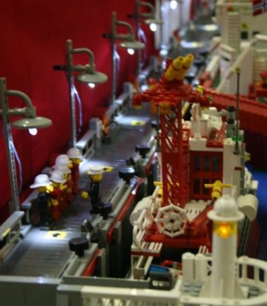

Comme en 2007, la petite brique et mon club de la maquette ont été de nouveau invités par les organisateurs du tout récent club de modélisme de Saint-Lô (Manche).

Malgré le caractère militaire omniprésent sur place dû au souvenir du débarquement de 1944, j’ai présenté un diorama identique aux précédents salons (nouveau port allumé cette fois-ci et barge animée).

L’accueil fort chaleureux à mes créations était une nouvelle fois au rendez-vous. Beaucoup d’intérêt concernant le mécanisme des mouvements du bateau. Sur place, des personnes m’ont reconnu et finissent par me suivre sur le grand Ouest. Comme quoi, LEGO est apprécié...

J’ai eu sur place quelques contacts pour des salons dans le pays mais la frilosité de ces organisateurs était palpable. Peut-être à Cherbourg...

Qui dit Saint-Lô, dit Famille EURY (Alain et Brigitte), figures emblématiques du coin dont je remercie leur gite et leur couvert.

En conclusion, un salon très plaisant et sympathique à voir malgré une fréquentation faible (620 entrées), une rencontre toujours aussi chaleureuse avec nos amis adhérents de Saint-Lô.

[Galerie photos](http://photos.freelug.org/main.php/v/barr__/expositions/2009/SaintLo/)

Jean-Marc de MORLAIX
