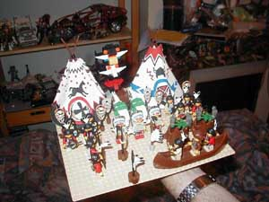
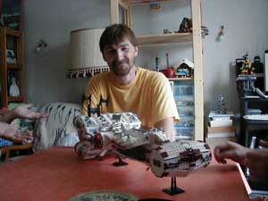

Chimère, Denis, Steinmeg et moi-même avons mis à profit ce samedi pour monter un buste darth maul. Une belle journée que nous avons mis à profit pour monter par ailleurs un barbecue !

**Le vide grenier**

J’avais tout d’abord rendez vous avec Steinmeg pour une petite brocante ou nous avons beaucoup rit, bien qu’estomaqués par un vendeur qui cherchait à vendre quelques centaines de grammes de Lego (et autres)pour 100 euros.

**Arrivée à grenoble**

En passant chez Steinmeg je découvre une collection impressinante mêlant allègrement sets Star wars, Technic ou FarWest.

Mais rapidement nous avons le plaisir de nous rendre chez Chimère pour la découverte de MOC villes et du si fameux 10018, agrémenté de quelques miniset sw.

Après le repas et moultes discussions (ils sont aussi bavards que sur Freelug) il est grand tant de nous diriger chez Denis.

**Le montage du buste Darth Maul**

Le nombre de pièces est impressionnants (1850) et fort heureusement nous nous relayons afin de terminer le darth maul dans les délais les plus courts malgré de nombreux aléas. Les méthodes de chimères étant pour le moins "costaudes" (mais à quoi donc peut lui servir ce marteau) et Denis s’étant rabattu sur le montage tout aussi ardu d’un barbecue, nous restons un moment avec Steinmeg les seuls à oeuvrer sur le buste, oubliant les brochettes préparées par Denis.

[Les photos](http://www.brickshelf.com/cgi-bin/gallery.cgi?f=53842)

La soirée se termine sur les 2h du mat’ et c’est fourbu que je rentres sur Lyon avec plein de nouvelles idées en tête.
