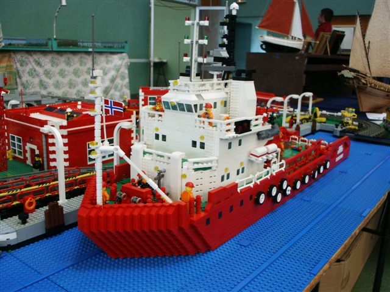

Résumé de ma participation au Salon de la Maquette à Plonévez Porzay, les 19 et 21 mai 2007.

Salut les AFOLS,  
**–** Combien de temps mettez vous pour monter votre réseau ?  
**–** Combien de temps pour le démontage ?  
**–** Avez vous un camion ? Non, une GOLF.  
**–** Est-ce que vous démontez pièce par pièce ?  
**–** etc.

Telles étaient les questions fréquemment posées lors de la dernière édition du Salon de la Maquette à Plonévez Porzay, prés de Douarnenez, le week-end dernier.

Depuis un an, après de nombreux contacts, les organisateurs (le comité d’animation de la ville et l’association train 29) voulaient absolument la présence des petites briques. C’est chose faite, ils ont été enchantés par ma prestation.  
Pour moi et mes collègues du club, nous avons eu, en hébergement, un bungalow de luxe dans un camping près de la mer.

Pour le salon, j’ai apporté le célèbre réseau, et le remorqueur "off-shore" qui avait fière allure au milieu du décor.

Tout s’est très bien passé, les tables étaient très rigides, ouf !!! Ce fut un très bon test avant le salon de Ploulec’h le week-end prochain.

Les organisateurs m’ont donné deux sacs de LEGO dont une boite Technic (moto, je crois), je n’hésite plus à demander aux exposants s’ils ont des briques dans un coin, ça devient naturel !!!

Votre serviteur  
Le Legoman Breton CIRCUS

[Galerie de photos](http://photos.freelug.org/main.php/v/barr__/expositions/Plovenez2007/)
