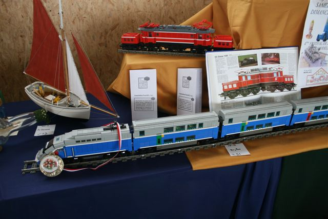

Pour la deuxième année consécutive, les organisateurs de Crozon n’ont pas pu trouver une place pour mon grand réseau (la salle est petite), c’est bien dommage pour les petits et grands enfants qui se sont déplacés pour rien, mais deux nouveaux rendez-vous sont prévus très prochainement : Morlaix (17 et 18 mai) et Douarnenez (31 mai et 1er juin).

Après le bronze de l’an passé pour le remorqueur rouge, une nouvelle médaille de bronze m’a récompensé avec le TGV Duplex dans le cadre du difficile concours IMPS Provinces de France.

Dans ce concours , je ne peux pas inscrire un modèle en LEGO dans une catégorie précise (ex : remorqueur rouge dans la catégorie bateaux, ce n’est pas une maquette traditionnelle, pour mémoire, il y a 13 catégories dont plusieurs dioramas civils et militaires).

Je discute beaucoup avec les personnes de la Fédération...  
Je représenterai le TGV à Cholet avec son diorama pour impressionner le jury très friand de ça. Notons au passage que mon club de la maquette dont je suis vice-président, a récolté 12 médailles sur 15 modèles inscrits (5 OR, 2 ARGENT, 5 BRONZE) COCORICOOOOOOOOOOOOOOOOOOOOOOOOOOOOOOOOOOOO !!!!!!!!  
Nous ferons mieux la prochaine fois .

[Galerie de photos](http://photos.freelug.org/main.php/v/barr__/expositions/crozon2008/)

Prochains salons  
**–** à Carantec le week-end prochain où j’expose quelques bateaux ;  
**–** les 17 et 18 mai 2008 au Salon de la maquette de Saint Martin des Champs où avec Ronan , nous allons assurer la permanence FreeLUG (on peut encore s’inscrire, faites vite) ;  
**–** 31 mai et 1er juin : Salon de Douarnenez avec Ronan j’espère et d’autres bretons ;  
**–** 13 et 14 septembre, salon de Dinan, inscription close, il doit bien y avoir un Freelugien dans cette ville.

Ensuite, Cholet, Le Relecq Kerhuon et Lorient...

A très bientôt pour les nouvelles aventures du légoman breton circus.

jean marc de Morlaix
