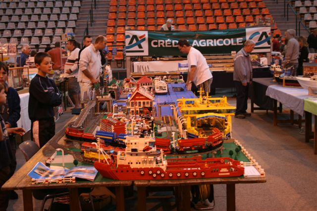

Un petit tour dans le pays dinanais.

Suite à ma prestation fort remarquée lors du [salon de Bourgbarré prés de Rennes en mars dernier](/articles/salon-de-bourgbarre-les-29-et-30-mars-2008/), un organisateur de Dinan m’a invité sans discussion : le stand était déjà réservé !!!

C’est donc avec plaisir que je me suis rendu à Dinan.  
Mon stand était situé au milieu de la grande salle prés du podium, le public était venu nombreux et très surpris de jouer avec moi.

Au cours de ce salon, il faudra noter la présence d’un local (Ghislain Baudon) et d’une famille normande (famille Eury) venue en voisins, merci.

Le samedi soir, le club local de la maquette a décerné des prix dans trois catégories : j’ai reçu une coupe dans la catégorie maquette originale.

En conclusion, excellent week-end, matériel fiable et tables correctes.

[Galerie de photos](http://photos.freelug.org/main.php/v/barr__/expositions/2008/dinan2008/)

[Prochain salon à Cholet](/articles/exposition-du-maquettisme-de-cholet-18-et-19-octobre-2008/).

Jean-Marc
