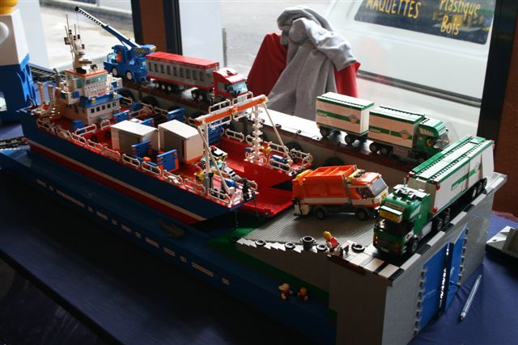
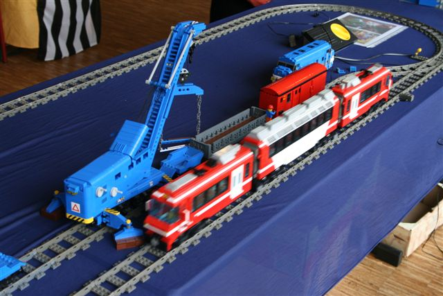

Le dimanche 8 mars dernier, s’est tenu le 10e salon de la maquette au Palais des Congrés de Pontivy.

Ma dernière prestation sur une journée remonte à 2 ans et, pour moi, il n’était pas question de sortir mon grand réseau. Aussi, cette année un peu molle en terme de nouveautés chez les maquettistes, j’ai amené des créations legotiques nouvelles :  
**–** la barge de l’Ile de Batz prés de Roscoff.  
**–** le TGV duplex  
**–** la locomotive rouge allemande mais version autrichienne, une version verte est en cours de construction...  
**–** la Z850 de la ligne de Chamonix  
**–** le train de secours SNCF avec la Cockeryl 85t.

Parti sur la base de 3m, je me suis retrouvé avec 6m de tables suite à défection de mon président de la maquette, il a fallu donc improviser sous un soleil généreux :  
**–** Le diorama de la barge au milieu et deux circuits simples avec les différents trains .  
**–** Sans conteste, la palme d’or est revenue à la barge.

Bien entendu, par curiosité, j’ai du expliquer au public le mécanisme des mouvements du bateau. Silence admiratif !!!!

Le stand LEGO a dégagé une forte impression et j’ai eu beaucoup d’encouragements... le livre d’or était là même pour les Anglais très nombreux !!!

Sur place, un nouvel adhérent de FreeLUG de Redon est venu spécialement me voir, c’était très sympa de sa part, j’espère qu’on se reverra à la fin du mois à Pont-Péan s’il lit mon article.

Un gars de Brest, Mickael, maquettiste naval avec un superbe bateau de pêche en bois d’1.50m (radiocommandé) et passionné de LEGO (médiéval), est intéressé par notre groupe LEGO finistérien (bientôt 6 membres adhérents ou non).

Pour clore la journée, le salon m’a offert une médaille de la ville de Pontivy.

Prochain salon, 28 et 29 mars 2009 à Pont-Péan prés de Rennes (voie express de Nantes à Rennes ).

[Galerie de photos sous le soleil](http://photos.freelug.org/main.php/v/barr__/expositions/2009/Pontivy2009/)

jean marc de Morlaix
