Le cinquième Salon des passionnés de La Ville Du Bois (91) s’est déroulé les 17 et 18 novembre 2007.

Le salon permet à de nombreux passionnés de tous poils de venir montrer et parler de leur passion.

Ainsi plus de 60 stands étaient présents et les 900 à 1000 visiteurs ont pu admirer qui les médaillons en émaux, qui les collections diverses et variées, qui des tableaux en ailes de papillons de toute splendeur et bien d’autres choses comme un diorama de plus de 30 m² en LEGO.

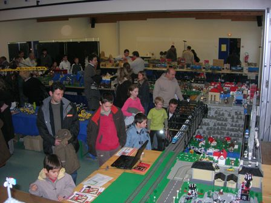

**Vue générale**

## Le déroulement :

Le vendredi soir, Jean et moi-même avons fait un premier tour pour apporter les éléments complémentaires aux moyens logistiques déjà mis à notre disposition par l’organisateur "Le club des Roussettes" (Les Roussettes sont des petits beignets spécialité locale).

Quatre tables "FreeLUG" ont été adjointes aux 14 tables standards pour compléter la surface de notre diorama.  
La vitrine du concours a été mise en place avec ses accessoires (parasol LEGO, éclairage).

La froideur de ce samedi matin 17 novembre n’a pas entaché la féroce volonté des premiers Freelugiens qui, dès 8 heures, ont commencé l’installation de leurs modules.

Les premières heures de la mise en place ne laissaient pas présager un aboutissement dans les délais, mais le défi de la fin d’installation avant 14 heures a été brillamment gagné. Félicitations à tous !

## Nos présentations

Trois nouveaux venus ont fait leurs premières armes en exposant de belles réalisations

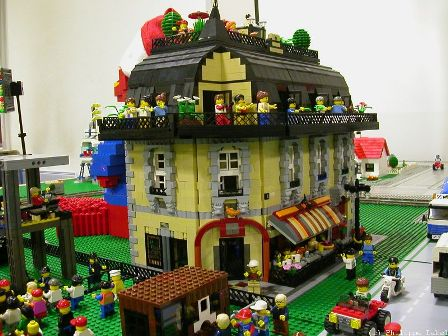

**Daniela avec une maison particulièrement réussie**

.

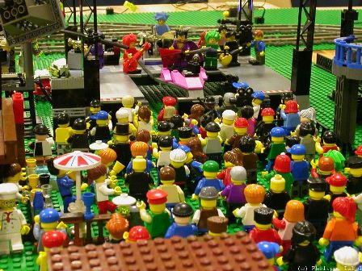

**Sylvain (9 ans) et son concert en plein air**

.

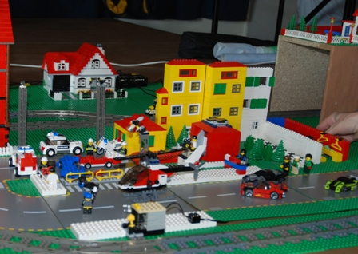

**Florian (11 ans) et sa scène de tournage de cinéma "l’accident"**

Jean a fourni un stade de football "de campagne".

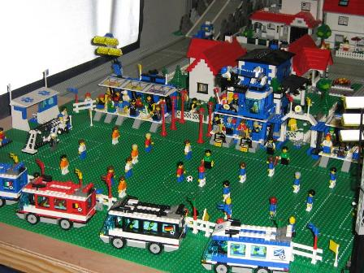

**Module de Jean**

Philippe (Frogleap) a animé l’ensemble de notre présentation avec la gestion en DCC d’un réseau de voies ferrées développées d’environ 86 m, auquel chacun avait contribué (d’après le logiciel TrackDesigner que nous avons utilisé pour le plan du stand, il y avait 535 rails droits, 90 rails courbes et 23 aiguillages). Trois rames circulaient simultanément, et une dizaine étaient présentées sur les voies d’arrêt en attente de partir sur le réseau.

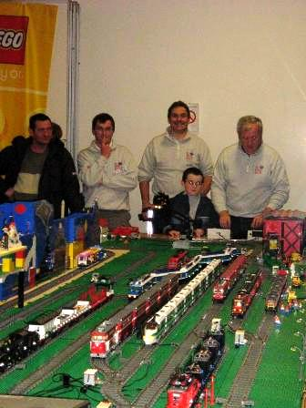

**Module de Philippe**

La louma de Sébastien prenait sa place près de la gare de triage de Philippe.

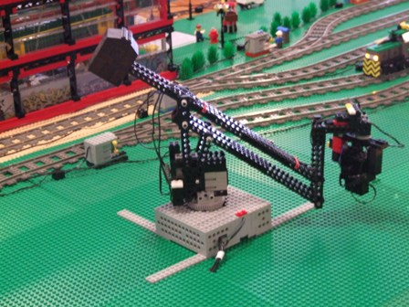

**Module de Sébastien**

Gilles (Gmi) a présenté son ensemble de scénettes "à travers les âges".

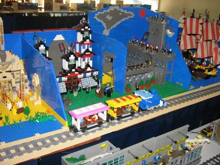

**Module de Gilles (partiel)**

Nicolas et Christophe ont installé leur module de ville, vallée et ponts.

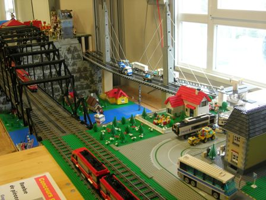

**Module de Nicolas et Christophe (Partiel)**

Didier (Qdm) a réalisé un module moyen-âge / fantastique animé.

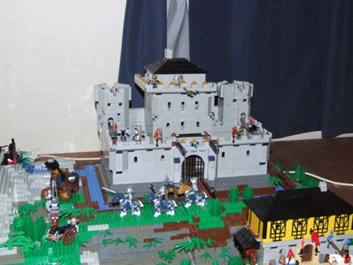

**Module de Didier (Partiel)**

Jérémy (Thaaz) & Nelly proposaient une ville en milieu ferroviaire. Pour sa première exposition, Nelly a monté la Tour Eiffel et habillé la gare de passagers et l’atelier de maintenance de Jérémy avec le corner café, le market street, le parc et la course cycliste. On y trouvait également une station service et quelques maisons.

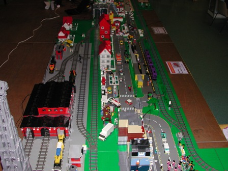

**Module de Jérémy**

Denis (DenisL) réinstallait son funiculaire, son moulin à papier et ses nouveaux manèges (fête foraine et équestre), le tout animé comme il se doit.

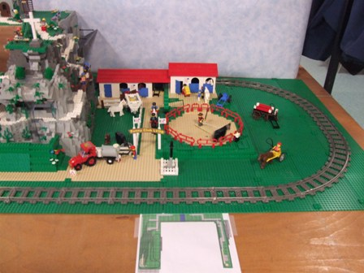

**Module de Denis (Patiel)**

Enfin, Philo nous a également apporté quelques robots de sa collection et bien sûr des modules de Bidule à balles.

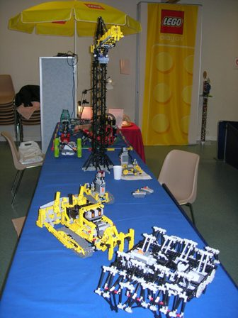

**Table de Philo**

Le samedi après midi s’est déroulé sans encombre avec son lot de petites finitions. Les premiers 250 visiteurs ont défilé médusés.

Le samedi soir fût l’occasion de partager un repas en commun avec les autres exposants.

Comme à l’habitude, c’est le dimanche à partir de 15 heures que la grosse foule fît son apparition. De nombreuses félicitations nous ont encouragés et motivés pour de futures exhibitions.

## Le concours :

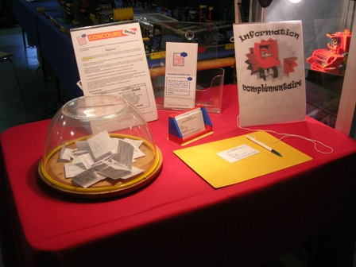

Un concours visant à deviner le nombre de pièces de la moissonneuse batteuse de DenisL a été organisé et a recueilli un franc succès.

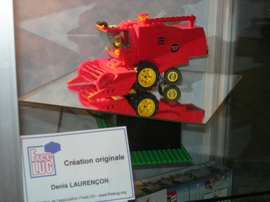

Ce MOC comportait 275 pièces dénombrées après démontage du modèle, le dimanche en fin d’exposition et en public.

Une personne a trouvé le nombre exact.

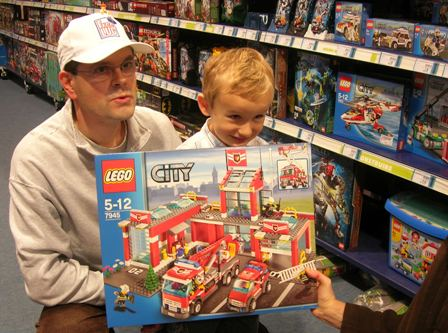

Bravo à Corentin qui remporte le gros lot : la boîte 7945 offerte par le magasin Oxybul de Ballainvilliers (91).

## Bilan :

En conclusion, toujours la même joie de se retrouver et de partager notre passion.  
**–** Merci à tous pour cette nouvelle belle expérience.  
**–** Merci aux organisateurs du salon.  
**–** Merci au magasin Oxybul  
**–** Merci aux visiteurs Freelugiens.  
**–** Merci aux visiteurs anonymes.

Bienvenue aux nouveaux adhérents qui ont souscrit à l’occasion de cette manifestation.

Nous avons rendez-vous dans deux ans !

Et un grand merci également à Denis (DenisL) pour nous avoir organisé encore une fois cet évènement de main de maître.

Pour plus de photos :  
**–** [Photos de Philippe](http://gallery.freelug.org/main.php/v/Frogleap/ExpositionsLego/2007-La-Ville-Du-Bois/)  
**–** [Photos de Didier](http://gallery.freelug.org/main.php/v/La-Gallerie-de-qdm/Expositions/2007-La+Ville+du+Bois/)  
**–** [Photos de Sébastien](http://www.brickshelf.com/cgi-bin/gallery.cgi?f=285995)  
**–** [Photos de Jérémy](http://www.brickshelf.com/cgi-bin/gallery.cgi?f=286494)  
**–** [Photos de Denis](http://photos.freelug.org/main.php/v/dlaurencon/LVDB+2007/)  
**–** [Photos de Philo](http://photos.freelug.org/main.php/v/philo/lvdb2007/)
