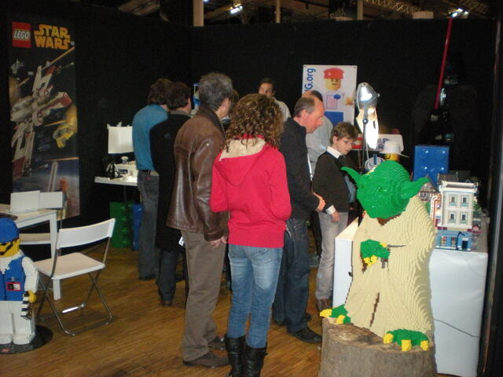
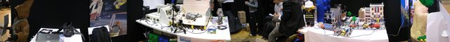
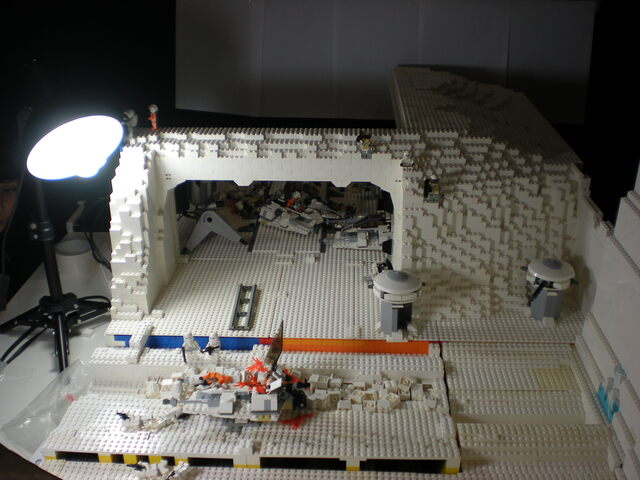
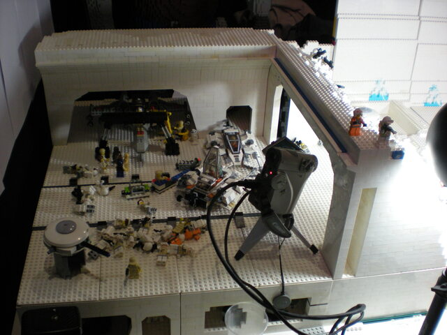
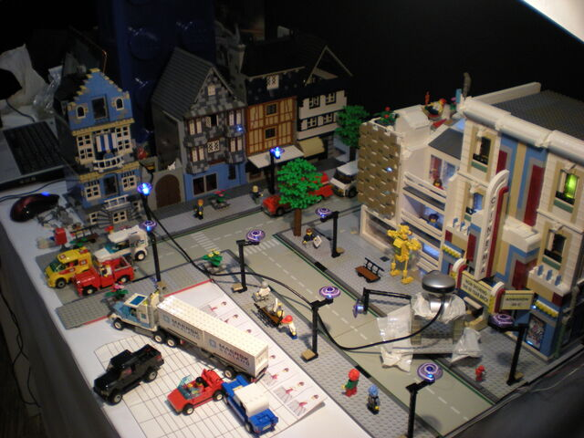
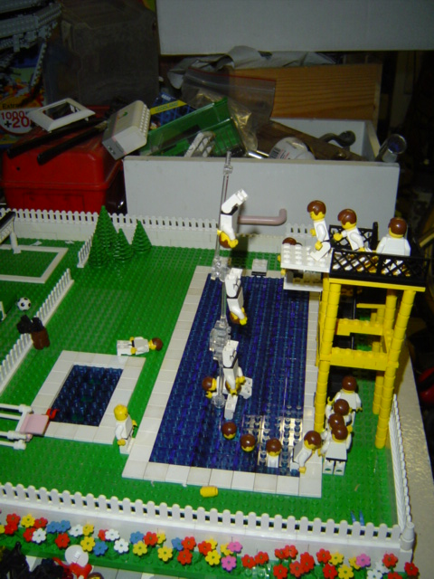
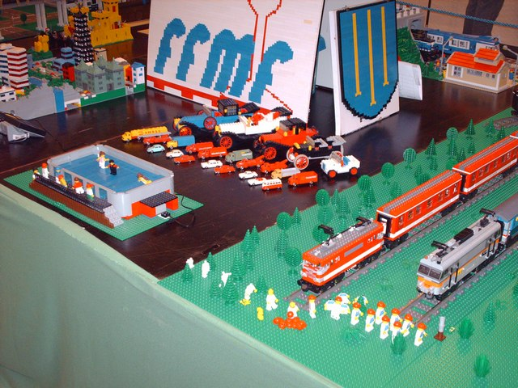

Le Salon du Cinéma se tenait du 16 au 18 janvier 2009 à la Grande Halle de la Vilette à Paris.

Nous avons participé à ce salon sur le stand que LEGO France a mis notre disposition (car il n’y avait pas de stand gratuit) ainsi que quelques sculptures StarWars.

**Quelques visiteurs sur notre stand.**

Voici d’ailleurs le panoramique du stand :

**Le panoramique du stand**

Le but pour nous était de produire des décors sur les thèmes StarWars et ville, afin de pouvoir animer un petit stand de _stop motion_ (film d’animation image par image) durant tout le weekend.

Nous avions donc un petit stand avec deux dioramas :  
**–** un diorama StarWars autour de thème Hoth (un bout de base et un champ de bataille)

**–** un diorama ville comprenant une rue en T

Il était prévu de faire participer le public à la réalisation de brickfilms. Le diorama ville fut utilisé pour cela, ce qui a fait la joie de nombreux enfants pouvant soit voir comment se fait un brickfilm, soit même participer à sa réalisation.

D’un autre côté, une petite équipe tournante d’exposants a réalisé un brickfilm avec le diorama Hoth, en improvisant totalement le scenario. Le résultat est plutôt réussi compte-tenu de l’improvisation totale, du fait que beaucoup d’entre nous était débutant et des contrainte environnantes (écran géant juste au dessus apportant quelques difficultés d’éclairage...)

[Vidéo de la publication d’origine](http://videos.freelug.org/uploads/KnLbaymbqAiJJkIJUbDL.flv)

Nous avons aussi découvert l’utilisation du logiciel [TVPaint](http://www.tvpaint.com/) mis a disposition par Eric et Patrick (il ne fait pas que de la stop-motion) qui est très pratique d’usage.

Comme nous étions au Salon du Cinéma, nous avons aussi réalisé un petit film d’une journée sur le stand en deux minutes. Au contraire d’un film en stop motion, ici nous ne prenions qu’une image toutes les 4 secondes :

[Vidéo de la publication d’origine](http://videos.freelug.org/uploads/kb5Dk1YuCsIjp2BtF54v.flv)

Ce salon fut très fréquenté, avec 80000 visiteurs dans le week-end et nous a permis d’avoir quelques contacts intéressés par d’autres expositions de ce type et même la visite des organisateurs de la Japan Expo qui sont aussi très intéressés par une animation stop-motion lors de la prochaine Japan Expo. Bref une exposition originale dans laquelle nous avons eu un bon succès.

Merci aussi à Bertrand de LEGO Fr pour sa bonne humeur et sa capacité à attirer les invités de la soirée d’inauguration sur notre stand, mais aussi pour la mise à disposition des sculptures qui ont contribué au succès du stand (n’est-ce pas Dark Vader ?).

* * *

## Le mot d’Erik

Voila, cela faisait plus de 3 ans que je ne m’étais plus essayé à la stopmotion. Et bien, faire ça à plusieurs, c’est vraiment sympa, pas de sérieux, tout en improvisation totale, et surtout la possibilité de se répartir l’animation de nombreux éléments simultanément, ce qui évite les oublis... Et puis quand on a le matériel adapté, c’est bien plus facile.

Bref, ça me donne envie d’investir et de m’y replonger, si j’avais le temps... mais en tout cas, c’est une expérience à renouveler pour de futures rencontres ou expositions !

* * *

## Le mot de Gilles

Cela fut très sympa de faire de la stop motion. Je voulais aussi en faire depuis très longtemps (même avant de reprendre les LEGO).

Depuis le salon je me suis rappelé que j’en avais presque fait mais sur une seule image (plutôt de la cinématique) pour la Ville du Bois 2005 :

**Cinématique**

Puis à Skaerbaek 2006 (fait en "live" sur l’exposition avec des personnages achetés dans le vrac)

Mais aussi lors de la construction de la Death Star :

[Vidéo de la publication d’origine](http://videos.freelug.org/uploads/wZsjGcjRKvlPkysjopED.flv)

Je ne me rappelai même pas avoir mis une minifig.

Nous n’avons pas eu une productivité très importante.  
C’est normal car il faut beaucoup de temps même à 10 images seconde... Plus un peu, beaucoup, voir énormément de discussions entre nous, et aussi avec le public souvent très intéressé.

Il fallait aussi de temps en temps modifier les décors, surtout le mur blanc de fond et de temps en temps l’AT-AT de JLB...

Pour moi le salon a commencé le samedi (car travail le vendredi) où j’ai regardé un peu les habitués faire.  
Et le dimanche où je me suis un peu plus lâché quand les autres laissaient un peu la place. Au début il n’est pas facile de trouver des idées de scènes mais au fur et à mesure, grâce à l’émulation des autres et que l’on a mis la main dans l’engrenage ça fuse plus.

Un grand merci à Jean-Yves qui a occupé énormément les enfants pour la stop motion city. Ainsi que pour ses conseils, on voit qu’il avait déjà pratiqué la stop motion.

Expérience à recommencer sans problème, de plus cela change des trains ;-).

Quelques vedettes sont passées devant le stand (il y avait le stand photos-presse en face). Mais la plupart des fois le temps que je réagisse et que j’allume le caméscope ils étaient partis.

* * *

## Le mot de Jean-Yves

Je fais parti de l’association voilà maintenant quelques années et pourtant c’était ma première participation à une exposition FreeeLUG.

Il est vrai que ma motivation première pour les LEGO est la stop-motion, mais pendant pas mal de temps j’ai hésité entre l’animation des petites briques ou de la pâte à modeler, aujourd’hui mon choix est fait ce sera les LEGO ! (j’entends d’ici un grand OUF de certains que j’ai horrifiés en mélangeant, oh infamie suprême ! les briques et la pâte !).

Pour le salon j’ai commencé à animer sur le superbe décor SW de Gilles et JLB. Car il faut dire que pour moi, chaque fois que je vois un beau décor réalisé par les AFOLS je pense "quel dommage que je ne puisse faire de la stop-motion avec !" et bien cette fois-ci ce fut possible, merci donc aux constructeurs !!

Ensuite je me suis mis à animer des plans très simples sur le décor city avec une webcam et avec la participation des jeunes visiteurs. Ils m’ont surpris par leur capacité d’attention et leur inventivité.

J’avais déjà fait de l’animation chez moi avec des copains et aussi pour un centre de vacances, et à chaque fois j’ai appris quelque chose de nouveau, des astuces ou du matériel. Le salon du cinéma n’a pas fait exception à la règle, puisque j’ai découvert le logiciel TVPAINT avec un de ses développeur en la personne d’Eric Matecki et j’ai été surpris par l’éclairage de qualité grâce aux lampes "froides" de Brickerik.

En conclusion je dirais qu’il en va de la stop-motion comme des autres activités à FreeLUG, le plaisir vient du partage et de l’échange, alors "on recommence quand ?"

* * *

## Le mot de Pierre

Comme beaucoup de mes camarades du week-end, j’ai découvert la stop-motion en LEGO sur le salon du cinéma. C’est une expérience très plaisante, surtout à travers le partage que nous avons fait avec le public.

Jean-Louis nous a apporté une très belle base de Hoth qui nous a permis de nous essayer à cet art peu évident de la réalisation "image par image". Et je pense que nous pouvons être fiers du résultat !

Jean-Yves a aussi fait un travail formidable avec le "plateau" City qui a permis aux plus jeunes de nos visiteurs de se mettre dans la peau de réalisateurs en herbe !

Pour finir, merci à Jean-Louis de m’avoir hébergé durant ce salon et un grand merci à tout mes camarades exposants ou visiteurs pour avoir pu partager ce bon moment de convivialité.

* * *

## Photos

**–** [Photos d’Erik](http://photos.freelug.org/main.php/v/brickerik/expositions/2009/SalonCinema2009)
