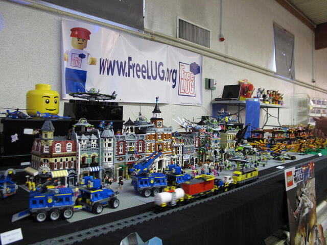
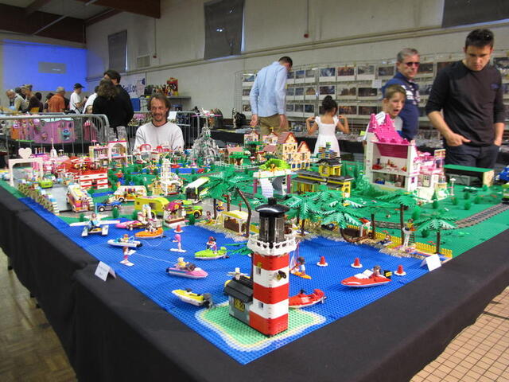

Le deuxième salon du jouet de Saint-Berthevin a eu lieu les 25 et 26 août 2012.

Suite à la bonne édition de 2011, la mairie nous a déménagés afin de doubler notre surface au parc exposition de Saint-Berthevin de 600 mètres carrés avec peut être dans l’avenir une possibilité de développement car le complexe possède d’autres halls.

Nous avons eu la chance d’avoir un soutien de vous tous FreeLUGiens qui se sont déplacés pour nous voir mais également un soutien moral de Festibriques qui a téléphoné pour nous encourager.

Nous avons fait 850 entrées et avons des pistes pour améliorer une future édition. Nous aurons la même salle pour l’édition 2013.

## Galeries photos

**–** [Photos de Gilles](http://photos.freelug.org/main.php/v/FIRE+GARDEN/st+berthevin+2012/)  
**–** [Photos d’Erik](http://photos.freelug.org/main.php/v/brickerik/expositions/2012/StBerthevin/)
