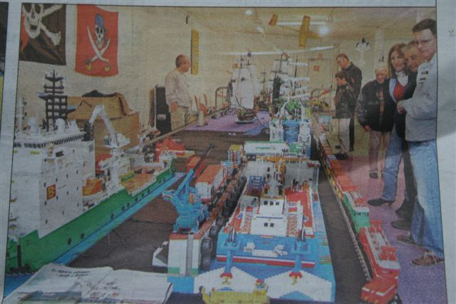
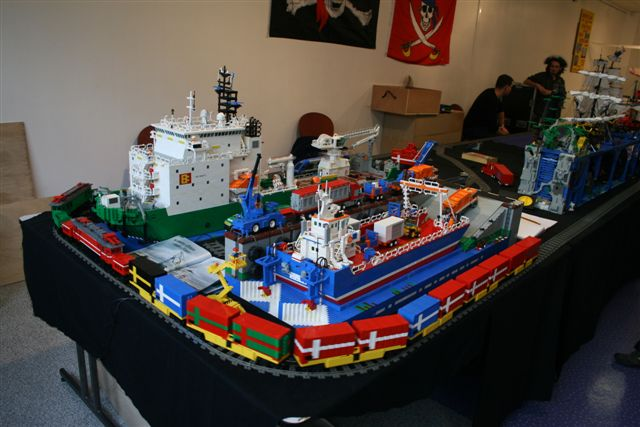
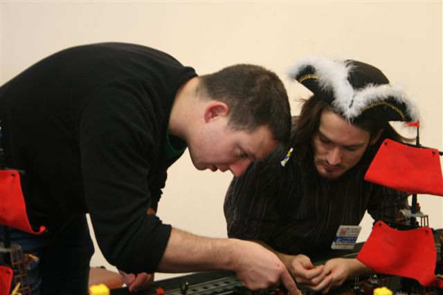
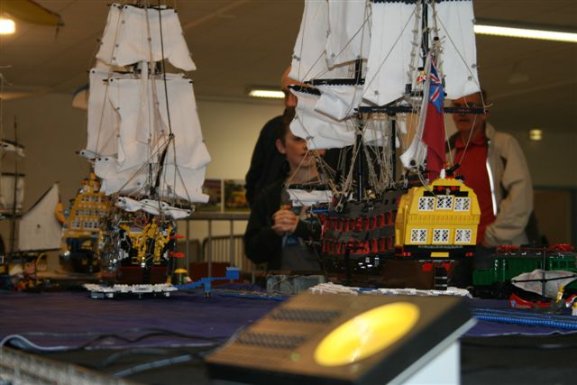
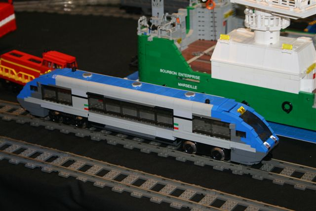
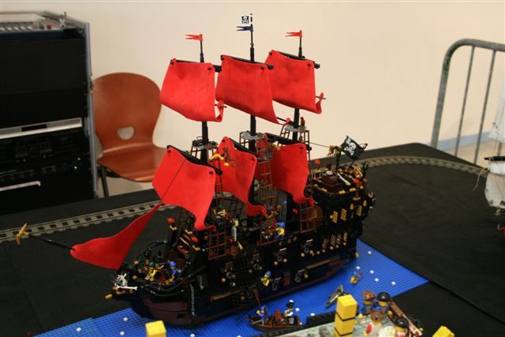

Seconde édition du salon de la maquette du Relecq-Kerhuon pour ma part, aux côtés des bateaux de Jean-Marc ; le weekend fut riche en casses, en imprévus, en dégringolades et en bricolages, l’occasion de faire le point et les rectifications avant le grand Cholet qui avait lieu le weekend d’après.

Grand succès auprès du public, surtout le dimanche après-midi, et l’exposition fut également l’occasion de faire la rencontre d’un nouveau membre constructeur de bateaux pirates, suffisamment rares dans les LUGs pour le souligner, en la personne de Richard.

Rendez-vous fut également pris pour une éventuelle fête de la mer à Landerneau et pour l’édition 2012 de Sainte-Catherine.

Un grand merci de nouveau à l’équipe de l’organisation, toujours aussi accueillante !

Laurent & Bruno

_Laurent_

* * *

Salut,

Pour cause de Kidexpo 2009 à Paris et Cholet 2009, 2 weekends consécutifs hors de chez moi, je n’ai donc pas pu honorer ma présence au grand dam des organisateurs en 2009.

Cette année, le salon est revenu à la charge, en 15 jours, le stand FreeLUG était complet avec une surface de 9mx1.60m.

Nous avons donc installé nos belles et uniques collections.

Pour Laurent, sa fabuleuse collection de bateaux.

Le stand Technic a brillé par son absence pour raison professionnelle et familiale.

Pour moi :  
**–** le Bourbon Entreprise,  
**–** la barge animée de l’ile de Batz,  
**–** un simple réseau de train d’une vingtaine de mètres avec mes rames de conteneurs et la rame de secours SNCF,  
**–** mes locomotives allemandes et un TER Bretagne sans stickers.

J’ai laissé Laurent étaler sa flotte qui a reçu un prix du jury.

Merci à Richard qui a exposé un galion le dimanche.

En conclusion, 3000 visiteurs sont venus nous voir, le salon nous a remerciés pour la qualité de notre prestation, et surtout, pour le record de fréquentation.

Sans LEGO, moins de visiteurs à cause de l’érosion du milieu de la maquette.

Pour 2012, nous ferons mieux...  
FLASH !...le salon est d’accord pour doubler la surface de 2011...FLASH !

_Jean-Marc_

[Galerie photos](http://photos.freelug.org/main.php/v/barr__/expositions/2011/relecq/)
