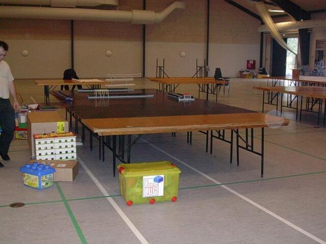
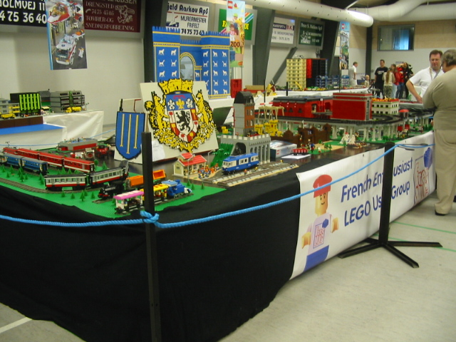
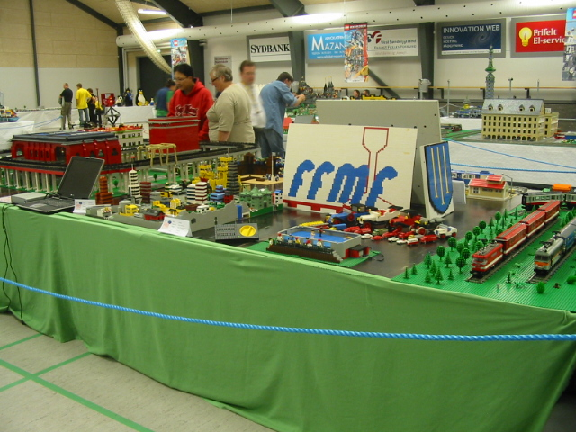
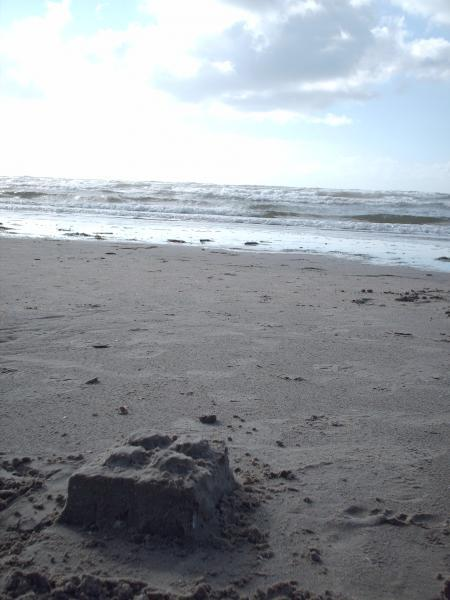
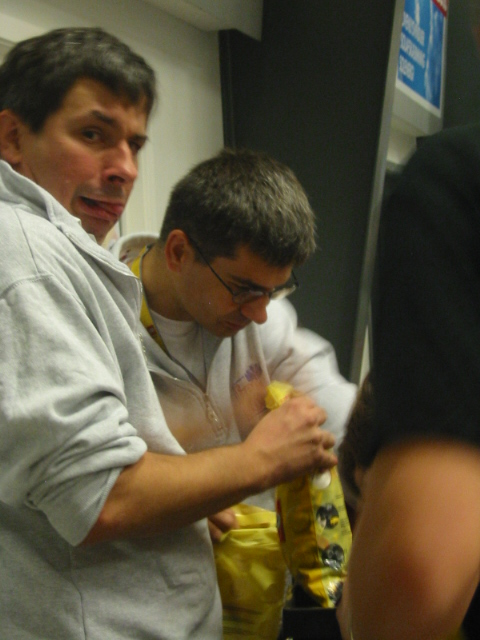
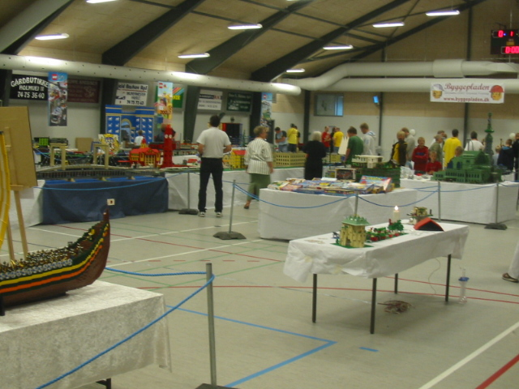
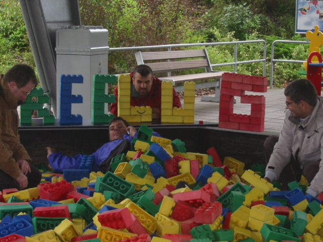

Ce week-end du 30 Septembre et 1er Octobre 2006, s’est tenue à Skaerbaek au Danemark, une rencontre internationale de fans de LEGO.  
5 membres de FreeLUG ont fait le voyage, accomplissant pour certains leur plus long trajet pour venir participer à cet événement.

Ils sont venus, ils sont tous là, même ceux venus du sud de... la France, car c’est après avoir parcouru plus de 2000Km en quelques jours, depuis la région toulousaine qu’Eric et Sylvie ont rejoint nos trois Franciliens, Eric, Gilles et Didier, pour participer à l’invitation de notre interlocuteur LEGO européen, Jan Beyer, au rassemblement de fans LEGO à Skaerbaek au Danemark.

Sur place nous avons retrouvé nos amis des clubs de Debouwsteen, de LowLUG et de 1000Steine, que nous connaissons déjà pour les avoir croisés sur de précédents rendez-vous et nous avons fait connaissance d’autres fans, notamment nos amis danois de Byggepladen, que nous remercions pour leur accueil, mais également à ceux venus d’Autriche et de Norvège, ce qui fait qu’au total, 6 nations différentes étaient représentées.

Il est vrai que derrière cette manifestation, se cache pour la plupart d’entre nous l’opportunité de prolonger un peu le séjour pour aller visiter le parc LEGOLAND à Billund et faire nos provisions de petites pièces et de grosses boîtes.

## L’exposition

Commençons donc par décrire le cadre.

L’exposition a lieu au centre ville même de Skaerbaek, le site s’appelle le Fritidscenter. C’est un complexe sportif qui comprend Bowling, piscine, terrains de basket, handball, volley-ball, terrain de football... et une cafétéria pour assurer les repas.

A proximité des petits bungalows pour l’hébergement. C’est un lieu très vivant et en même temps dans un endroit très calme, pas de bruit de voitures, pas de grands immeubles...

L’acceuil est chalereux (Tag Hanne), malgré la barrière de la langue.

Nous sommes arrivés de bonne heure, à 9h35, Jan nous rejoint vers 10h00. Il nous indique la salle et notre emplacement.

Tout est bien prévu, pas de mauvaise surprise pour les tables et la surface demandée.

**La salle**

Nous voyons arriver les autres participants et pouvons commencer l’installation de "nos chefs d’oeuvres" :)

Après le déjeuner avec toutes les personnes présentes, nous pouvons poursuivre l’installation pour la première partie de l’après midi.

Vers 16h tout est installé, nous pouvons aller faire un tour coté hébergement et faire une pause méritée ! :)

Arrivent ensuite Eric et Sylvie, à qui nous faisons découvrir les lieux. L’installation est maintenant complète, nous pouvons faire à présent le petit tour de l’exposition et découvrir les incroyables constructions présentes. Et quelles constructions !

## Le 1er jour

Samedi matin c’est le jour de l’ouverture au public, à 10h00 ils arrivent. Il y a également une deuxième salle avec un atelier de construction et avec des jeux gonflables pour les enfants.

**Stand FreeLUG**

**stand FreeLUG 2**

Le petit déjeuner s’est passé dans la salle de restauration avec les autres participants, copieux comme c’est l’habitude dans le pays.

Jan Beyer a aménagé un petit stand de vente. Et nous réserve la surprise d’avoir apporté un ensemble de pièces en vrac. Nous voilà lancés dans notre sport favori ! La journée s’annonce bien ! :-)

Le public est présent, mais sans la grande foule des grandes expositions. Cela facilite la surveillance.

L’après midi est prévue une petite journée découverte de la région. Nous allons visiter l’île de Romo et voir la mer du Nord ! Il fait beau et découvrir la plage est un régal !  
La plage est immense, sauvage et de sable fin, c’est le paradis des cerf-volants.

**La plage**

Ensuite petite visite à la pointe de l’île où il y a un embarcadère et où nous pouvons voir les ferries à quai ...

Vers 18h00 retour vers Skaerbaek pour l’exposition. Un nouveau petit tour coté stand LEGO ! :-)

La première journée s’est bien passée !

## Dimanche 2 ème Jour

Ce matin il faut se lever plus tôt, l’ouverture au public est prévue pour 9h00.

Il y a agitation coté Stand LEGO , le compte à rebours est lancé pour l’ouverture de nouvelles boites pic’n’mix et il y a foule ! Le décompte commence : 10, 9 , 8 , 7 , 6 , 5, 4 , 3 , 2 , 1 , 0 : 9h00 ! Nos petites mains fébriles peuvent se remettre au travail et remplir de nouveau les petits sacs de pièces ...

**pick n’ mix : la bataille !!!**

Vers 10h00 , nous allons profiter de la piscine couverte et du tobogan pour nous détendre.

Nous passons le reste de la journée à faire le tour des stands et à discuter avec les autres participants. Le contact passe bien, nous apprécions leurs créations et ils nous félicitent pour les nôtres avec sincérité ! :-)

**Vue générale**

Vers 18h00 la journée se termine et l’exposition également ! Ce fût une belle exposition ! Nous revoilà donc à tout redémonter ! et à tasser tout ça dans les voitures...

Mais une autre chose se prépare, un autre évènement, encore plus attendu... le LEGOLAND !

Le parc LEGO, la ville de Billund, là où tout a commencé en 1932...  
Chacun se prépare et commence de s’émerveiller sur ce qu’il va découvrir.  
La nuit va être longue...

**Legoland : on n’a pas résisté**

Les liens vers les galeries photos :

QDM :

[2006-Skaerbaek](http://gallery.freelug.org/main.php/v/La-Gallerie-de-qdm/Expositions/2006-Skaerbaek/)

[Billund](http://gallery.freelug.org/main.php/v/La-Gallerie-de-qdm/Parcs/Billund/)

CHATPIN31

[Danemark+2006](http://gallery2.freelug.org/main.php/v/chatpin/danemark+2006/)

[Exposition et LEGOLAND billund](http://www.brickshelf.com/cgi-bin/gallery.cgi?f=210431)

F1TVF

[LEGOLAND](http://gallery.freelug.org/main.php/v/f1tvf/legoland_billund/)

GMI

[Skaerbaek](http://www.brickshelf.com/cgi-bin/gallery.cgi?f=211789)

[Billund](http://www.brickshelf.com/cgi-bin/gallery.cgi?f=211810)
