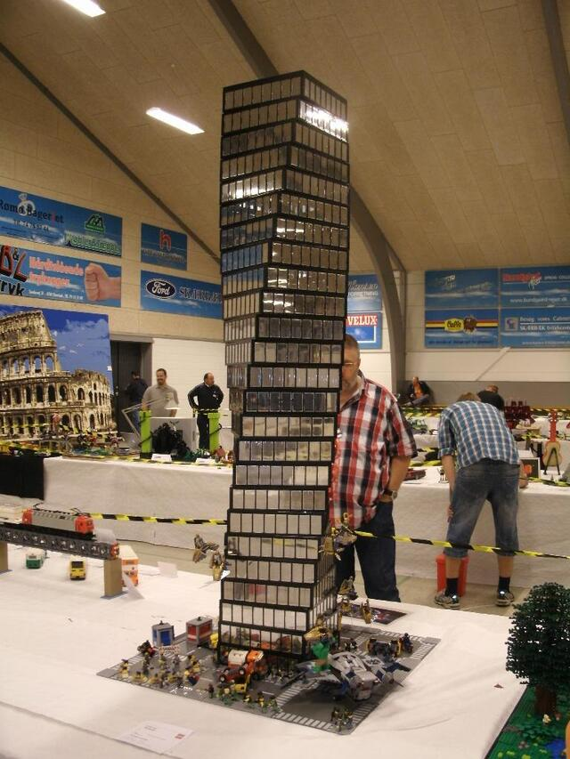
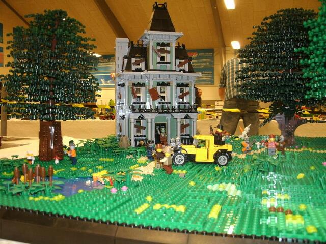
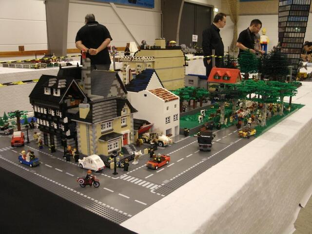
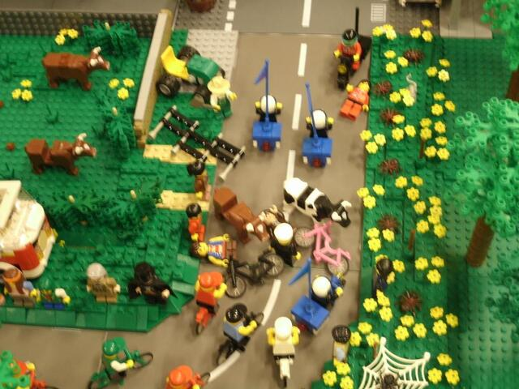
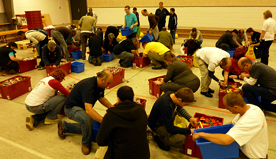
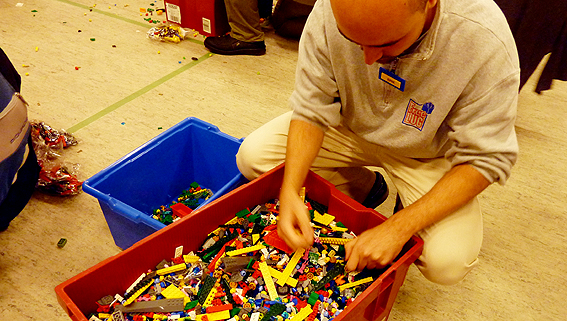
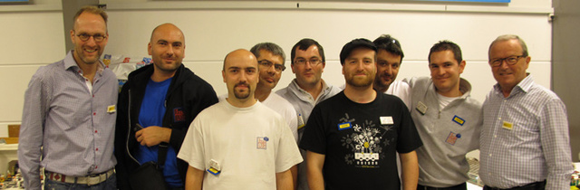

Pour notre seconde participation au LEGO Fan Weekend, nous étions 10 à représenter FreeLUG.

Nous sommes partis le jeudi matin avec une voiture et un fourgon (quasi vide à l’aller). Denis et Samuel nous ont rejoints sur place par leurs propres moyens. Après 14 heures de route nous voilà arrivés, pour prendre possession de nos logements.

Le lendemain, découverte du hall d’exposition : deux grands bâtiments accolés l’un à l’autre où il n’y aura que du LEGO... que du bonheur. Mais lors de la présentation des exposants, petit couac, ils avaient compris qu’il n’y avait qu’un exposant et non 10 mais ça c’est vite arrangé grâce à Daniela.

Nous avons présenté quatre dioramas :  
**–** Pierre avec son immeuble et les Avengers

**Immeuble et les Avengers**

**–** Manu avec la maison hantée

**la maison hantée**

**–** JLB avec sa base hoth

**–** Et nous les autres un diorama collectif représentant la France des années 60

**diorama frenchie**

Nous y avons inséré le Tour de France d’Eric

**tour de france**

Nous avons fini notre séjour par une visite du parc Legoland de Billund.

* * *

Grâce à un désistement de dernière minute dans le groupe initial, j’ai pu profiter de l’occasion pour aller voir cette grande exposition 100% LEGO au royaume de la Brique.

Je ne suis pas déçu par tout de qui est présenté de la petite vignette à 25 briques jusqu’à l’immense layout du LUG local (avec une véritable buvette sous leur montagne de 3m de haut...).

Mais le plus Homérique fut sans aucun doute l’opération ’caisse bleue’ du vendredi soir ; un grand moment :

_cdhd_

* * *

Cette exposition est un vrai truc à faire. Trouver 340 exposants d’environ 40 pays différents est tout simplement génial. Beaucoup de rencontres internationales et des mocs à ne plus savoir où regarder en premier. Il m’a fallu les deux matinées (hors public) pour faire des photos et pouvoir discuter. Et oui, je n’étais pas souvent au stand. Le voyage nous a permis de finir au parc LEGOLAND et nous avons eu de la chance puisque c’était la seule journée où la météo était clémente. Les soirées entre AFOL’s sont mémorables aussi. Les habitués de cette exposition organisent des fêtes autour de leurs bungalows et invitent les autres pour participer. Bref, à refaire en tout urgence.

_Daniela_

* * *

Après avoir participer au LEGOWorld à Zwolle, je me suis laissé tenter par l’aventure. Petite participation pour ma part, j’ai construit une unique maison pour le diorama des années 60.

Et donc pour l’exposition, il y avait beaucoup à voir, prendre en photo... De nombreux pays représentés... Quelques animations pour les AFOLs et quelques déductions...

La soirée du samedi soir a été sympa avec la présentation de l’Horizon Express en présence du designer. Le dimanche, nous avons vu passer Jorgen Vig Knudstorp et Kjeld Kirk Kristiansen.

Et les jours suivant nous avons fait durer le voyage sur Billund pour voir le siège de LEGO, la maison où tout a commencé... et forcement le parc.

Comme pour toutes les grosses expositions, c’est à faire !

_Pierrolego_

* * *

Je remercie Jean-Yves (je crois, qui s’est désisté) ce qui m’a permis de participer à un évènement à faire. C’était pour moi une première et donc forcement magique malgré des couacs. J’espère participer à d’autres évènements car être ouvert au monde ne peut être que bénéfique. Cela m’a donné envie de visiter d’autres évènements, peut-être d’organiser un nouveau séjour dans un autre pays... Merci malgré tout à Daniela.

_Samuel_

* * *

manque Daniela, Samuel et Denis parti dans les briques ou les mocs...

## Galerie photos

**–** [Photos d’Eric](http://photos.freelug.org/main.php/v/f1tvf/expositions/skaerbaek2012/)  
**–** [Photos de Sébastien](http://photos.freelug.org/main.php/v/sebhamon/2012/Skaerbaek/)  
**–** [Photos d’Erik](http://photos.freelug.org/main.php/v/brickerik/expositions/2012/Skaerbaek/)
