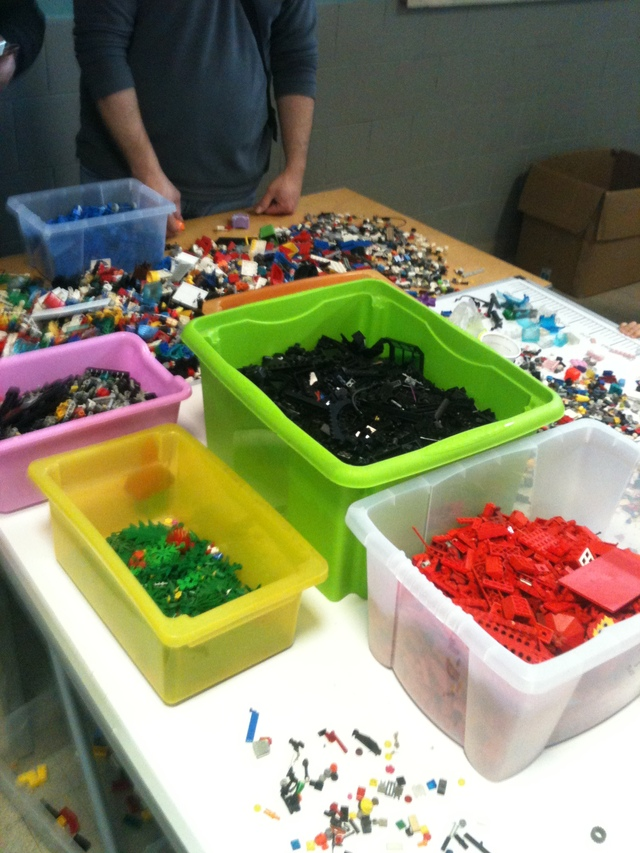
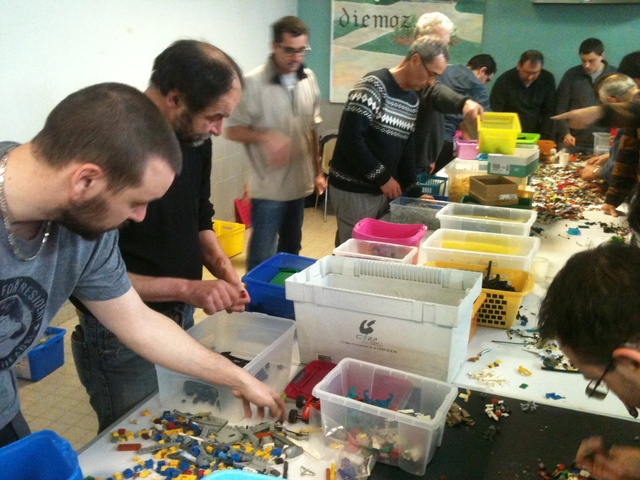
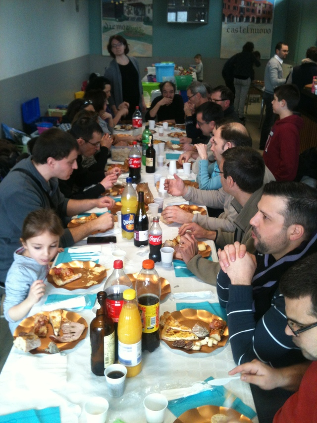
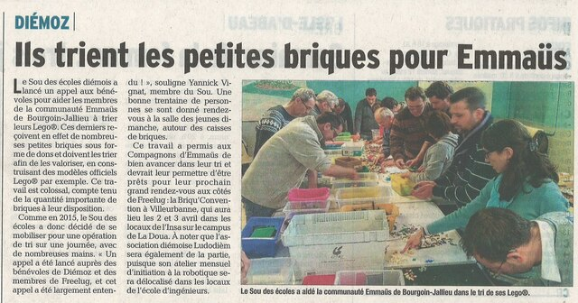

Samedi 27 Février, une nouvelle journée de Tri LEGO a été organisée avec les bénévoles du Sou des Ecoles de Diemoz, les compagnons et bénévoles de la [communauté Emmaüs de Bourgoin Jallieu](http://www.emmaus-bourgoin.org/) et les Afols lyonnais (membres de FreeLUG ou autres).

De nombreuses personnes ont répondu à l’appel et sont venues apporter leur aide à trier les nombreuses caisses de vrac qu’Emmaüs proposera ensuite à la vente, notamment lors des événements LEGO organisés par FreeLUG dans la région lyonnaise.

**Caisses de Vrac**

Les précédentes journées de tri étaient organisées chez Emmaüs, à Bourgoin, en plein air. Mais cette fois, compte tenu de la date hivernale, c’est à Diemoz, dans la salle des jeunes que tout ce beau monde s’est donné rendez-vous.

**Afols, bénévoles et compagnons au travail**

Ces journées sont toujours aussi agréables, l’occasion de faire de belles rencontres, et de conjuguer l’utile à l’agréable.

Outre les nombreuses pièces LEGO, les bénévoles ont pu compter aussi sur le traditionnel casse-croûte.

**Le casse-croûte**

Enfin, cette fois encore, cela a été relaté dans la presse :

**Article paru dans le Dauphiné Libéré**

Vivement la prochaine.

Yannick/Yannoch06.

* * *

C’était une belle journée, bien sympathique, dans une salle pleine à craquer d’AFOL et de LEGO. J’ai pu découvrir tout un tas de pièces que je ne connaissait pas. Merci.

Nicolas.

* * *

J’adore trier. Je suis sans doute un grand malade... ;-)  
Ces sessions de tri, ajouté au fait que c’est pour la bonne cause, permet de retrouver des têtes connues, notamment celles des membres du Sou des Écoles de Diemoz qui ont largement contribué à ce que les deux éditions de la BRIQU’Expo Diemoz soient des succès. Encore merci à eux.

Trier c’est aussi découvrir des pièces dont on ignorait l’existence, avec la désormais classique question : "Euh... C’est LEGO, ça ?" qui fuse de toute part. Oui parce qu’il s’agit aussi de séparer le bon grain de l’ivraie, voyez-vous... Des briques de mauvaise lignée se sont mêlées aux dignes représentantes de la célèbre marque danoise. Les pièges sont monnaie courante. Parfois il faut vraiment avoir de bons yeux !  
Je participerai volontiers aux prochains tris.

Jérôme (jivé69)

* * *

C’est avec plaisir que j’ai aidé à trier. Plaisir de revoir les bénévoles et les afols, de plonger les mains dans ce qui semble une addiction. Y découvrir des voyages vers des gammes LEGO mal connues. Des voyages dans le temps aussi car tout se côtoie.

Et puis surtout ne pas oublier que le LEGO on peut y jouer seul chez soi mais que je ne le conçois que dans le partage. Vecteur de dialogue humain tant en expositions que dans ce beau partenariat pour valoriser les collectes Emmaüs.

Souhaitons de belles ventes aux bénévoles :)  
Je reviendrais donner un coup de patte avec plaisir.

Thierry / Lejigabou
