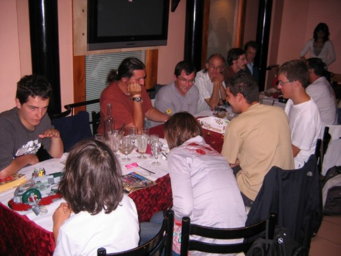
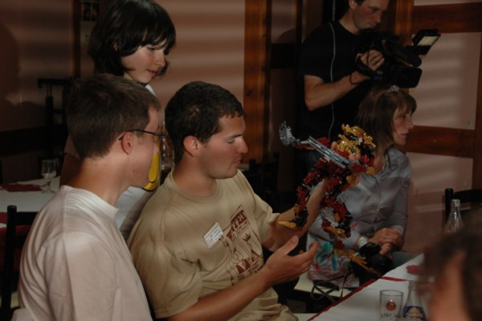

Aprés Quimper en 2007 avec Ronan et Juliette, Brest en 2008, Port Launay en 2009, le restolego a fait escale, de nouveau, à Quimper sous la houlette de Ronan, coordinateur local ce mardi 17 août.

Cette année, la rencontre finistérienne a connu une affluence record et exceptionnelle, 17 personnes étaient à table.

Parmi les personnes, en plus des locaux (moi, Mickael, Ronan, mon prez de la maquette Pierrick, Martine), des bretons expatriés (Sebastien, Pierre, Etienne) en vacances dans la région) nous ont fait l’amitié de venir.

Signalons la présence surprise de Daniela et des 2 Sylvain, saluons au passage Erik, un nouvel adhérent et la famille Duvert.

Ce restolego a eu un petit gout spécial avec la présence d’une caméra de télévision qui n’a absolument pas troublé les invités fort occupés par les futurs projets, les sorties de sets, etc.

En conclusion, je remercie toutes les personnes qui ont répondu à notre invitation, prochain restolego : Morlaix 2011.

_Jean-Marc_

* * *

Bonjour,

Comme le dit Jean-Marc, nous avons passé un très bon moment. Bretons, bretonnants, sympathisants, nous nous sommes régalés d’histoires de briques et... de briques.  
Merci à tous ceux qui ont fait le déplacement, il en manquait quelques-uns qui devront se libérer la prochaine fois.

RDV à Morlaix !!

_Ronan_

* * *

Ce fut un agréable moment de retrouver les FreeLUGien(nes) avec chacun des attaches en Bretagne. Nous avons pu découvrir un des nouveaux jeux de société de LEGO que Pierrolego avait ramené.

_Seb_

* * *

Même en vacances, on fait du LEGO ! J’ai donc profité de ce resto pour ramener le bulldozer TECHNIC 8265, le Slave I 8097 ainsi qu’un nouveau jeu de société LEGO Orient Bazaar. Donc il y avait des LEGO sur la table, et ça circulait. Il y avait même du BIONICLE ramené par Erik. Nous avons donc dicuté, parlé LEGO...

Sinon, un bien agréable repas passé en compagnie d’AFOLs. Vivement les prochaines vacances !

_Pierre LAURENGE / Pierrolego_

* * *

Après [Lyon](/articles/le-10-janvier-une-bande-d-alfreds-envahit-un-restaurant-a-lyon/), [Saint-Etienne](/articles/brouhaha-lego-au-club-des-5/) et [Clermont-Ferrand](/articles/des-afols-a-l-indian-saloon/), je me suis trouvé au resto de Quimper avec mon frère et de nombreuses nouvelles têtes. Ce fut agréable de parler de ma passion avec un journaliste très attentif. Notons quand même que les pizzas étaient bonnes.

Comme on le dit à chaque fois : " Vivement le prochain".

_Etienne LAURENGE / Kitfisto_

* * *

Pas vraiment une visite surprise car je savais que je serai en Bretagne avec Sylvain fils mais il était incertain, si Sylvain (le père) pourrait nous rejoindre. Un bon resto avec beaucoup de briques et des énormes pizzas. Sylvain fils était en admiration devant le Bionicle fait par Erik. Merci à Ronan et Jean-Marc pour cette initiative et à la prochaine pour nous aussi.

_Daniela et les deux Sylvain_

* * *

Première participation à une manifestation de FreeLUG : malgré un temps un peu pluvieux, j’ai passé un très bon moment à Quimper grâce à l’association. Merci encore à tous !

_Erik B_

## Photos

**–** [Photos de Jean-Marc](http://photos.freelug.org/main.php/v/barr__/rencontres/Resto2010/)  
**–** [Photos de Daniela](http://photos.freelug.org/main.php/v/Daniela+et+Sylv1/Rencontres/Resto+Quimper+2010/)  
**–** [Photos de Sébastien](http://photos.freelug.org/main.php/v/sebhamon/Restolego+Quimper+aout+2010/)  
**–** [Photos de Xavier](http://photos.freelug.org/main.php/v/XavierD/Resto+Quimper/)
