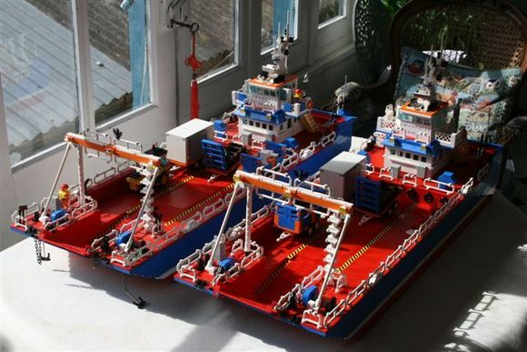

Le 18 juin dernier (ce n’est pas l’appel du Général De Gaulle !) a eu lieu la livraison de la deuxième maquette de la barge en LEGO au Commandant de la vraie barge.

Petit retour en arrière.

Le 12 août 2008, en présence du Commandant, la presse locale fut conviée pour la présentation officielle de ma barge. L’accueil fut très positif, à tel point que le Commandant voulait l’acheter immédiatement.

Evidemment, j’ai refusé à cause des salons de la rentrée à venir.

Toujours très intéressé, je lui ai proposé de refaire une deuxième maquette en fonction de ma disponibilité et de me payer en conséquence, banco de sa part.

La construction de la maquette fut très longue à cause des pièces à chercher, du montage (de mémoire), du démontage pour chiffrer le coût final (du dollar en euro) et, enfin, du remontage final.

Ce genre de travail, je ne le referai pas, c’est trop compliqué.

Après coup de fil au Commandant très excité, je lui ai remis en mains propres la fameuse maquette, cette dernière a traversé le chenal qui sépare l’ile du continent sur le dos du grand frère. La mer était belle, ouf !

Quinze jours plus tard, profitant d’une excursion sur l’ile, je suis allé voir ma maquette au siège de la compagnie, pas de problème !

Un service après vente est toutefois prévu, sait-on jamais quand c’est du LEGO, je n’ai rien collé !

Signé le papa de la barge,  
Jean-Marc, architecte naval en LEGO

[Galerie de photos](http://photos.freelug.org/main.php/v/barr__/creations/barge_ile_batz/)
