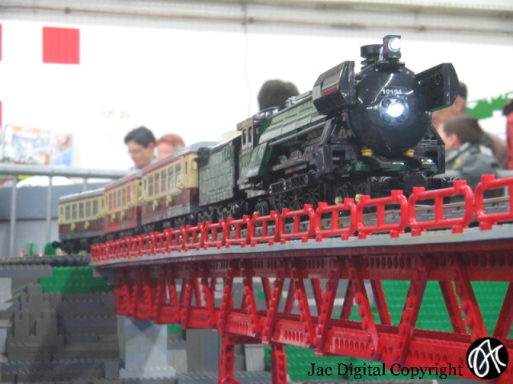
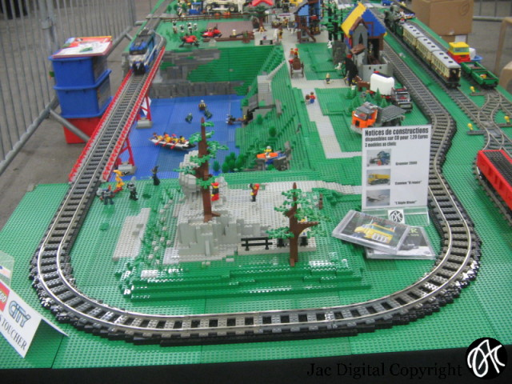
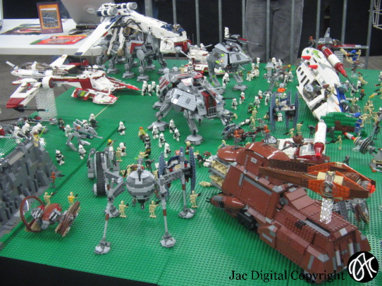
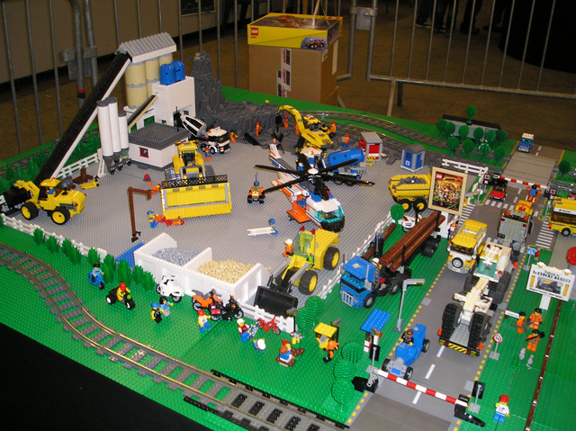
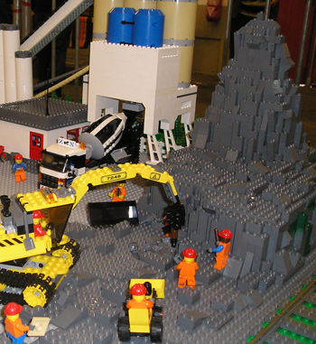

Pour ma dernière exposition de l’année, rendez-vous était pris à Cournon d’Auvergne (63) les 14 et 15 novembre, avec Pierre et Etienne, pour présenter un petit réseau et une scène de bataille Star Wars. Nous avons tous les trois répondu à l’invitation des clubs de modélisme ferroviaire clermontois.

On ne pouvait pas faire la même longueur de rails qu’à [Saint-Rambert](/articles/une-lgv-lego-a-saint-rambert-xve-exposition-adimin/). Du coup, nous avons orienté notre réseau sur l’ancien et la vapeur. Nous en avons profité pour tester les facultés de traction de la nouvelle machine à vapeur LEGO ([10194](http://guide.lugnet.com/set/10194)). Pierre avait pris la sienne, motorisée comme indiqué dans la notice, et j’avais apporté mes deux voitures voyageurs supplémentaires. Ce qui faisait un beau petit train. Tellement que le public ne croyait pas que c’était du LEGO. Il a fallu souvent sortir le catalogue du Shop, seul endroit où ce train est vendu, pour le prouver.

**Le train vapeur sur le viaduc.**

Nous nous sommes bien amusés à prendre des photos. Par contre, la voie doit être très bien placée. La moindre bosse, et les roues pédalent dans le vide. L’embiellage saccade un peu aussi de temps en temps. Pierre a du faire quelques réparations et entretien. Pendant ce temps là, c’est la locomotive de la BNSF ou ma BB 67020 qui assuraient le spectacle. Mais dans l’ensemble, la vapeur a assumée son rôle, malgré le poids du convoi.

La conception du réseau était amusante : pas de gare, une partie médiévale et très champêtre, et une belle centrale à béton. Le tout séparé par une route très encombrée et coincée entre deux passages à niveaux.

L’espace important m’a permis d’allonger la taille de mon viaduc, ou pont, je ne sais plus ! Il enjambait deux modules et il a supporté toutes les charges, durant ces deux jours. Ca m’a permis de tester la construction de ce type, pour d’éventuelles constructions plus grosses.

**La partie champêtre du réseau.**

Etienne nous a concocté une bataille dont il a le secret. Tout est improvisé sur place, il suffit juste d’avoir les bons vaisseaux, les bons personnages, de connaître les films et surtout d’avoir de l’imagination pour créer quelques scénettes rigolotes. Mais je laisse à l’auteur la description de son module.

_Jérôme/Jac_

* * *

Pour ma sixième exposition, je me suis retrouvé dans la ville de Cournon juste à côté de Clermont-Ferrand où je fais mes études.

Etant depuis le début de mon aventure avec FreeLUG un grand fan de Star Wars je continue dans ma lancée et j’ai présenté un petit diorama Clone Wars. J’ai malheureusement mal calculé la place car mes cartons étaient encore remplis une fois la scène terminée :).  
C’est donc sur 4 tables BaB que j’ai animé une bataille totalement improvisée mais qui a fait briller les yeux des plus jeunes. J’en ai profité pour exposer, tout juste dépoussiéré le bombardier clone ARC-170 ([boîte 7259](http://guide.lugnet.com/set/7259)), quelques MOC comme le poste de commandement et le splendide Republic Dropship ([boîte 10195](http://guide.lugnet.com/set/10195)). La table était donc bien remplie et les enfants bien conquis, de nombreux enfants ont pu donner des idées à leurs parents pour les fêtes de fin d’année.

Le week-end s’est donc bien passé, une petite exposition comme on les aime, le seul malaise : le Star Wars parmi les trains.

Un grand merci à JAC qui nous a encore bien fait rire.

**La bataille Star Wars d’Etienne**

_EtienneL/Kit Fisto_

* * *

**Ma partie**

Dernière exposition de l’année pour moi aussi. Cette exposition fut en grande partie improvisée. Jac et moi avions quand même émis les bases du layout. C’est pourquoi je n’avais pas réellement prévu comment j’allais mettre en place ma centrale à béton. Je l’ai donc ramenée telle qu’elle était partie de Saint-Rambert et j’ai improvisé sur place.

**Mon tas !**

Frappé par la beauté du moc de Xavier à Saint-Rambert et son tas, j’ai voulu en faire un à ma sauce... J’ai donc improvisé ce rocher sur place. :-D

J’ai passé un agréable week-end avec Jac et mon frère. On a bien ri, rencontré des membres de FreeLUG en visite, pris le casse-croute (saucisson, fromage, pain, rouge...) avec nos voisins d’exposition. Il y avait par ailleurs de belles choses à voir sur toute l’exposition, de nombreuses reproductions de réseaux réels.

Bref, une exposition comme on les aime !

_Pierre L. / Pierrolego_

* * *

## Galerie photos

**–** [Galerie photos de Pierre](http://photos.freelug.org/main.php/v/pierrel/exposition/2009/cournon/)  
**–** [Galerie photos de Jac](http://photos.freelug.org/main.php/v/JAC/Exposition/Expositions2009/Volcanorails/)
