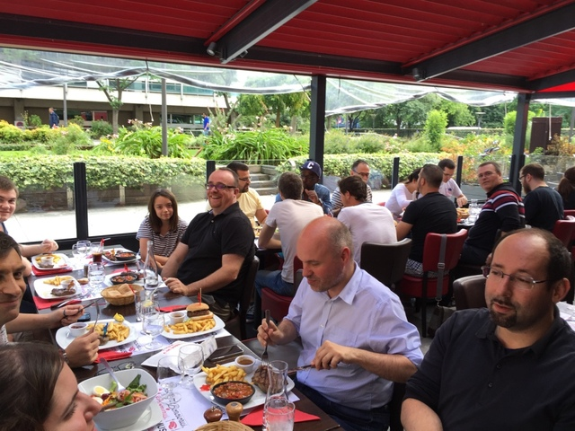
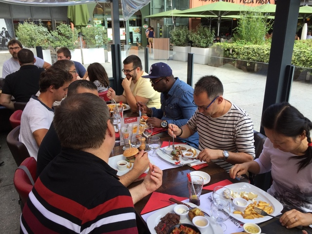
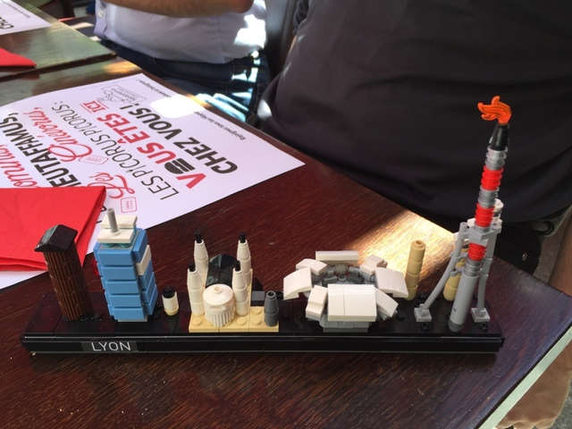
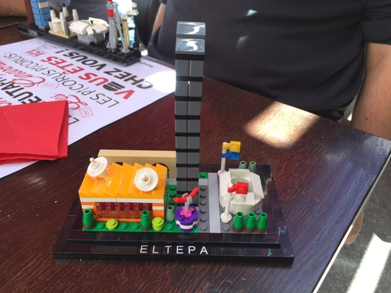
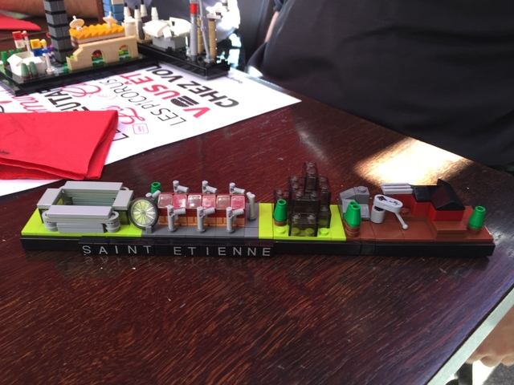
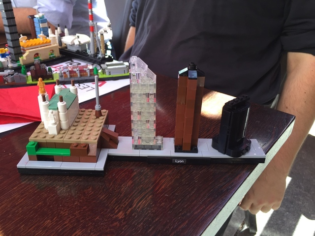
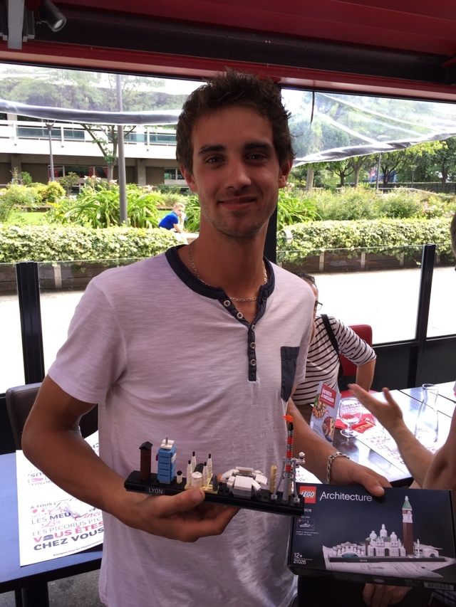
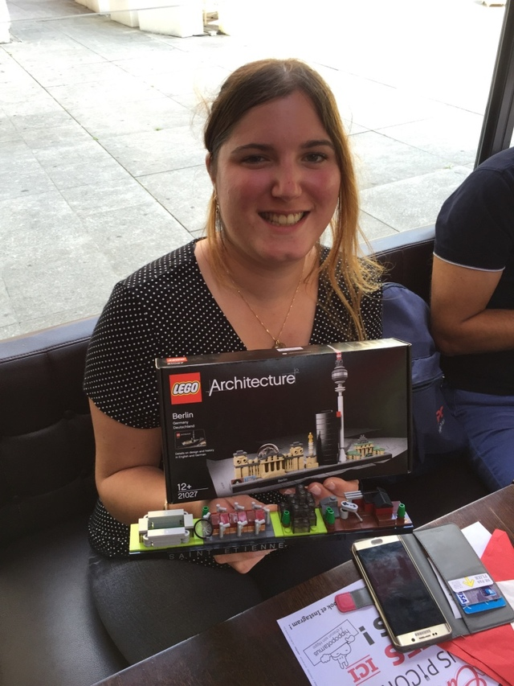
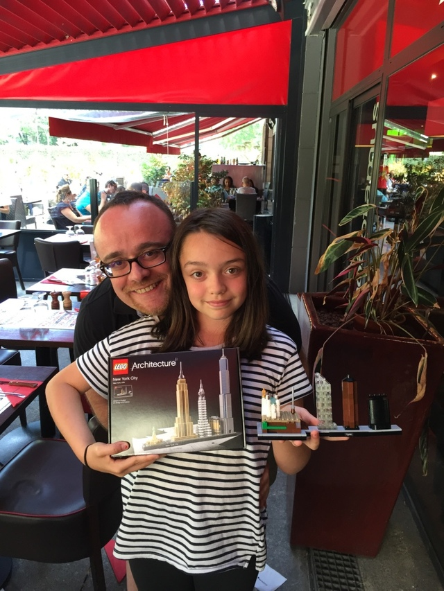

Lors de l’AFOL’s Day du mois d’août, le VoldeCoR a organisé un restaurant au sein de l’Hippopotamus du centre commercial de la Part-Dieu. Une vingtaine d’AFOL’s du CoR, se sont réunis pour manger un morceau et partager un bon moment de convivialité.

Lors ce restaurant, avait lieu le second concours du VoldeCoR. Le jury était composé de moi (Antoine) et Laurent vainqueur du précédent concours.  
Les participants devaient réaliser une skyline comme sur la nouvelle gamme Architecture.

4 participants et seulement 3 lots....  
Voici donc les vainqueurs avec leur réalisation et leur joli sourire ultra brighton :).  
Valentin, Marie et Jeanne notre grande vainqueur.

