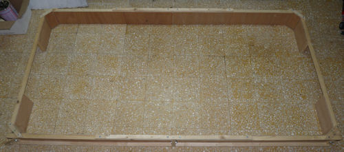
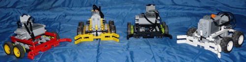
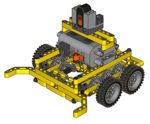
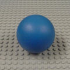
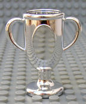

Si ce sport vous tente, voici le minimum à savoir pour faire une partie.

## Principe

Un match de foot entre deux équipes composées chacune de deux module PFS.

## Le terrain

**Terrain officiel**

C’est un rectangle de 2m de long par 1m de large clôturé par un mur de 15cm de haut (sortie de balle impossible). Dans chaque largeur du rectangle, est pratiquée une ouverture de 45cm de large qui constitue les cages.

## Les modules

Ils doivent avoir une taille maximum de 20cmx16cmx14cm (soit un rectangle de 25 tenons par 20) et n’utiliser qu’un seul canal PFS (pas de limitation de poids). Les modules n’ont pas le droit de se déplier, de laisser des morceaux ou de lancer des objets.

Les modules ne doivent contenir que des pièces LEGO d’origine (non modifiées).

**Notice de montage d’un exemple de module**

## Le ballon

Il s’agit de la grosse [balle Duplo référence 23065](http://www.bricklink.com/catalogItem.asp?P=23065).

**Balle officielle**

Attention la couleur peut changer

## Les matchs

Les matchs se déroulent en 2 mi-temps de 2 minutes.

Au début de chaque mi-temps, les modules sont positionnés de chaque coté de leur cage face à l’adversaire, la balle est placée au centre du terrain.

Après chaque but, les modules sont remis à leur position initiale et la balle est donnée à l’équipe qui vient d’encaisser le but.

A la mi-temps, les équipes changent de coté du terrain.

Le match prend fin quand :  
**–** une équipe a marqué plus de 3 buts de plus que ses adversaires ;  
**–** les 2 mi-temps sont finies.

En cas d’égalité à la fin des 2 mi-temps, le match continue jusqu’à ce que l’une des 2 équipes marque un but (_mort subite_).

**Cas particuliers :**

_Le blocage_

Si à un moment de la partie les modules se trouvent dans une position où ils ne peuvent plus évoluer, au bout de 20 secondes ils sont remis en position initiale et un engagement avec balle au centre est fait.

_Le blocage volontaire_

Si une équipe menant au score bloque volontairement les modules adverses de façon à les empêcher de jouer, on réalise un engagement mais la balle est donnée à l’équipe se faisant bloquer. Si cette situation se reproduit, l’équipe bloquante peut se faire sanctionner d’un point.

## Le tournoi

En fonction du nombre de participants, ce serra :  
**–** soit poules (sélection du premier ou des 2 premiers) puis phase finale à élimination directe ;  
**–** ou une seule grande poule.

En phase de poule, une victoire donne 3 points, un nul donne 1 point, une défaite ne donne pas de point.  
Le classement dans la poule est fonction du nombre de points.

## Tech-ball et NXT

Dans le cas d’utilisation d’un NXT à la place du système PFS, les règles, le terrain et la balle sont les mêmes que dans le jeu classique.

La différence se situe dans la commande du module qui se fait en blue-tooth et de l’assistance que peut apporter le NXT au pilotage et en fonctions annexes (commande de virage, pinces, plus de moteurs...).

La seule règle est l’interdiction à un module de lever la balle pour la transporter (le lob par contre est autorisé).

  
**Pour plus d’information ou pour voir des exemples de modules :**  
**–** [exemple d’un module de base](http://photos.freelug.org/main.php/v/-PZ/moc/techball/)  
**–** [exemple de module "style chantier"](http://www.brickshelf.com/cgi-bin/gallery.cgi?f=286519)  
**–** [présentation du Tech-ball sur le blog "La Mounière"](http://mouniere.blogspot.com/2008/03/techball-un-lego-sport-qui-grandit.html)  
**–** [présentation d’un module sur "blogotechnic"](http://blogotechnic.blogspot.com/2008/07/moc-techball.html)  
**–** [module de Nicolas](http://photos.freelug.org/main.php/v/nicolas_carel/TechBall/)  
**–** [module de Nico de Strasbourg](http://lego.nico.free.fr/lego-techball.htm)  
**–** [le topic Techball sur SeTechnic](http://www.setechnic.com/Forum/topic753.html)
