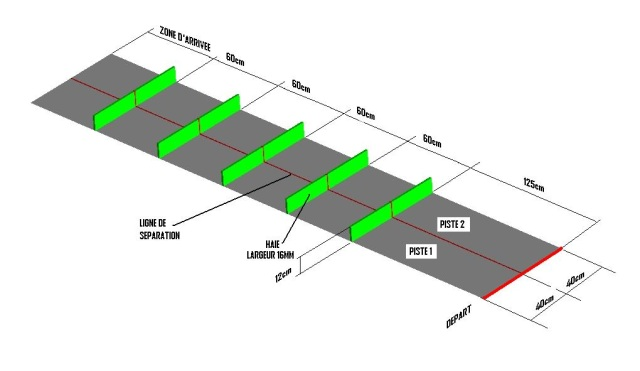

Ce challenge n’est pas réservé aux possesseurs de RCX. Il est tout a fait possible de réaliser un robot capable d’effectuer cette course, sans brique RCX. Avis aux amateurs :-)

## BUT

Le but est de parcourir le plus rapidement possible une ligne droite sur laquelle sont disposées des haies. Une manche se court entre 2 robots sur des pistes parallèles.

## Règlement

**Piste**

Description de la piste :

**–** une piste est constituée de 2 couloirs (un pour chaque participant)  
**–** les 2 couloirs sont séparés par un rebord de 3cm\*3cm pour éviter que les concurents ne se gênent. Ce rebord sera fixé au sol par de l’adhesif double face. Il sera brut et non peint.  
**–** aucune ligne de guidage au sol ne sera tracée par les organisateurs.  
**–** la longueur de piste est de 5m  
**–** les couloirs font environ 40cm de large (équivalent a la largeur d’une plaque 48x48)

**Vue schématique de la piste.**

**Haies**

Description des haies :

**–** les haies font environ 14 studs de haut (12 briques de haut + 1 tile, environ 12cm).  
**–** les haies font environ 15mm de large (l’équivalent de 2 studs)  
**–** les haies sont fixes.  
**–** les haies sont considérées comme indestructibles. Les robots peuvent donc prendre appui dessus.  
**–** les haies sont espacées de 60 cm + ou - 1cm (équivalent de 72studs)  
**–** le nombre de haie est de 5  
**–** la première haie est positionnée à 1,25m de la ligne de départ.  
**–** les haies font environ 40cm de large (équivalent à la largeur d’une plaque 48x48)

**Robot**

Description/contraintes sur les robots

**–** les robots devront contenir uniquement des pieces LEGO®. Aucune pièce personnelle ne sera tolerée.  
**–** le nombre de roues est illimité.  
**–** il faut au moins une roue, une brique ou une patte, touchant le sol au départ.  
**–** Nombre de moteurs illimité.  
**–** La puissance nécessaire doit être emporté par le robot  
**–** Toutes les sources d’énergie sont utilisables, mais la tension est limitée à 9 volts.  
**–** le robot ne doit pas forcement contenir de brique programmable, mais doit être autonome (pas de radio commande ou commande infrarouge lors de la course)

**Course**

Contraintes sur le déroulement de la course.

**–** Le robot doit franchir toutes les haies  
**–** Le robot ne peut pas sauter plusieurs haies en même temps  
**–** L’intégralité du robot doit franchir la ligne d’arrivée.  
**–** Le point de contact du robot avec le sol, doit être situé derrière la ligne de départ avant le départ de la course.

**Organisation de la Compétition**

La compétition est organisée en Poule. Chaque tour est organisé au meilleur des 3 manches.

Une poule consolante est crée avec les perdants du premier tour.

Entre 2 manches un délai maximum de 5 minutes sera accordé aux deux équipes pour effectuer la maintenance des robots. Si passé ce délai et après trois appels du starter, une équipe ne se présente pas, elle est déclarée défaillante et l’équipe restante est declarée vainqueur.

Le départ sera donné manuellement par les concepteurs sur ordre de l’arbitre. Aucune poussée ne sera tolerée.

Aucune intervention ne sera possible 30 s avant le départ et pendant la durée de la course.

**Eliminations**

Une équipe est éliminée de la manche (et l’adversaire declaré vainqueur) dans les cas suivant.  
**–** Sortie de piste.  
**–** Pénétration dans la piste adverse.  
**–** Intervention humaine pendant la manche.
