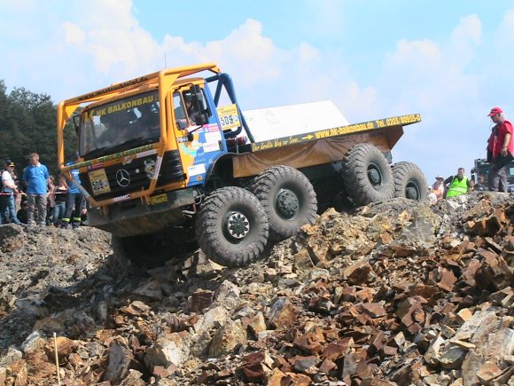
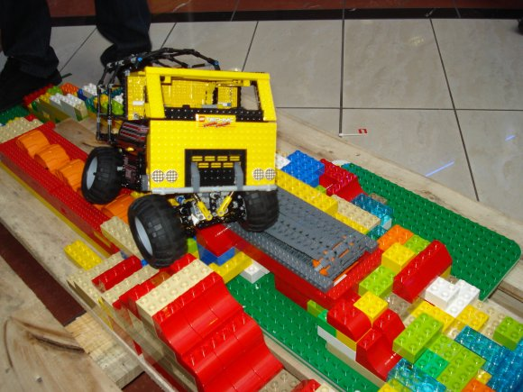

Très prisée dans les pays de l’Europe de l’Est, la discipline du TruckTrial consiste à construire un camion motorisé capable de franchir des obstacles de différente nature.

**Un truck trial**

**–** Auteur : [Wossi199](http://en.wikipedia.org/wiki/File:Truck-Trial_OS_2006.JPG)  
**–** Photo distribuée sous licence "GNU Free Documentation License".

## Préambule

Le règlement général n’est pas encore figé, et pourra évoluer jusqu’au jour de la première épreuve. Le règlement technique, qui impose les contraintes de construction, est normalement figé jusqu’à l’épreuve.

## But du challenge

Construire un véhicule à roues capable de franchir les obstacles, en un temps minimum.

## Règlement général

**1 - Les participants**

Tout passionné doté de son véhicule de franchissement peut participer, sans restriction d’âge. Chaque concurrent peut se faire assister par une personne.

**2 - Catégories**

Il n’est pas prévu de catégorie.

**3 - Nature des obstacles**

Les obstacles sont de nature artificielle. Ils permettent d’illustrer :  
**–** la capacité de monter et descendre des dénivelés importants ;  
**–** la capacité de rouler sur une surface non plane ;  
**–** la manœuvrabilité du véhicule.

**4 - Bonifications**

Le franchissement de chaque obstacle est validé par le franchissement d’un point de contrôle matérialisé par deux fanions. Le véhicule doit arriver sur ses roues. Chaque validation est bonifiée. La bonification peut être fonction de la difficulté de l’obstacle.

Si le temps de parcours devient excessivement long pour un obstacle, les arbitres peuvent décider d’invalider son franchissement au concurrent. Dans ce cas, ce dernier n’a pas le droit à la bonification.

**5 - Pénalités**

Toute intervention humaine est pénalisée :  
**–** légère remise en place du véhicule : 60 s ;  
**–** fanion renversé : 50 s ;  
**–** intervention technique (réparations etc.) : 40 s ;  
**–** chute ou retournement du véhicule : 20 s. Le véhicule est alors replacé à sa position avant la chute ;  
**–** si le véhicule est filoguidé :

-   toute aide caractérisée à la manoeuvre : 60 s ,
-   toute aide non volontaire : le véhicule est replacé à sa position initiale.

**6 - Vainqueur**

Le vainqueur :  
**–** doit avoir rempli les conditions de validation et respecter le règlement technique ;  
**–** accumulé le maximum de points de bonification ;  
**–** est le concurrent à avoir réalisé le parcours en un temps minimal.

En cas d’égalité, le jury départagera les concurrents sur l’esthétique du véhicule.

**7 - Déroulement de l’épreuve**

Chaque concurrent doit s’inscrire auprès de l’organisateur de l’épreuve avant le début de celle-ci.

L’ordre de passage sera désigné par les arbitres.

Des essais libres sont possibles en dehors des épreuves.

**Exemple de truck trial en LEGO**

**–** [Photo de Schmade](http://www.brickshelf.com/gallery/Shmade/Technic/Trial-Trucks/01.jpg)

## Règlement technique

**1 - Le véhicule**

Contraintes sur l’apparence et les dimensions du véhicules :  
**–** le véhicule doit ressembler à un camion, avec une cabine, un volant (fonctionnel ou non) et au moins un siège (un conducteur au volant n’est pas obligatoire) ;  
**–** la transmission au sol doit être réalisée par roues ;  
**–** échelle approximative : 1:13 ;  
**–** largeur maximale (hors roues) : 24 tenons ;  
**–** largeur maximale (avec roues) : 26 tenons ;  
**–** doit pouvoir manoeuvrer (avancer, reculer, tourner).

**2 - Motorisation**

Contraintes sur la motorisation :  
**–** maximum de deux moteurs pour la propulsion ;  
**–** autres moteurs possibles pour les autres fonctionnalités (dont la direction) ;  
**–** tout type de motorisation : 4,5V, 9V, PFS (sont exclues les motorisations des voitures RC) ;  
**–** tout type de commande LEGO : filaire, IR, PFS, Bluetooth (NXT).

Dans le cas d’un véhicule filoguidé, la source d’énergie doit se trouver à bord du véhicule.

**3 - Restrictions**

Ne sont pas autorisés :  
**–** les pièces modifiées ;  
**–** les pièces non LEGO (sauf ficelle ou bâche à usage exclusivement décoratif).

## Annexes

**–** [Brick Truck Trial](http://www.bricktrucktrial.com/), site consacré au TrialTruck LEGO, disposant de nombreuses ressources sur le sujet (en anglais)
