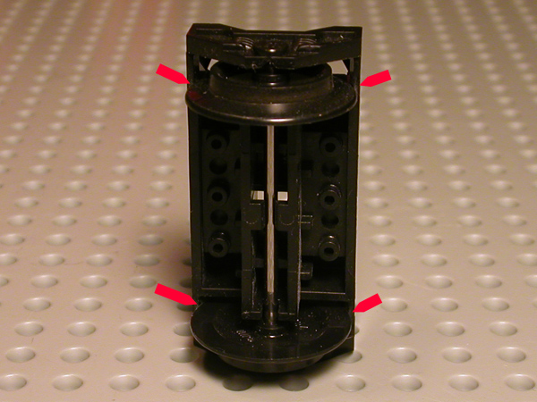
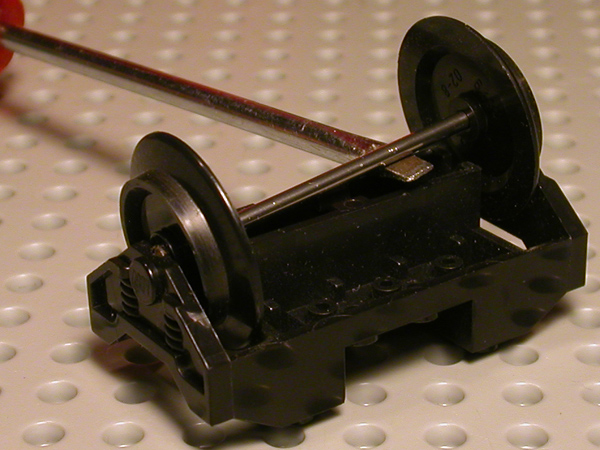
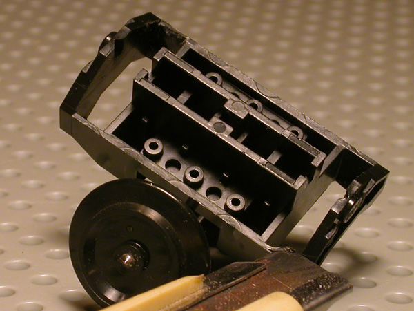
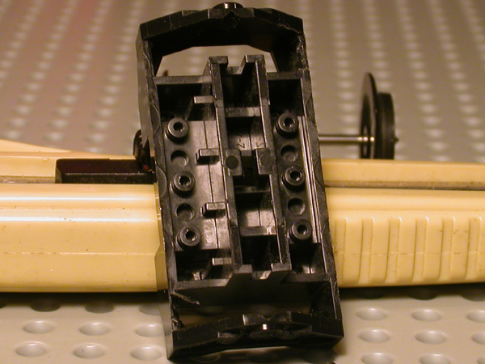
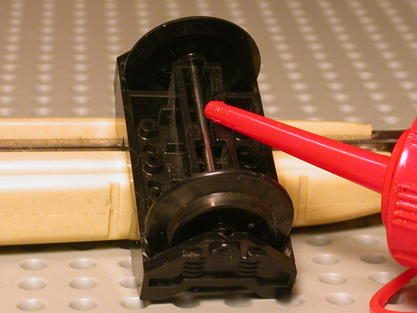

Un essieu de train qui a un peu roulé peut, par l’usure, faire frotter les roues à l’intérieur du bogie. Voyons comment remédier rapidement à ce problème et redonner une nouvelle jeunesse à ces pièces d’usure.

_**Tout d’abord une mise en garde : les opérations qui suivent consistent à utiliser un outil très coupant sous votre entière responsabilité.  
**_

## Quel est le problème ?

A force de faire rouler vos trains préférés, vous constatez une résistance de plus en plus grande au roulement, qui peut aller jusqu’à faire patiner le moteur 9V. Même en poussant les wagons seuls à la main, vous réalisez à quel point ça freine tout seul.

Après vous être assuré que le frein ne provient pas d’un mauvais montage ou de briques trop près des rails, démontez les bogies de vos wagons et inspectez les minutieusement en faisant tourner à la main chaque essieu dans son bogie et en observant bien l’origine du frottement.

La cause de très loin la plus courante provient du frottement de la couronne la plus extérieure de chaque roue sur la cage en plastique du bogie aux endroits indiqués sur cette photo.

**Les flèches rouges montrent l’origine des frottements**

La seule solution est de faire de la place pour la roue. Vous êtes alors face à un cruel dilemme : intervenir pour enlever du plastique sur le bogie, quitte à "abîmer" la pièce LEGO, ou bien ne rien faire et ranger cette pièce dans votre boîte des rebuts inutiles mais tellement vénérables qu’on ne les jette jamais. Pour les pragmatiques dans mon genre, voici la recette en image pour enlever du plastique au cutter et libérer le passage de la roue.

## Intervenir pour libérer ces frottements

Commencez par démonter l’essieu freineur de son bogie. Ne touchez pas aux roues, il faut garder leur surface intacte.

**Relever l’essieu métallique avec un tournevis**

C’est sur le bogie que l’intervention va avoir lieu.

Avec le cutter raclez le plastique à l’intérieur du passage de la roue. Il s’agit d’enlever la matière sur un angle de 45° afin que la modification soit invisible de l’extérieur. Le plastique enlevé représente environ 0,5 mm du passage de la roue. Faites l’opération sur chaque côté du bogie et sur chaque passage de roue. Vous devez donc enlever quatre fois du plastique par bogie.

**Entailler à 45° avec le cutter**

**On distingue bien l’entaille avant d’enlever le plastique**

Remontez l’essieu dans son bogie. Pendant que vous y êtes, déposez une goutte d’huile fine sur l’essieu métallique à l’endroit où il frotte sur le bogie. Cela évitera à l’avenir une usure trop rapide de cet appui, qui est à l’origine de l’enfoncement de l’essieu et du frottement de la roue sur le bogie.

**Lubrifier les points de frottement**

A propos de la lubrification, Marc Schickelé nous indique que le lieu d’usure se situe aux extrémités de l’axe sur la partie conique à l’extérieur de la roue. C’est à cet endroit qu’il vaut mieux apporter un peu de lubrifiant. D’ailleurs, là c’est frogleap qui parle, ce lubrifiant peut être de l’huile de paraffine ou de l’huile de vaseline. En tous cas évitez les dégrippants qui contiennent des solvants pouvant attaquer le plastique LEGO.

Les précisions de Marc sont importantes par leurs conséquences. Savoir que l’usure à l’origine de l’enfoncement de l’axe, se situe dans les cônes d’extrémités indique que plus le bogie sera chargé et plus cette usure sera prononcée. C’est le prix à payer pour faire du 8 de large. En outre, les nouveaux essieux avec roues séparées de l’axe métallique ont des cônes d’extrémités désormais en plastique... l’usure ne sera que plus intense et le bogie moins durable.

Trois conclusions de Marc pèsent lourd pour les traineux :  
1ère conclusion : il faut lubrifier les bogies neuves pour éviter l’usure des logements coniques,  
2ème conclusion : faites des constructions les plus lègères possibles ou multipliez les bogies,  
3ème conclusion et la pire : les bogies RC qui ont des bouts coniques en plastique intégrés dans la roue auront une usure encore plus rapide.

Pour terminer, retenez aussi que LEGO a produit au moins un lot de bogies tellement ajustés au moulage que ce frottement arrive très tôt et se manifeste même sur des pièces neuves. C’est à cause de ce problème que nous avons appris à faire cette intervention.

J’avais promis cet article sur la liste de discussion des adhérents. En espérant que les photos seront explicites. Un grand merci à Marc pour ses précisions importantes sur l’origine de l’usure.
