Salut à tous, pour commencer ma participation à FreeLUG, je commence par la présentation de la boite 7679 le Republic Fighter Tank. Cette boîte Star Wars fait partie de la saga Clone Wars sortie depuis le film du même nom.

Je dois dire que même en tant que fan Star Wars, je ne m’attendais pas à la sortie de ce véhicule de combat car le Republic Fighter Tank ne fais aucune apparition dans les films. Cependant il est tiré de jeux vidéo tel que Clone Wars sur Game Cube mais ces jeux sont peu nombreux où on le voit clairement.

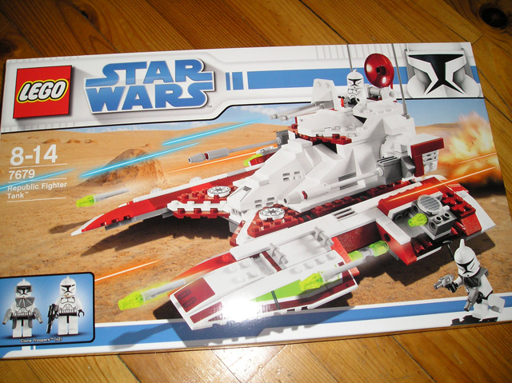

**la boite**

Ce tank fait parti de l’équipement d’assaut Clone lors de la guerre entre l’épisode 2 et 3. Il est rapide et a une puissance de feu non négligeable.  
**–** Numéro de la boîte : 7679  
**–** Nom : Republic Fighter Tank  
**–** Gamme : Star Wars  
**–** Nombre de pièce : 592  
**–** Prix : autour de 70 euros

La boîte contient de nombreux sachets mais il n’y a pas d’étapes bien séparées.

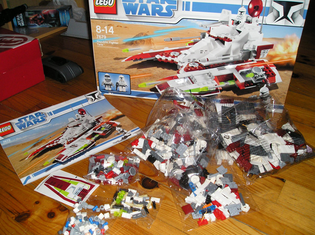

**l’ensemble**

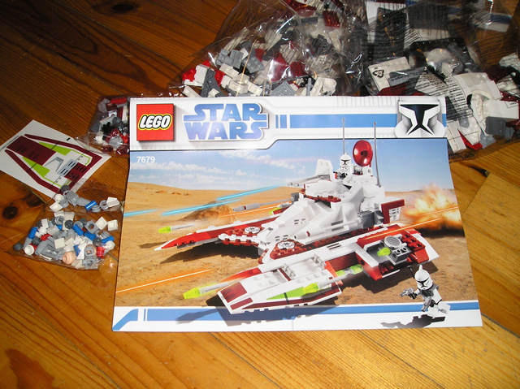

**la notice**

Tout d’abord on fabrique la base du tank, et ça monte doucement.

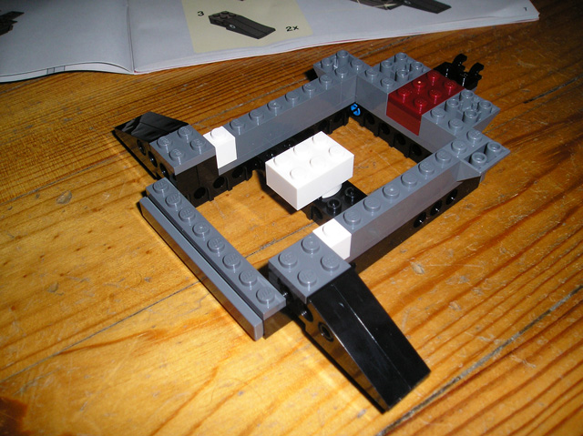

**étape 9**

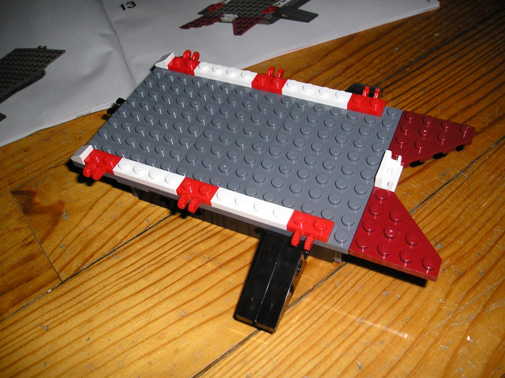

**étape 14**

La tête du tank commence à prendre forme.

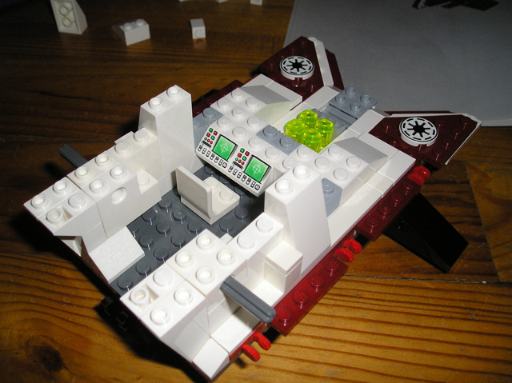

**étape 26**

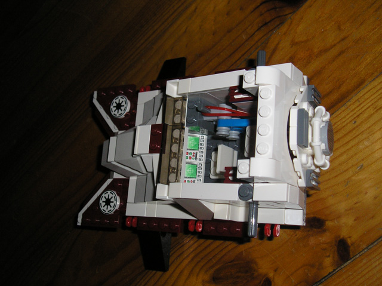

**étape 36**

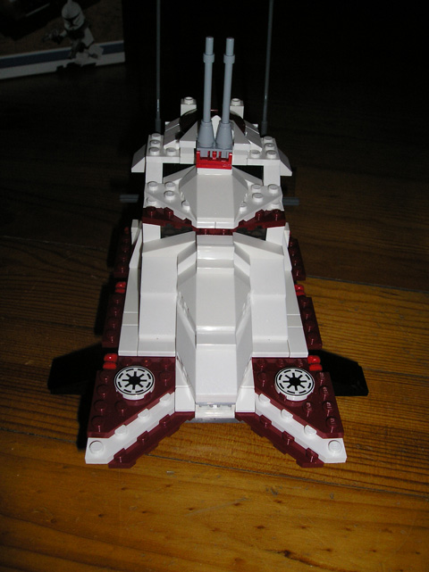

**étape 39**

Après le corps du tank, on s’occupe des ailes des côtés.

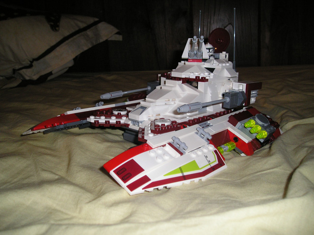

**fini !**

Enfin on termine par des petits détails.

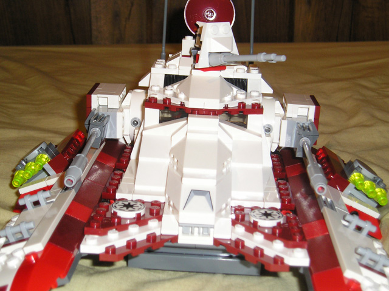

**avant**

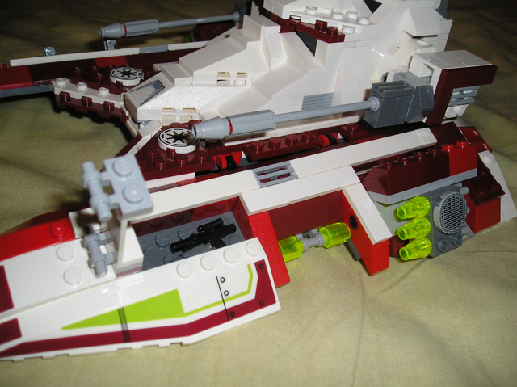

**détail sur l’aile**

Un petit mécanisme permet d’élever un siège interne et des lances missiles se déploient sur les côtés.

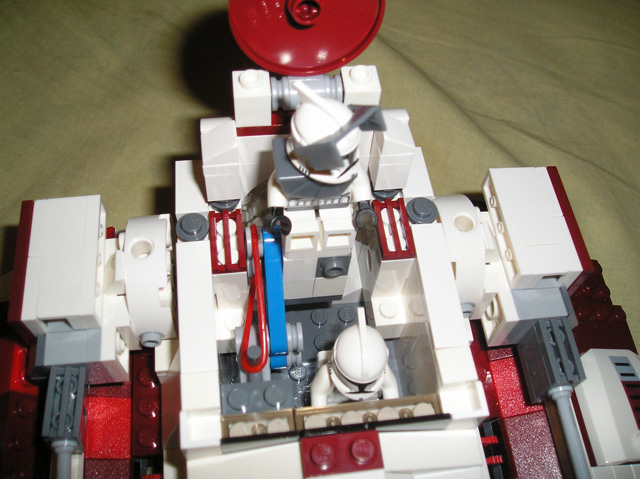

**le cockpit**

J’ai été très satisfait de mon achat, il est vraiment sympa à construire et ça rend super bien sur un champs de bataille.
