Voici la revue du set 10247 dans la gamme Expert : Ferris Wheel (la grande roue). Il est sorti en 2015 au prix de 179,99 euros pour 2464 pièces. Soit un ratio de 7,3 centimes par pièce avec 10 minifigs.

La boite possède les logos CREATOR et EXPERT. La boite montre la grande roue dans un décor de fête foraine.

[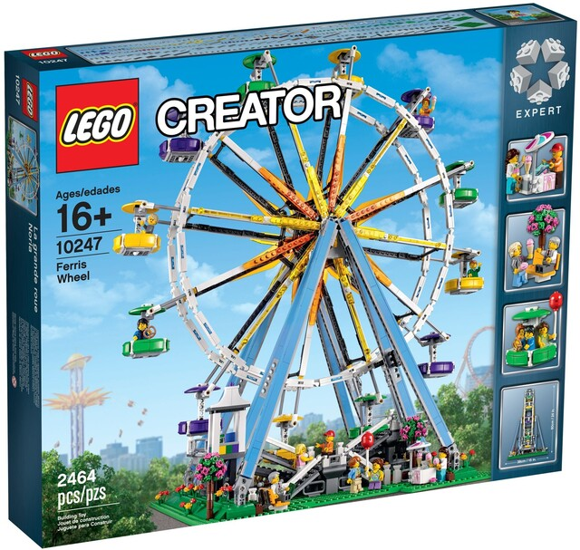](https://www.freelug.org/IMG/jpg/10247_alt1.jpg)

[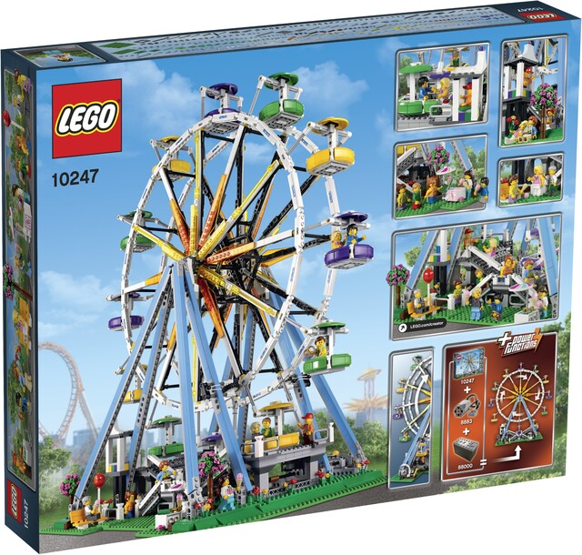](https://www.freelug.org/IMG/jpg/10247_box5_na.jpg)

Ayant déjà ouvert la boite il y a un an je ne sais plus combien il y avait de sachets, mais ils sont numérotés de 1 à 4 correspondants aux différentes étapes de montage. Ce qui permet de faire le montage en plusieurs fois (chose que je n’ai pas faite la première fois).

[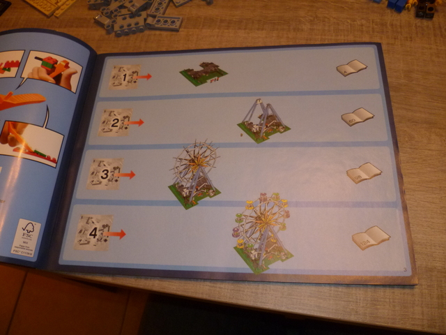](https://www.freelug.org/IMG/jpg/P1070526.jpg)

La première étape parait la plus longue au vue du nombre de pages annoncé. Il ne faut pas s’y fier sous peine de passer toute la nuit dessus (ce que j’ai fait la première fois).

## Etape 1 - La base

Voici les pièces des sachets numéro 1

[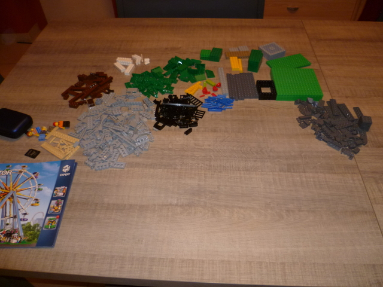](https://www.freelug.org/IMG/jpg/P1070523.jpg)

Voici les minifig

[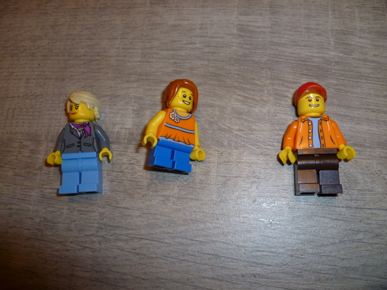](https://www.freelug.org/IMG/jpg/P1070524.jpg)

[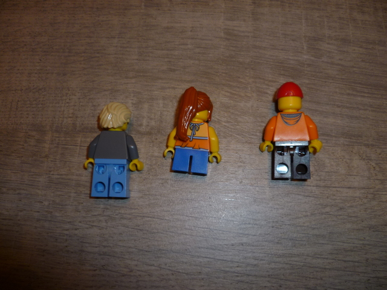](https://www.freelug.org/IMG/jpg/P1070525.jpg)

On commence le montage par un squelette en pièces technics.

[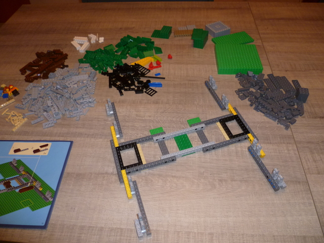](https://www.freelug.org/IMG/jpg/P1070538.jpg)

On pose les plaques 16x16 qui servent de base (48x48 au total), ainsi que le décor de base et la première partie du mécanisme.

[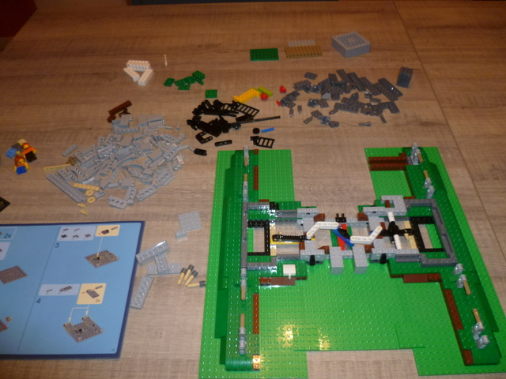](https://www.freelug.org/IMG/jpg/P1070557.jpg)

On finit cette première partie par les plateformes et la fin du mécanisme.

[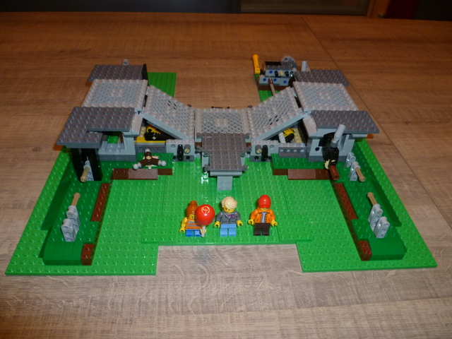](https://www.freelug.org/IMG/jpg/P1070579.jpg)

## Etape 2 - Les finitions de la base

Voici les pièces des sachets numéro 2

[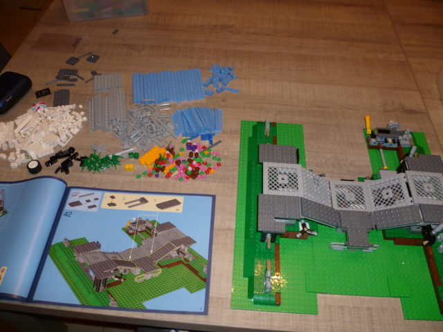](https://www.freelug.org/IMG/jpg/P1070582.jpg)

Voici les minifig

[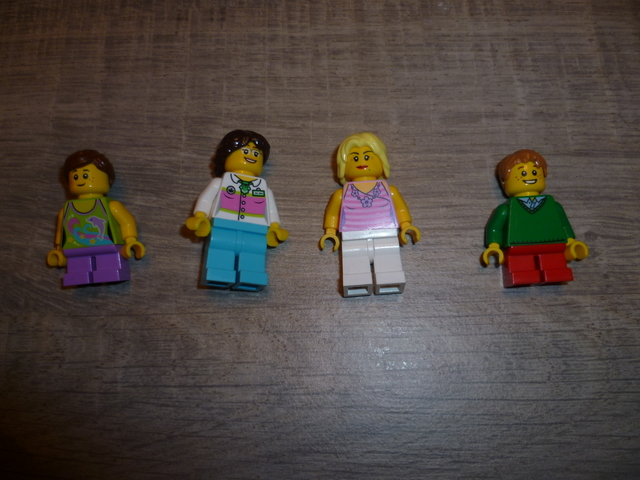](https://www.freelug.org/IMG/jpg/P1070580.jpg)

[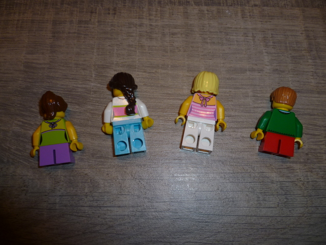](https://www.freelug.org/IMG/jpg/P1070581.jpg)

On commence cette étape par le montage des dernières parties du décor : le banc, le stand de glace, les rambardes et la cabine.

[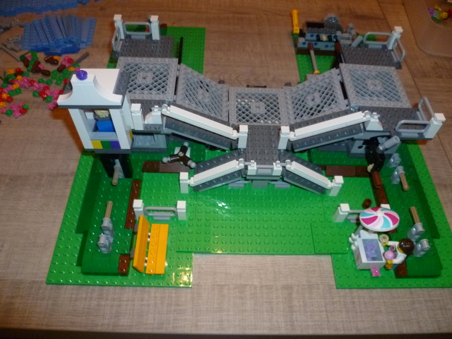](https://www.freelug.org/IMG/jpg/P1070592.jpg)

On attaque après les deux structures de maintien de la roue.

[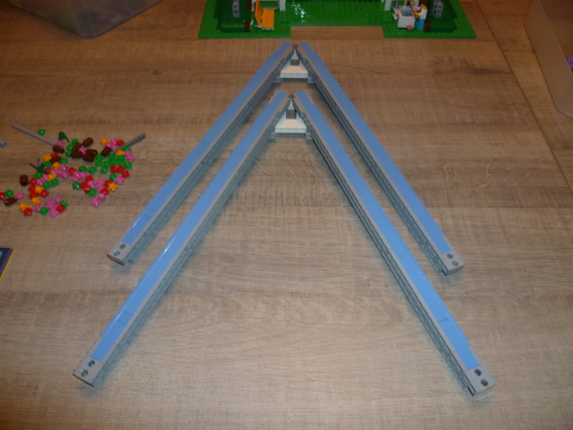](https://www.freelug.org/IMG/jpg/P1070604.jpg)

Et on finit par le montage des arbres réalisés avec la nouvelle pièce de maintien des fleurs

[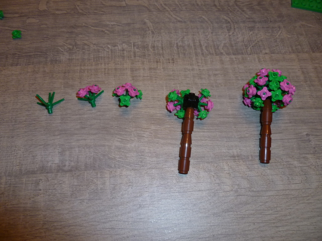](https://www.freelug.org/IMG/jpg/P1070609.jpg)

Voici le résultat à la fin de la deuxième étape

[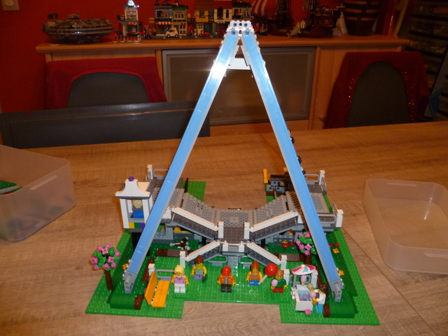](https://www.freelug.org/IMG/jpg/P1070610.jpg)

## Etape 3 - La roue

Voici les pièces des sachets numéro 3

[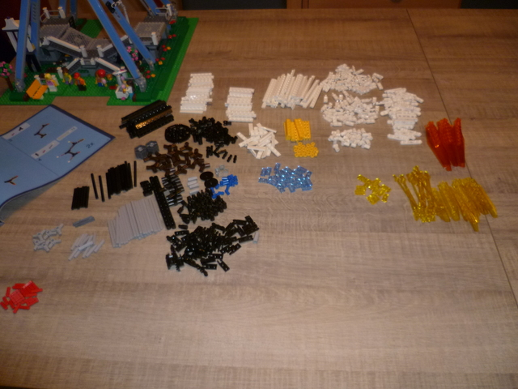](https://www.freelug.org/IMG/jpg/P1070611.jpg)

Pas de minifig pour cette partie

Dans cette étape, nous allons faire la roue. Cette étape marque aussi le début de tâches répétitives, il faut souvent faire plusieurs fois la même chose (jusqu’à 12x la même chose).  
On attaque par deux étoiles à 12 branches (vérification sur le livret)

[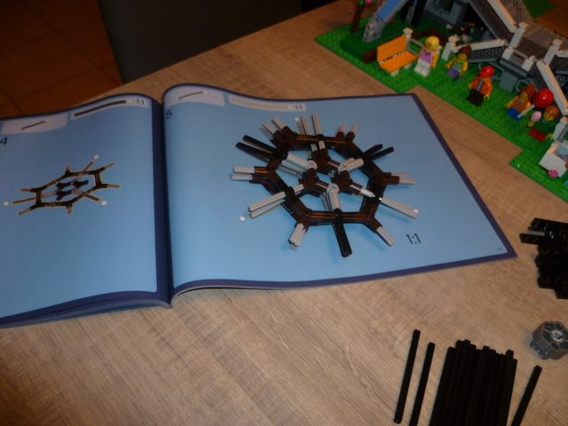](https://www.freelug.org/IMG/jpg/P1070624.jpg)

On continue avec les 12 premières branches

[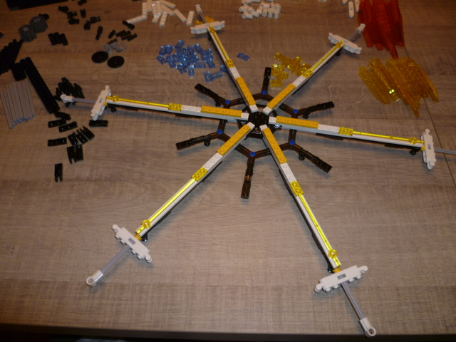](https://www.freelug.org/IMG/jpg/P1070642.jpg)

Puis on relie les branches pour faire un cercle

[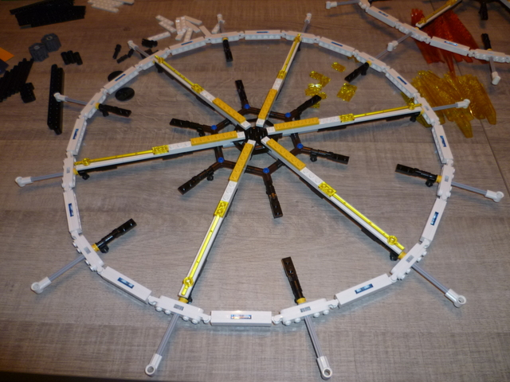](https://www.freelug.org/IMG/jpg/P1070656.jpg)

On fait la deuxième série de 12 branches et on assemble les deux cercles formés

[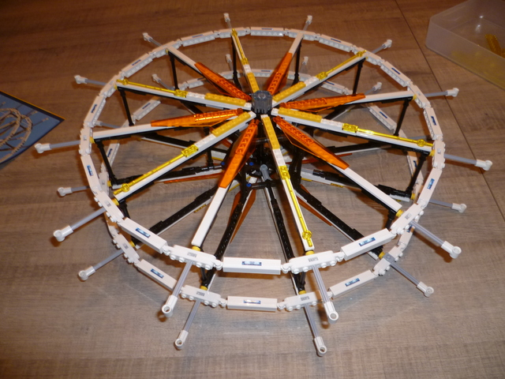](https://www.freelug.org/IMG/jpg/P1070664.jpg)

Voici le résultat sur la base

[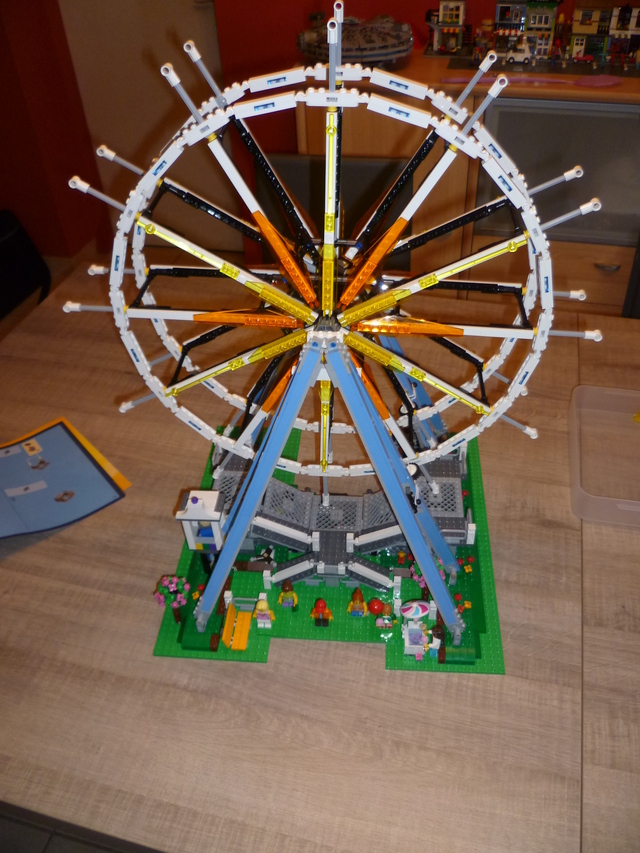](https://www.freelug.org/IMG/jpg/P1070665.jpg)

## Etape 4 - Les nacelles

Voici les pièces des sachets numéro 4

[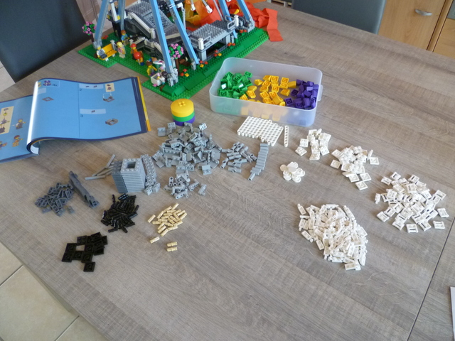](https://www.freelug.org/IMG/jpg/P1070723.jpg)

Voici les minifig

[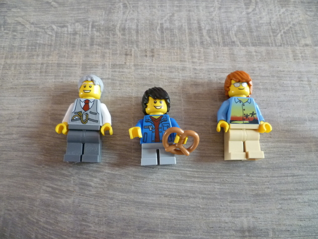](https://www.freelug.org/IMG/jpg/P1070721.jpg)

[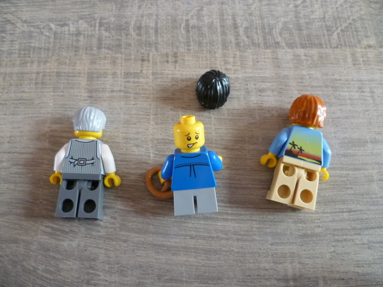](https://www.freelug.org/IMG/jpg/P1070722.jpg)

Dans cette étape, nous allons faire les nacelles de la roue. Toujours des tâches répétitives, car il faut faire 12 fois la même nacelle. Donc cette étape ne possède que quelques pages dans le livret mais vu qu’il faut le faire 12 fois, ça prend du temps. La première fois je me suis dit "oh il ne reste que quelques pages, c’est l’affaire de dix minutes !" et une heure après, j’y étais encore. Voici une illustration, 48 portes à faire :

[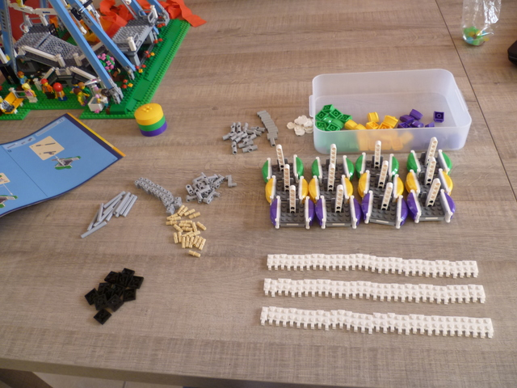](https://www.freelug.org/IMG/jpg/P1070735.jpg)

Et voilà le résultat final

[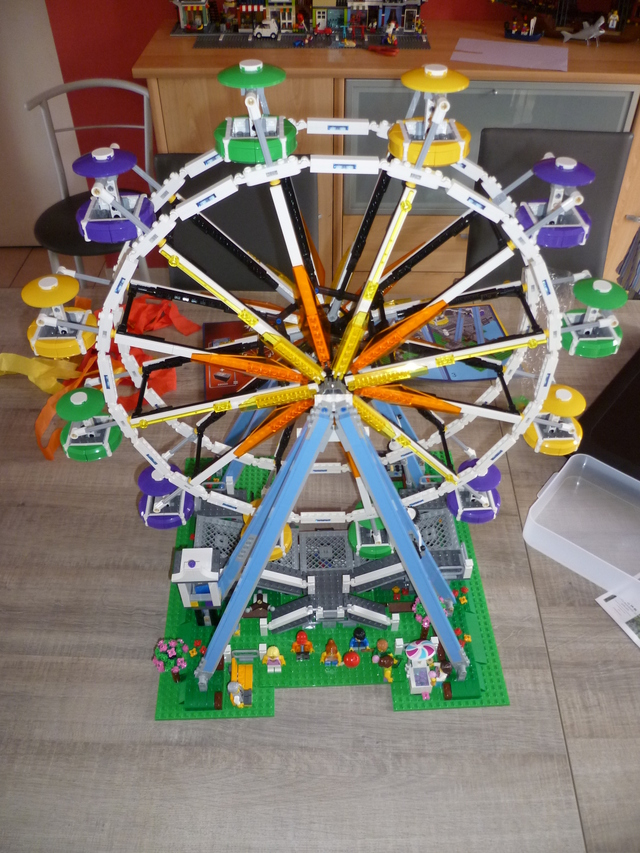](https://www.freelug.org/IMG/jpg/P1070743.jpg)

Les minifigs sont en nombre et très diverses. Vous comprendrez pourquoi je ne les mets pas dans les nacelles au prochain article.

## Animations (cliquez sur l’image pour lancer l’animation)

Lever des plateaux pour monter dans les nacelles

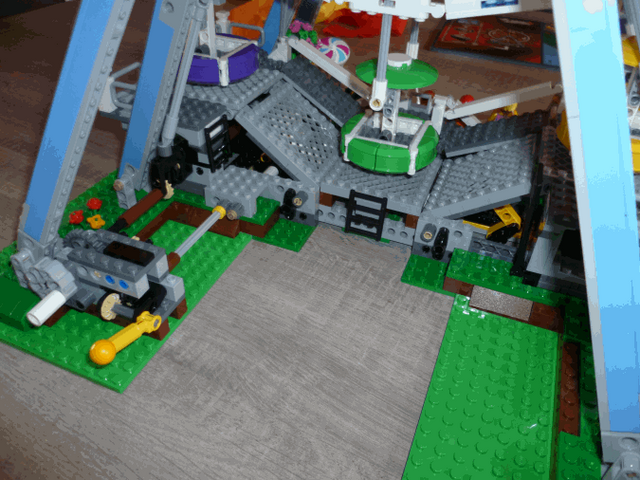

La roue tourne

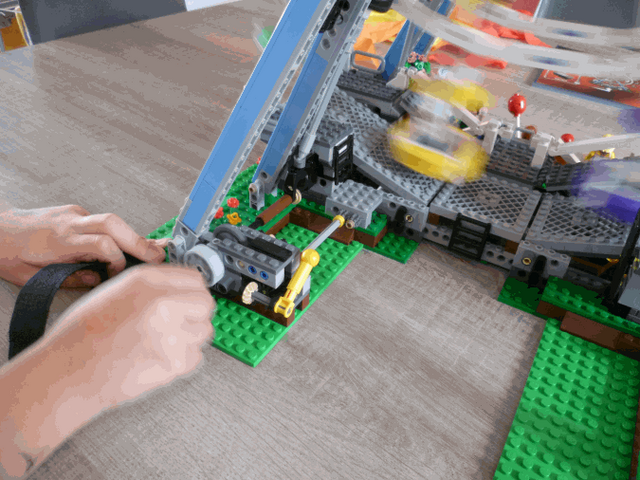

Montage étape par étape

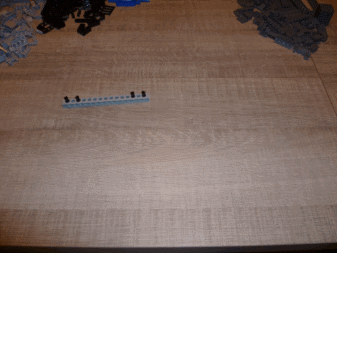
