Année 2015, la firme LEGO nous propose le montage d’un bolide mythique, la Ferrari F40 !

2015, la firme LEGO relance sa série de voiture à grande échelle ([Lamborghini Gallardo 8169](/articles/lamborghini-gallardo-lp560-4-8169/), série des Ferrari...) avec un bolide qui a marqué son temps, la F40. Produite entre 1987 et 1992 pour fêter les quarante ans de la marque, elle était la voiture la plus puissante et la plus chère de l’histoire de l’automobile. Il y a eu 1315 exemplaires vendus.

Mais, vu que LEGO nous gratifie d’une reproduction à l’échelle (environ 1/16e), nous allons plutôt nous intéresser aux caractéristiques techniques, histoire de comparer.

-   Moteur : essence V8 à 90° de 2,9l, biturbo, 2 arbres à cames en tête et 32 soupapes.
-   Position du moteur : Centrale arrière, longitudinale.
-   Puissance maximale : 478 ch (352 kW) à 7 000 tr/min.
-   Transmission : Manuelle à 5 rapports plus marche arrière, uniquement aux roues arrières.
-   Poids à vide 1088 kg.
-   Vitesse maximale 324 km/h

Cette boite fait partie de ma collection depuis au moins 5 ans. Je repousse sans cesse le plaisir du montage. Pour faire du rangement, j’étais prêt à démonter la version plus petite de la F40, la ["speed champion" 75890](/articles/review-75890-f40-speed-champions/). Finalement, je me suis décidé à ouvrir cette belle boite et à assembler la bête. Bien m’en prit !

Faisons d’abord le point sur cette boite.

-   Année de sortie : 2015
-   1048 pièces
-   Aucun personnage
-   Les sachets sont numérotés de 1 à 2. Mais il y en a beaucoup plus !
-   Temps de montage, il m’a fallu environ 3h40mn.

Sur la face avant de la boite nous découvrons la version LEGO assemblée. Ca donne une belle idée de ce qui nous attend.

[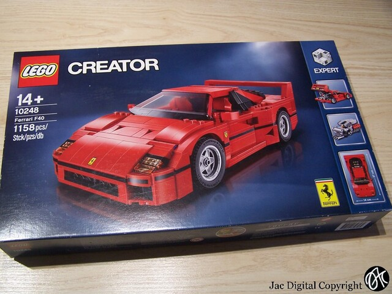](https://www.freelug.org/IMG/jpg/photo_01-4.jpg)

A l’arrière nous pouvons découvrir tous les détails que nous allons construire au fil des étapes. Il n’y a aucune photo du modèle réel, c’est dommage. Mais il n’en manque pas sur le net si on veut personnaliser la construction.

[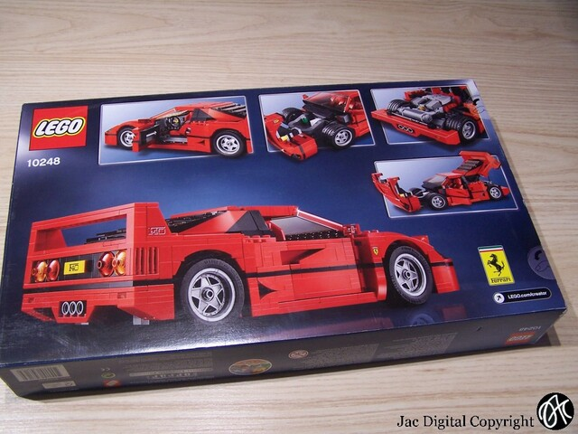](https://www.freelug.org/IMG/jpg/photo_02-5.jpg)

La boite s’ouvre en poussant les ergots au dos. A l’ouverture on découvre six sachets numérotés de 1 à 2, en fait 3 de chaque. C’est un peu bizarre, mais n’oublions pas que nous sommes des experts, c’est écrit sur la boite. La notice est emballée à part, avec la petite planche d’autocollants.

[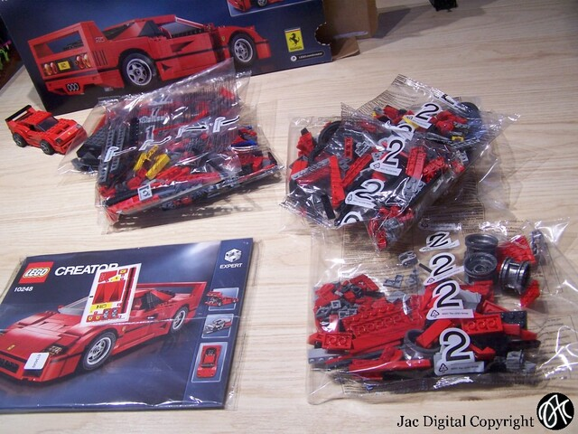](https://www.freelug.org/IMG/jpg/photo_03-3.jpg)

La phase d’ouverture des sachets est importante. Pour cette fois, j’ai fait en sorte de séparer un peu les pièces. j’ai pris trois bacs, ça permet de moins chercher les petits éléments, surtout au début. Le pare-brise était en vrac dans un sachet. Je l’ai mis de côté pour ne pas l’abimer. Il est tampographié sur les cotés en rouge. Ca évite une phase de collage d’autocollants. Un démonte-brique est fourni. Il m’a bien servi, car j’étais un peu pressé de voir le résultat final. J’ai fait plus d’erreurs que d’habitude.

[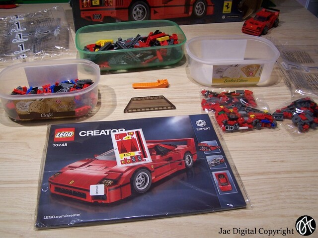](https://www.freelug.org/IMG/jpg/photo_04-3.jpg)

A l’étape 18 on a déjà une idée précise du châssis. Les freins à disque sont représentés par des plates rondes 2x2 gris foncées. Il n’y a pas les étriers. Je suis aidé dans ma construction par la version Speed Champion et par une F40 Majorette plus petite.

[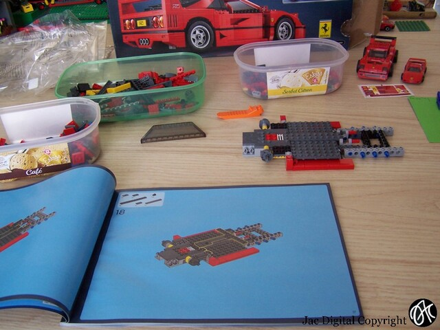](https://www.freelug.org/IMG/jpg/photo_05-3.jpg)

Premier autocollant à coller, il faut bien viser le centre du volant. On a pas droit à l’erreur, sinon, le petit rond jaune sera abimé.

[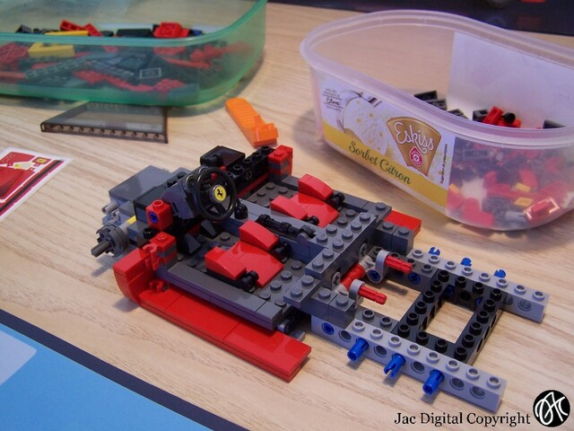](https://www.freelug.org/IMG/jpg/photo_06-3.jpg)

Les sièges sont magnifiques. Il faut vraiment reproduire une voiture à cette taille pour avoir des reproductions et des montages détaillés bien faits. Parce que on est loin de cet intérieur dans la version plus petite, avec un seul siège... Par contre, on ne trouvera pas de personnage LEGO à mettre aux commandes. C’est une maquette statique.

[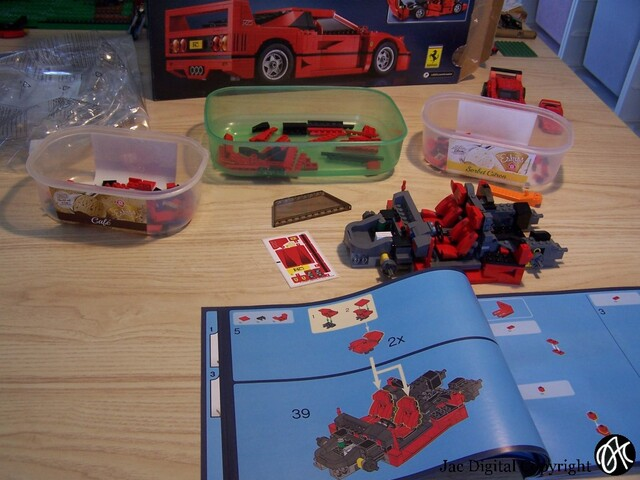](https://www.freelug.org/IMG/jpg/photo_07-3.jpg)

Le volant est réglable en hauteur. Non je plaisante, c’est juste pour le montage... Mais le tableau de bord avec ses petites pièces imprimées représentant des manomètres rend super bien.

[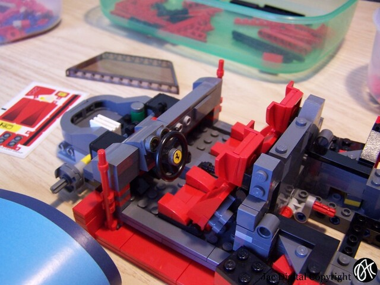](https://www.freelug.org/IMG/jpg/photo_08-2.jpg)

Pour le montage du pare-brise, j’ai oublié une plate. Du coup la partie haute ne collait pas au toit. Je trouvais ça vraiment dommage et bizarre aussi parce que ça ne se voyait pas sur les photos. En corrigeant l’erreur grâce au démonte-brique, tout est rentré dans l’ordre. Je vous avais dis que j’étais pressé d’admirer le résultat final. Mais du coup ça s’aligne parfaitement et ce n’est pas le seul endroit aussi bien prévu.

[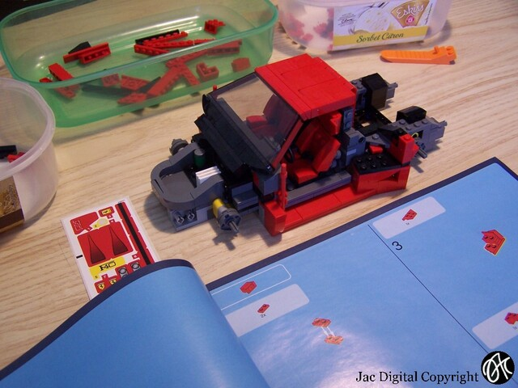](https://www.freelug.org/IMG/jpg/photo_09.jpg)

Les portes sont un peu dures à mettre en place. Il y a beaucoup de pièces à crochet qui permettent la rotation mais aussi la solidité. Du coup il faut forcer un peu pour que ça passe. Les rétroviseurs sont placés dans la continuité de l’axe. C’est possible.

On est à la fin de la première phase de la construction. La Ferrari a déjà belle allure. Il reste pas mal de pièces en extra. On n’a pas encore collé la moitié des autocollants. Mais la planche n’est pas si grande, en rapport de certaines "Speed Champions".

[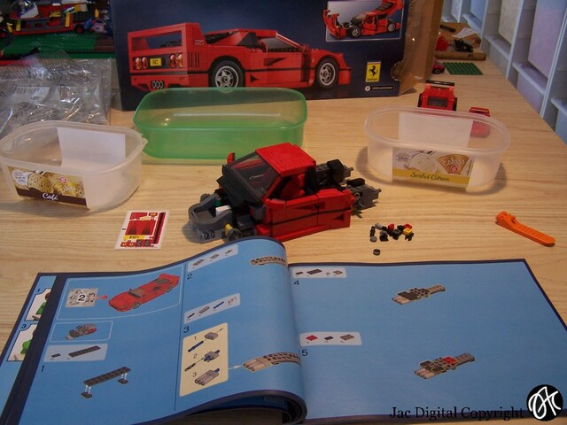](https://www.freelug.org/IMG/jpg/photo_10-3.jpg)

Deuxième et dernière phase d’ouverture de sachets. Les bacs se remplissent à nouveau. On découvre deux grandes pièces tampographiées. Il faudra se contenter de cette couleur rouge foncé. Je garde le démonte-brique à portée de main, on ne sait jamais...

[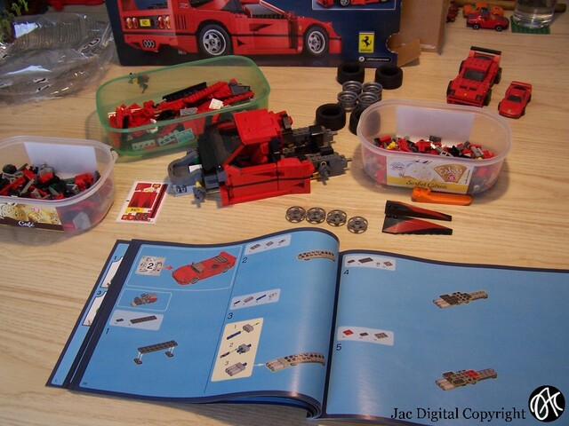](https://www.freelug.org/IMG/jpg/photo_11-3.jpg)

Ces deux plates vertes qui peuvent choquer au début ont leur utilité à cette étape. Elles permettent de rattraper l’écart de hauteur entre le châssis et le pare-choc arrière. On peut ainsi assembler le reste de la voiture sans rien casser. Il faudra les enlever à la fin bien sûr, avant de mettre les roues. J’ai trouvé ça bien pratique. On peut finir le montage sans devoir soulever la voiture sans arrêt pour maintenir les éléments.

[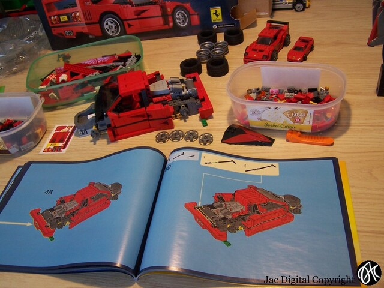](https://www.freelug.org/IMG/jpg/photo_12-2.jpg)

Lorsqu’on pose la vitre arrière sur le hayon, on est surpris par l’espace vide qui reste entre les pièces. Je me suis demandé comment il allait être comblé. Voilà la solution, très technique mais vraiment efficace. Ce petit montage remplit parfaitement l’espace. J’ai vraiment adoré ce passage.

[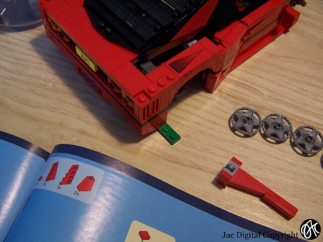](https://www.freelug.org/IMG/jpg/photo_14-3.jpg)

[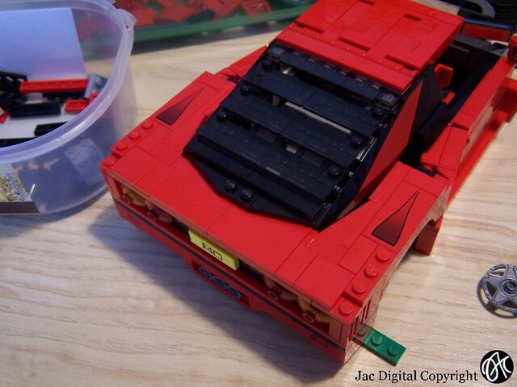](https://www.freelug.org/IMG/jpg/photo_15-2.jpg)

A cette étape on s’occupe du fonctionnement manuel des phares escamotables. C’est à lever ou baisser à la main. Mais c’est vraiment bien qu’ils y soient.

[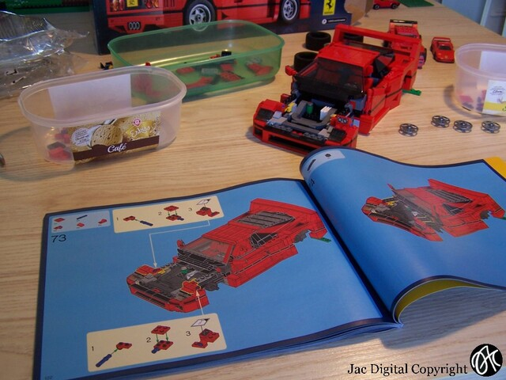](https://www.freelug.org/IMG/jpg/photo_16-2.jpg)

Et voilà enfin notre bolide terminé. Il reste pas mal de pièces en extra, dont les fameuses plates 1X4 vertes. J’ai repassé toutes les pages de la notice et je n’ai rien oublié. Il y a bien une grille rouge 1X2 en trop.

[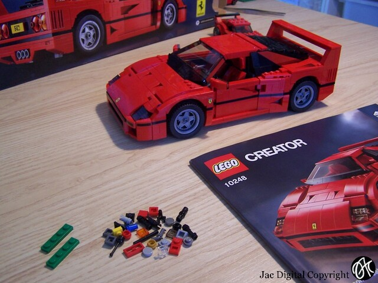](https://www.freelug.org/IMG/jpg/photo_18-2.jpg)

Pour finir, ma conclusion et quelques photos supplémentaires de la voiture. Je me suis un peu amusé à la prendre sous des angles sympas. Il faut dire que la maquette est vraiment bien finie, sous tous les angles. On prend plaisir à la manipuler et à chercher les détails.

[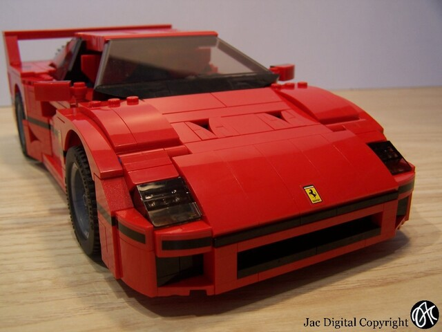](https://www.freelug.org/IMG/jpg/photo_21.jpg)

[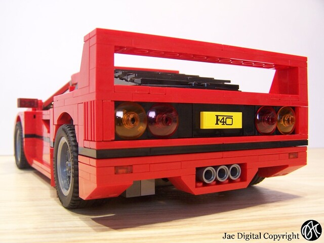](https://www.freelug.org/IMG/jpg/photo_25.jpg)

Dans les moins, je mettrais tout de même la direction absente, c’est dommage, ça donne un plus pour la présentation. Il n’y a pas les suspensions, mais ce n’est pas du "Technic". La voiture semble un peu courte. Pourtant en comparant avec les données techniques de la voiture réelle, on obtient à peu près les valeurs de notre reproduction, même pour la hauteur.

Ne faites pas comme moi, appliquez-vous pour la pose des autocollants. On n’a pas droit à l’erreur car si on les décolle, ils s’abîment et tiennent moins bien. Il faut prendre patience. J’ai surtout raté le logo "F40". C’est dommage...

Il manque une petite présentation de la voiture réelle sur la notice. Ca se fait maintenant et je trouve que c’est bien de s’instruire un peu avant d’assembler la maquette.

Comme vous le voyez, je parle de maquette parce que cette voiture est prévue pour exposition. Heureusement, on peut la manipuler sans grand risque, juste le hayon qui a tendance à s’ouvrir tout seul. Mais il n’y a rien de vraiment fragile et on peut vraiment s’amuser à tout ouvrir, tout fermer.

Justement, comparons un peu les caractéristiques :

-   Moteur : essence V8 à 90° de 2,9l, biturbo, 2 arbres à cames en tête et 32 soupapes. Sans chercher les deux arbres à cames en têtes, forcément, on peut contempler tout de même un superbe V8 lorsqu’on ouvre le capot arrière.
-   Position du moteur : Centrale arrière, longitudinale. Bin là pas de doute on y est !
-   Puissance maximale : 478 ch (352 kW) à 7 000 tr/min. Transmission : Manuelle à 5 rapports plus marche arrière, uniquement aux roues arrières. Poids à vide 1088 kg. Vitesse maximale 324 km/h. Pour tout ça vous comprendrez bien que ça ne sera pas facile. Mais vue la forme de la voiture, on a bien envie d’y aller.

Si on prend l’échelle du 1/16e :

-   Longueur réelle 4430mm, LEGO 270mm (4430/16=277)
-   Largeur réelle 1980mm, LEGO 128mm (1980/16=124)
-   Hauteur réelle 1130mm, LEGO 80mm (1130/16=71)

Pour finir, si vous êtes fan de cette Ferrari, vous pouvez y aller, vous ne serez pas déçus, il y a de très beaux détails rendus, des montages bien faits pour un résultat qui tient la route, c’est le cas de le dire.

[Toutes les photos dans ma galerie](https://photos.freelug.org/main.php/v/JAC/review/Creator/10248/)
