Voici la revue du set 10254 dans la gamme Expert : Winter Holiday Train (le train de Noël). Il est sorti en 2016 au prix de 94,99 euros pour 734 pièces. Soit un ratio de 12,9 centimes par pièce avec 5 minifigs.

La boîte possède les logos CREATOR et EXPERT. Elle montre le train dans un décor enneigé.

[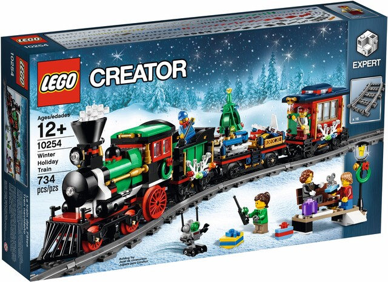](https://www.freelug.org/IMG/jpg/10254_Box1_v39-2.jpg)

Les sachets sont numérotés de 1 à 3 correspondant aux différentes étapes de montage et avec deux livrets. Ce qui permet de faire le montage en plusieurs fois.

[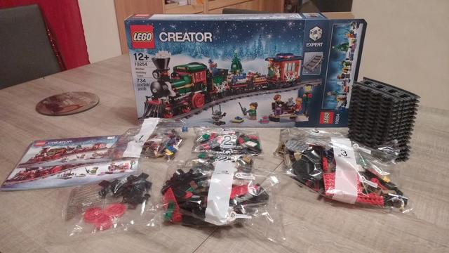](https://www.freelug.org/IMG/jpg/IMG_20160922_205154044.jpg)

Voici une nouvelle pièce (en tout cas c’est la première fois que je la vois).

[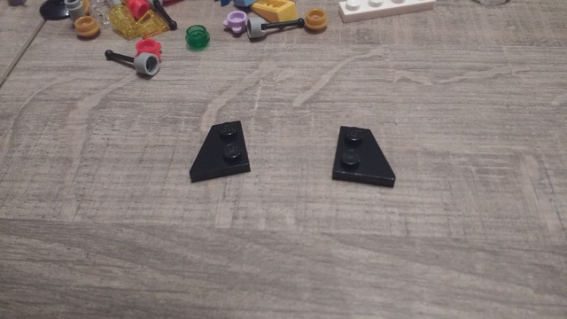](https://www.freelug.org/IMG/jpg/IMG_20160922_205411111.jpg)

## Etape 1 - Le quai

Cette étape comprend juste un petit sachet et le petit livret.  
Voici les Minifigs avec la dame qui dort !

[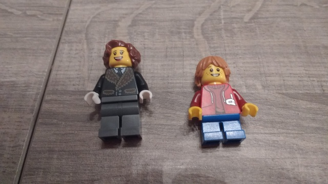](https://www.freelug.org/IMG/jpg/IMG_20160922_205452331.jpg)

[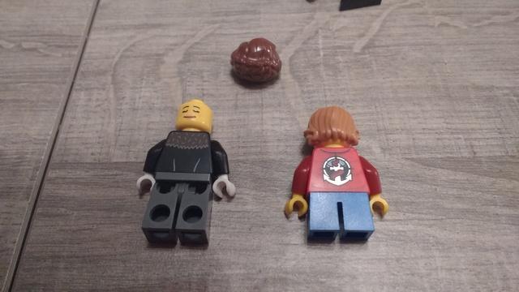](https://www.freelug.org/IMG/jpg/IMG_20160922_205505074.jpg)

Et le quai avec les jouets.

[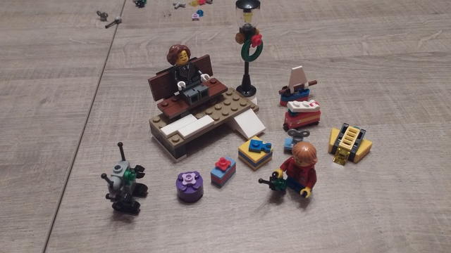](https://www.freelug.org/IMG/jpg/IMG_20160922_210306267.jpg)

## Etape 2 - La locomotive et le Tender

On monte maintenant la locomotive.  
Le montage des essieux se fait de manière à pouvoir le motoriser.

[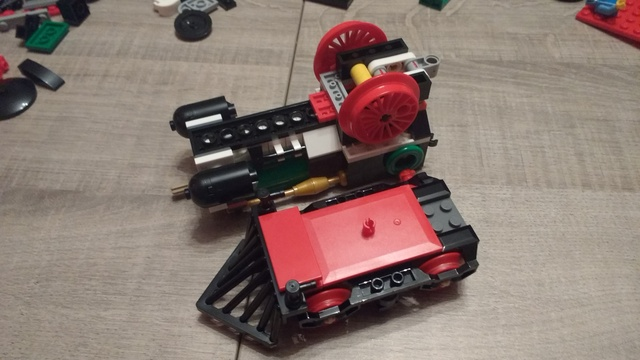](https://www.freelug.org/IMG/jpg/IMG_20160922_211923936.jpg)

Avec une pièce spéciale construite pour être remplacée par un capteur infrarouge (IR).

[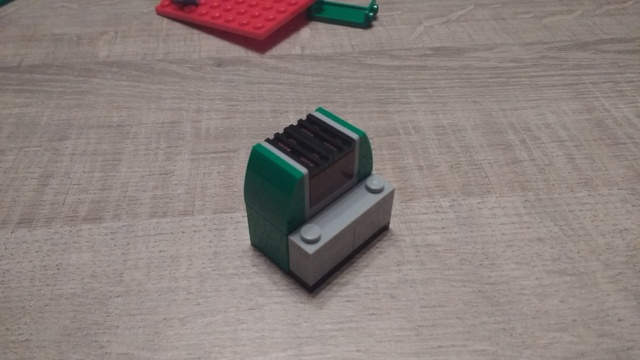](https://www.freelug.org/IMG/jpg/IMG_20160922_212200565.jpg)

[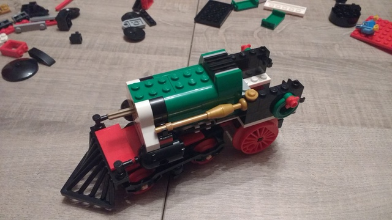](https://www.freelug.org/IMG/jpg/IMG_20160922_212210616.jpg)

On monte le tender avec une partie amovible pour pouvoir mettre une batterie.

[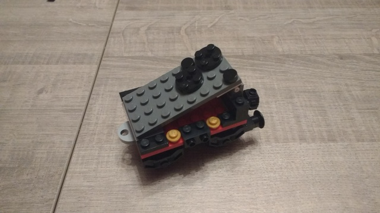](https://www.freelug.org/IMG/jpg/IMG_20160922_214919092.jpg)

Et voici le résultat avec le conducteur et la fumée...

[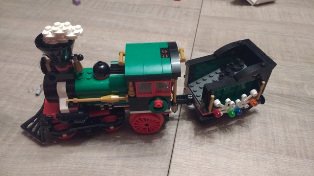](https://www.freelug.org/IMG/jpg/IMG_20160922_215353162.jpg)

[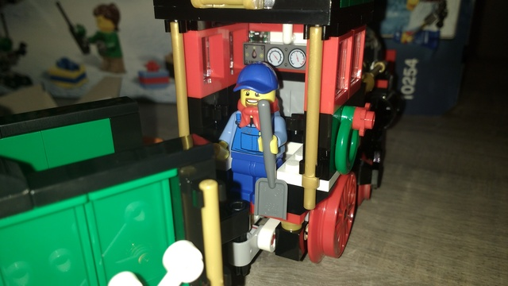](https://www.freelug.org/IMG/jpg/IMG_20160922_215722607.jpg)

## Etape 3 - Les wagons

On finit avec les deux wagons.  
Voici les Minifigs.

[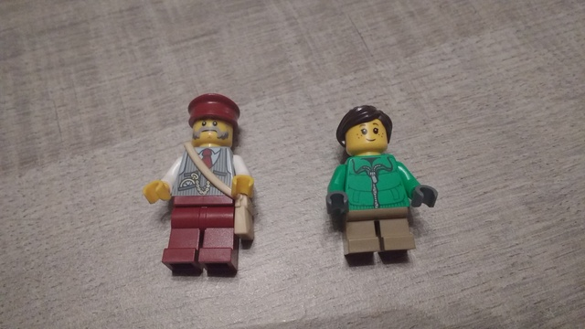](https://www.freelug.org/IMG/jpg/IMG_20160922_215807305.jpg)

Une nouvelle façon de faire le pied du sapin.

[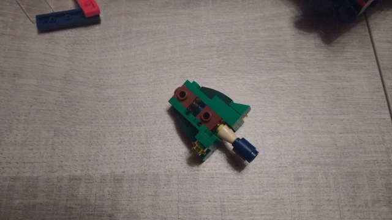](https://www.freelug.org/IMG/jpg/IMG_20160922_220951480.jpg)

Un mécanisme pour le faire tourner.

[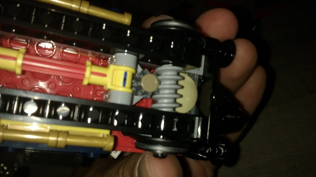](https://www.freelug.org/IMG/jpg/IMG_20160922_221127398.jpg)

Voici le premier wagon.

Et le deuxième.

[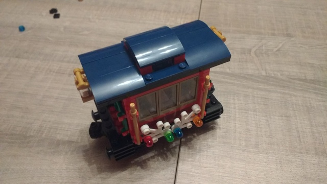](https://www.freelug.org/IMG/jpg/IMG_20160922_222049584.jpg)

Voici les pièces supplémentaires après le montage.

[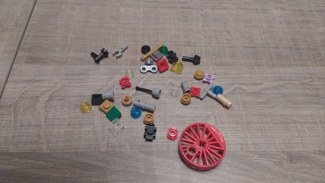](https://www.freelug.org/IMG/jpg/IMG_20160922_222314871.jpg)

Et voilà l’ensemble.

[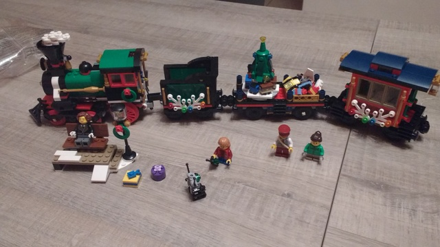](https://www.freelug.org/IMG/jpg/IMG_20160922_222731735.jpg)

[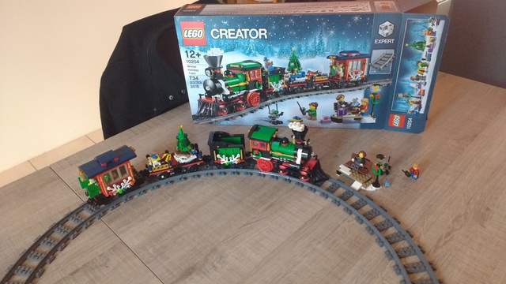](https://www.freelug.org/IMG/jpg/IMG_20160923_171430426.jpg)

**Animations du montage** (Cliquez pour lancer l’animation)

Le Quai

[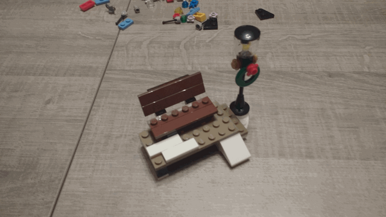](https://www.freelug.org/IMG/gif/Quai.gif)

La Locomotive

[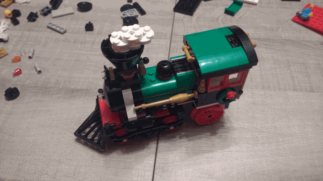](https://www.freelug.org/IMG/gif/Locomotive.gif)

Le Tender

[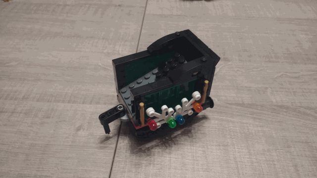](https://www.freelug.org/IMG/gif/Tender.gif)

Le premier wagon

[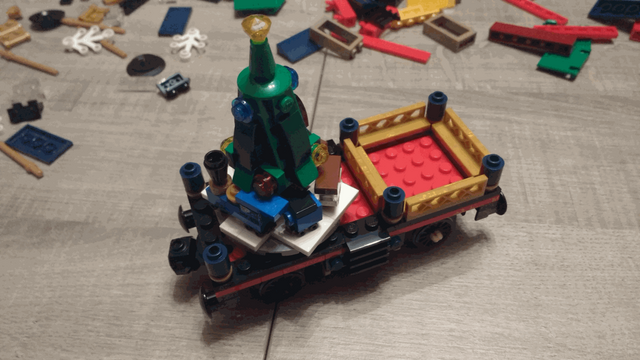](https://www.freelug.org/IMG/gif/Wagon1.gif)

Le deuxième wagon

**Motorisation**

Toute la procédure pour motoriser est décrite dans le livret de montage.  
On peut faire un montage avec récepteur IR pour pouvoir le télécommander à distance.

[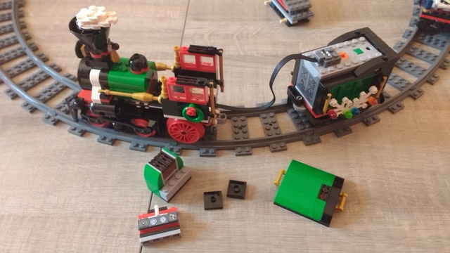](https://www.freelug.org/IMG/jpg/IMG_20160923_174933683.jpg)

[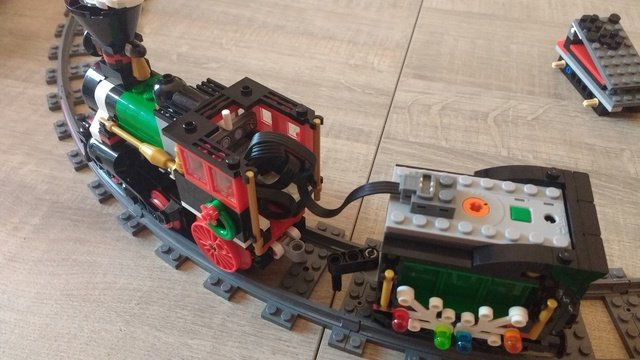](https://www.freelug.org/IMG/jpg/IMG_20160923_175059447.jpg)

Ou simplement utiliser une batterie et se servir du variateur intégré.

[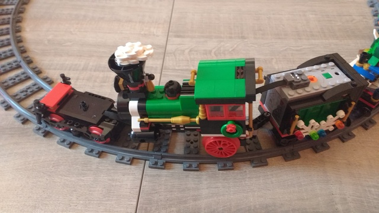](https://www.freelug.org/IMG/jpg/IMG_20160923_174830544.jpg)
