Voici la revue du set 10937 dans la gamme DC comics : Arkham Asylum Breakout (l’évasion de l’asile d’Arkham). Il est sorti en 2012 au prix de 159,99 euros pour 1619 pièces. Soit un ratio de 9,9 centimes par pièce avec 8 minifigs.

La boite montre le set sur un fond de forêt avec le détail des 8 minifigs incluses.

[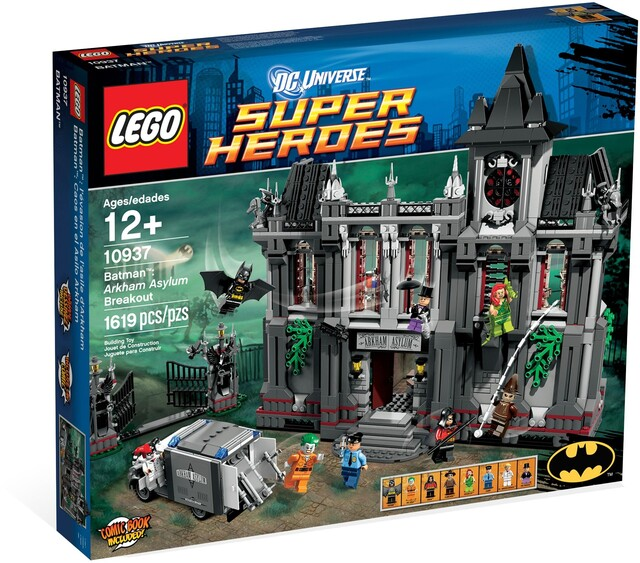](https://www.freelug.org/IMG/jpg/10937_alt1.jpg)

Dans la boite on trouve 3 livrets, une BD et 9 sachets

[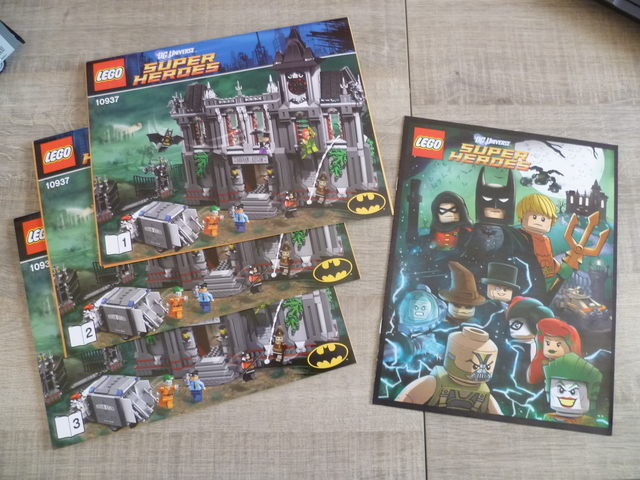](https://www.freelug.org/IMG/jpg/P1080282.jpg)

## Etape 1 : l’ambulance

Voici les pièces du sachet 1,

[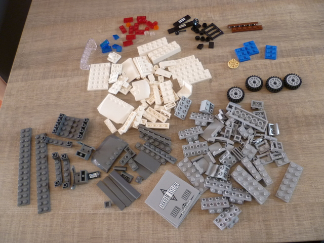](https://www.freelug.org/IMG/jpg/P1070948.jpg)

Et les minifigs dont le Joker en tenue orange.

[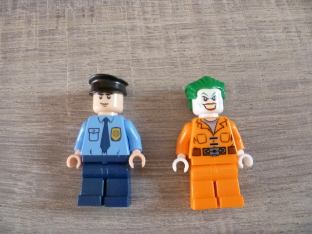](https://www.freelug.org/IMG/jpg/P1070949.jpg)

[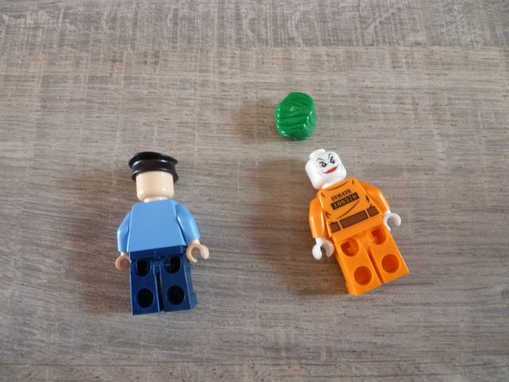](https://www.freelug.org/IMG/jpg/P1070950.jpg)

L’ambulance possède pas mal de pièces cachées en trans-red.

[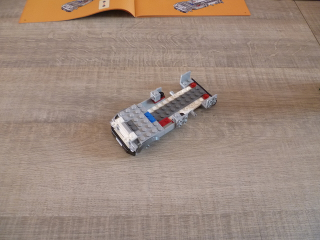](https://www.freelug.org/IMG/jpg/P1070965.jpg)

Elle procède aussi au montage de tiles pour pouvoir mettre un grand autocollant ‘ARKHAM ASYLUM’. A la fin du montage on procède à la réalisation d’une civière-camisole pour le Joker.

[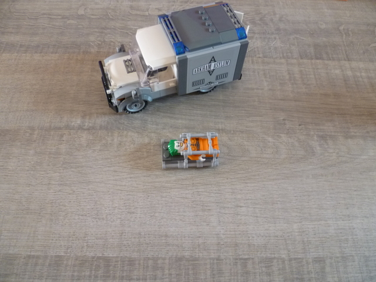](https://www.freelug.org/IMG/jpg/P1070995.jpg)

## Etape 2 : le portail

Voici les pièces du sachet 2,

[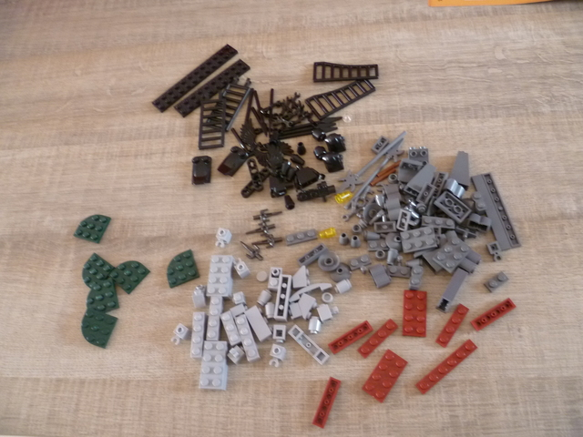](https://www.freelug.org/IMG/jpg/P1080001.jpg)

Et la minifig de BATMAN.

[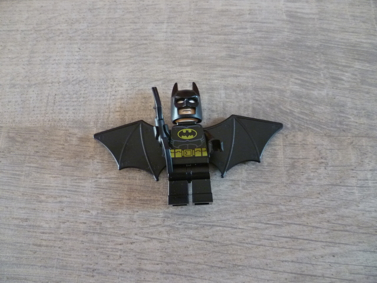](https://www.freelug.org/IMG/jpg/P1070998.jpg)

[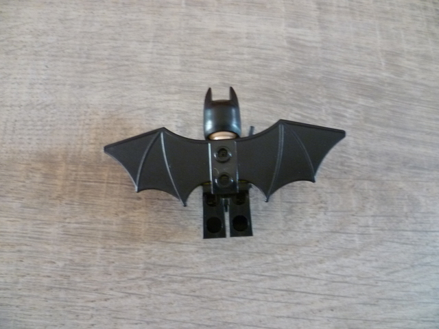](https://www.freelug.org/IMG/jpg/P1070999.jpg)

Ce portail est vraiment très intéressant à monter avec les statues sur les piliers,

[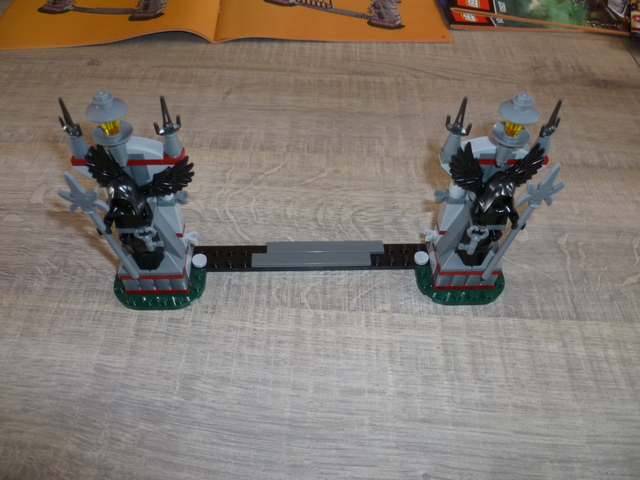](https://www.freelug.org/IMG/jpg/P1080027.jpg)

Et le portail lui-même se compose de deux pièces reliées entre elles par des bras.

[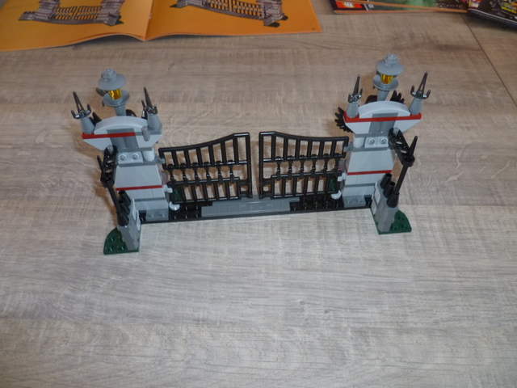](https://www.freelug.org/IMG/jpg/P1080033.jpg)

## Etape 3 : le bâtiment principal

Voici les pièces du sachet 3,

[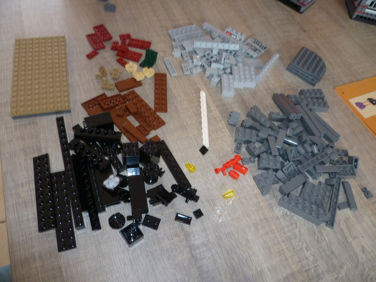](https://www.freelug.org/IMG/jpg/P1080036.jpg)

Et la minifig du Pinguin.

[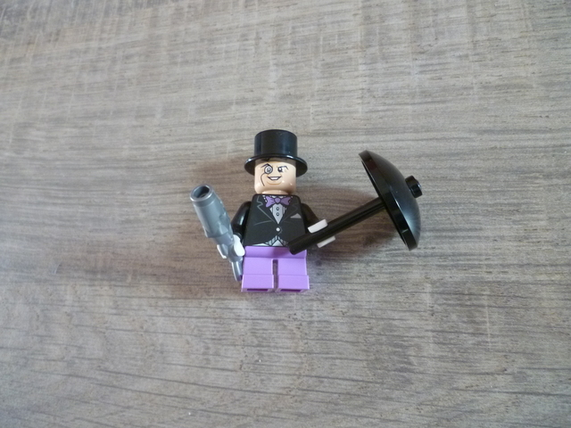](https://www.freelug.org/IMG/jpg/P1080037.jpg)

[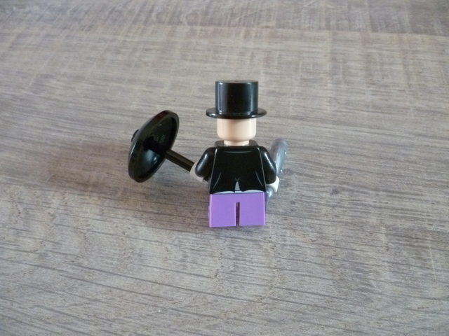](https://www.freelug.org/IMG/jpg/P1080038.jpg)

Voici le centre de contrôle du bâtiment principal,

[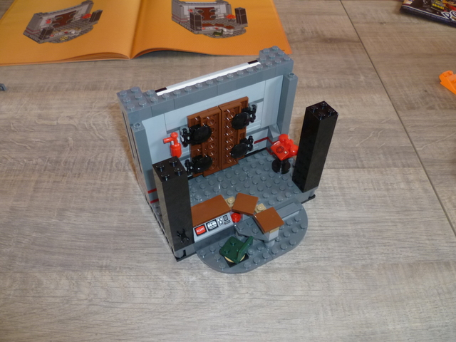](https://www.freelug.org/IMG/jpg/P1080069.jpg)

Et l’entrée à la fin du sachet 3.

[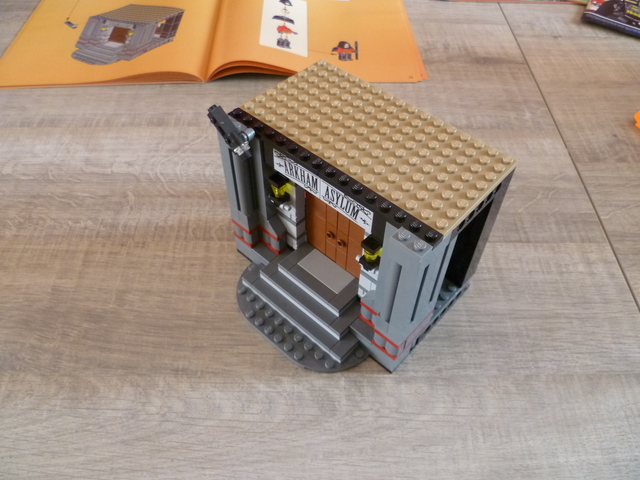](https://www.freelug.org/IMG/jpg/P1080072.jpg)

Voici les pièces du sachet 4,

[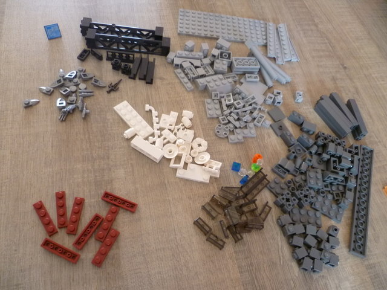](https://www.freelug.org/IMG/jpg/P1080074.jpg)

Et la minifig de Robin avec une cape noire.

[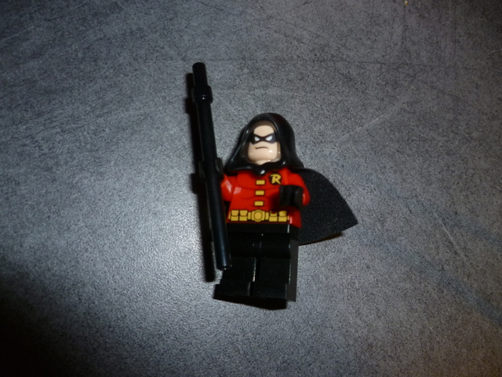](https://www.freelug.org/IMG/jpg/P1090199.jpg)

[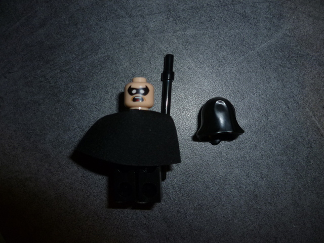](https://www.freelug.org/IMG/jpg/P1090200.jpg)

Ce bâtiment utilise un système de fenêtre très original,

[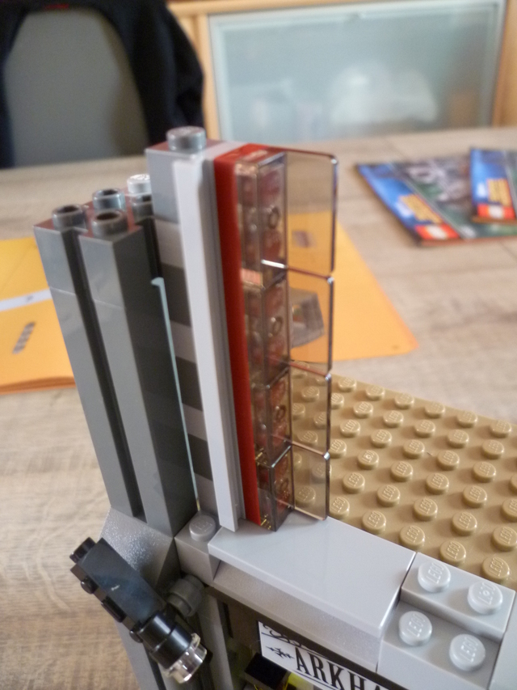](https://www.freelug.org/IMG/jpg/P1080082.jpg)

Pour un résultat très réussi à mon goût,

[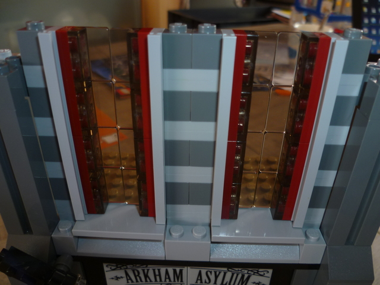](https://www.freelug.org/IMG/jpg/P1080085.jpg)

Voici la vue d’ensemble de la façade terminée.

[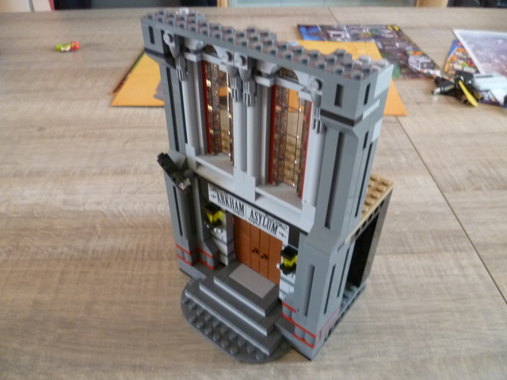](https://www.freelug.org/IMG/jpg/P1080093.jpg)

On finit par l’aménagement de l’étage avec la table d’auscultation et un bureau avec tiroir ouvert. Ainsi que la finition du toit.

[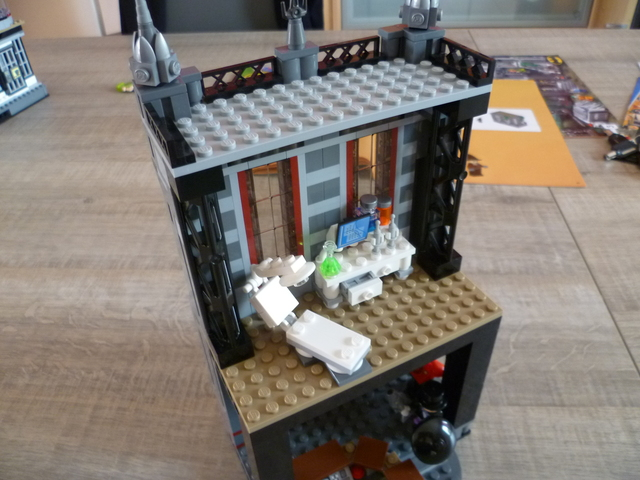](https://www.freelug.org/IMG/jpg/P1080115.jpg)

## Etape 4 : la première aile

Voici les pièces du sachet 5,

[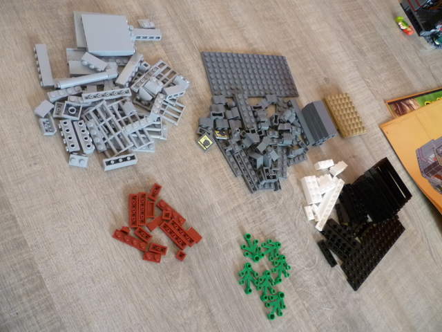](https://www.freelug.org/IMG/jpg/P1080118.jpg)

Et la minifig de SCARECROW.

[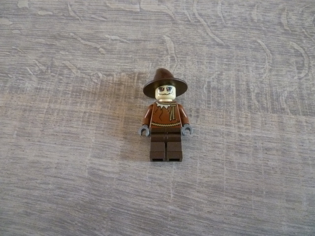](https://www.freelug.org/IMG/jpg/P1080116.jpg)

[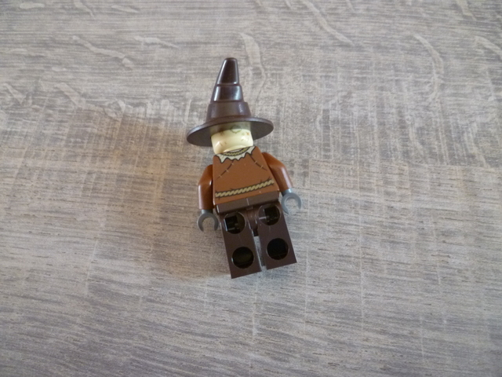](https://www.freelug.org/IMG/jpg/P1080117.jpg)

Cette aile est l’aile des prisons avec des cellules aux portes coulissantes.

[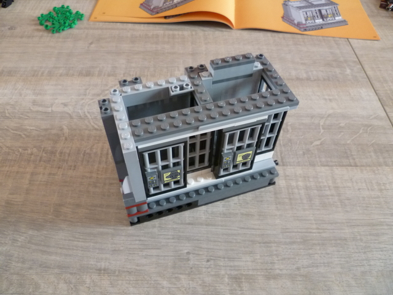](https://www.freelug.org/IMG/jpg/P1080151.jpg)

On finit le sachet 5 par l’habillage de la façade avec un système de plante grimpante déjà utilisé dans d’autres sets (notamment la mairie).

[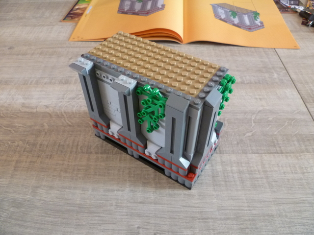](https://www.freelug.org/IMG/jpg/P1080158.jpg)

Voici les pièces du sachet 6,

[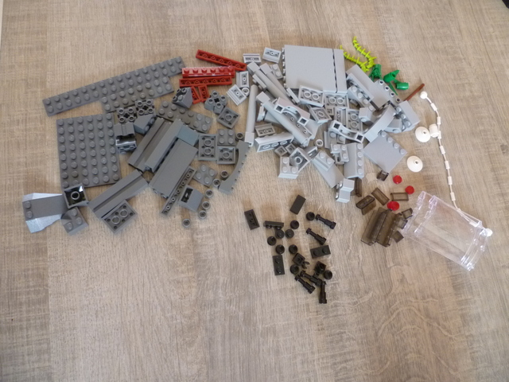](https://www.freelug.org/IMG/jpg/P1080159.jpg)

Et la minifig de Poison IVY.

[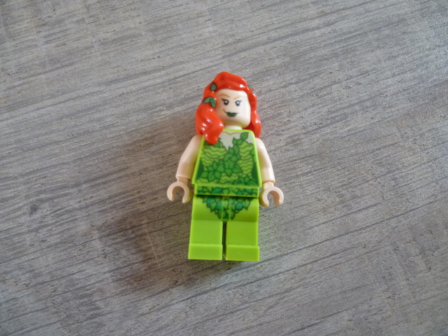](https://www.freelug.org/IMG/jpg/P1080160.jpg)

[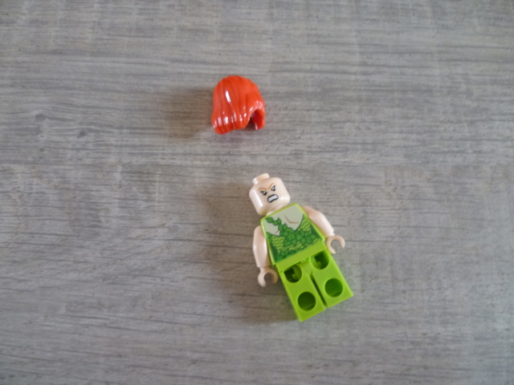](https://www.freelug.org/IMG/jpg/P1080161.jpg)

On poursuit le montage de cette aile par la façade du 1er étage avec le système de vitre, mais cette fois avec des carreaux cassés et un système à barreaux (avec des crochets pour attacher de la végétation).

[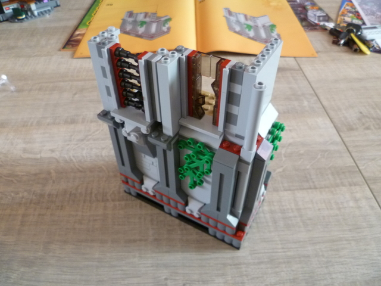](https://www.freelug.org/IMG/jpg/P1080176.jpg)

On finit le sachet par l’intérieur avec une cellule en verre (qui peut s’ouvrir).

[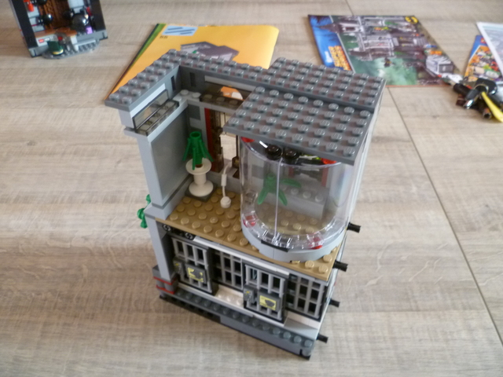](https://www.freelug.org/IMG/jpg/P1080191.jpg)

Voici les pièces du sachet 7,

[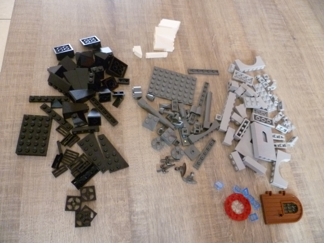](https://www.freelug.org/IMG/jpg/P1080192.jpg)

Pas de minifig pour ce sachet.

On finit cette aile par une cellule de congélation,

[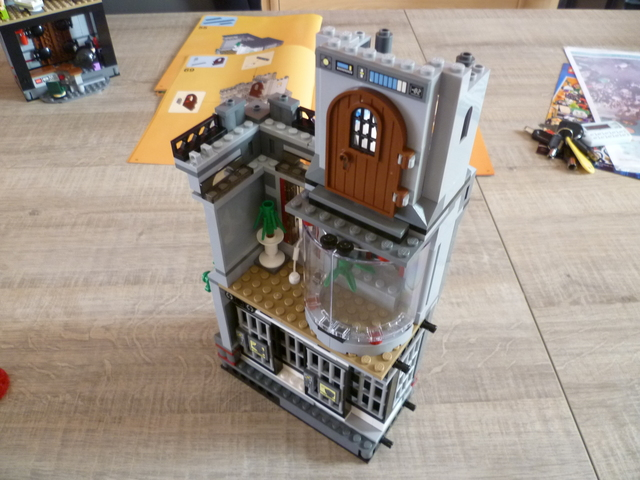](https://www.freelug.org/IMG/jpg/P1080204.jpg)

Un vitrail en façade,

[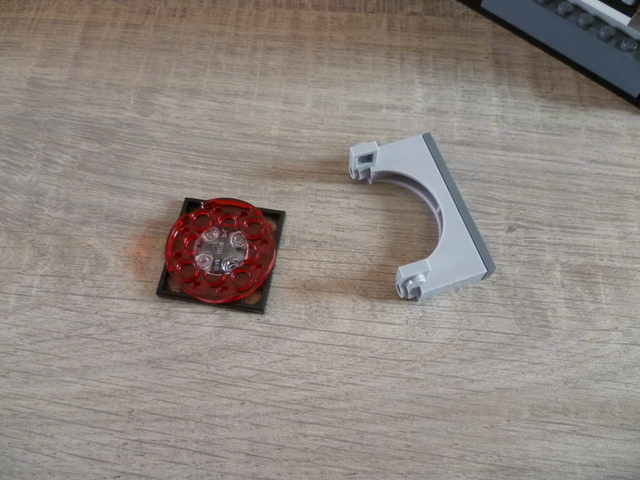](https://www.freelug.org/IMG/jpg/P1080205.jpg)

[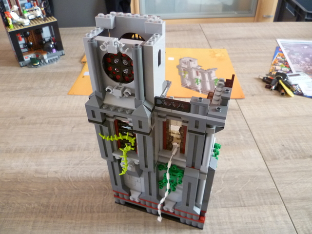](https://www.freelug.org/IMG/jpg/P1080207.jpg)

Et le toit avec une gargouille très originale.

[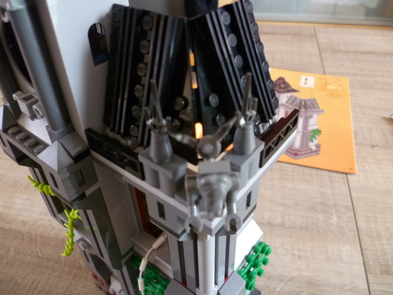](https://www.freelug.org/IMG/jpg/P1080216.jpg)

Voici l’aile finie.

[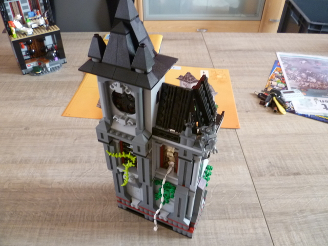](https://www.freelug.org/IMG/jpg/P1080215.jpg)

## Etape 5 : la deuxième aile

Voici les pièces du sachet 8,

[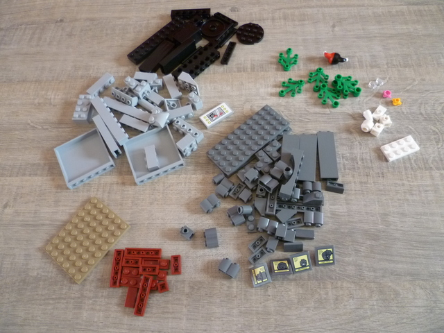](https://www.freelug.org/IMG/jpg/P1080217.jpg)

Et la minifig d’Arlequinn.

[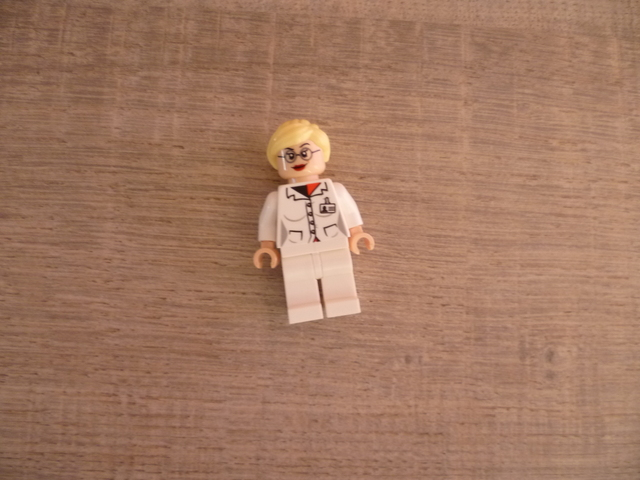](https://www.freelug.org/IMG/jpg/P1080376.jpg)

[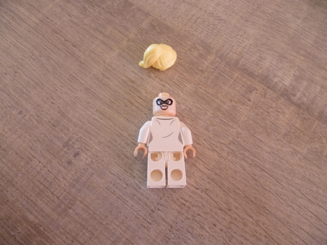](https://www.freelug.org/IMG/jpg/P1080377.jpg)

La façade de cette deuxième aile est dans le même style que la première.  
Cette deuxième aile renferme les panneaux de contrôle des cellules,

[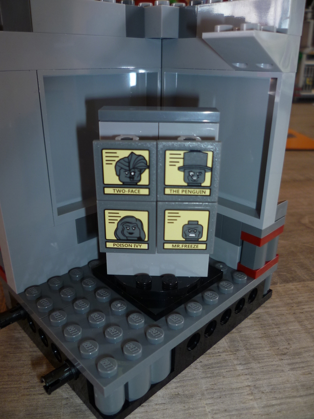](https://www.freelug.org/IMG/jpg/P1080249.jpg)

Qui cache la loge d’Arlequinn si on le tourne,

[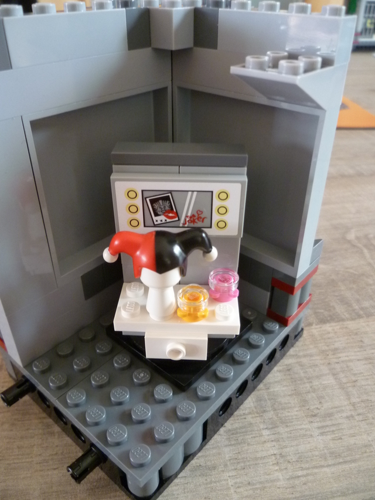](https://www.freelug.org/IMG/jpg/P1080248.jpg)

Voici le résultat à la fin du sachet 8.

[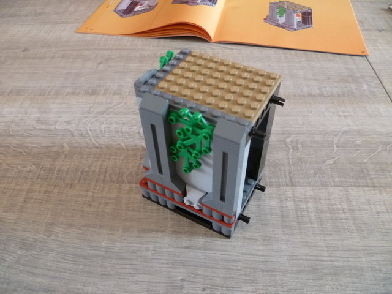](https://www.freelug.org/IMG/jpg/P1080254.jpg)

Voici les pièces du sachet 9 (le dernier),

[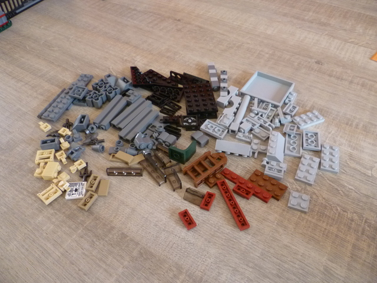](https://www.freelug.org/IMG/jpg/P1080255.jpg)

Pas de minifigs pour ce sachet.

L’étage de cette aile reste dans le même style que la première et possède un bureau avec un montage très original.

[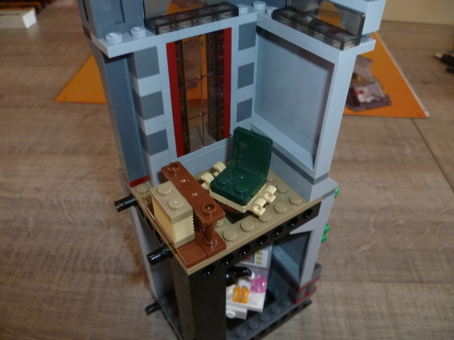](https://www.freelug.org/IMG/jpg/P1080275.jpg)

[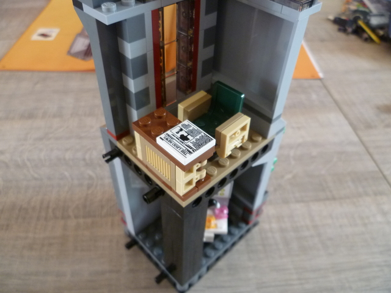](https://www.freelug.org/IMG/jpg/P1080278.jpg)

Voici la vue d’ensemble de face :

[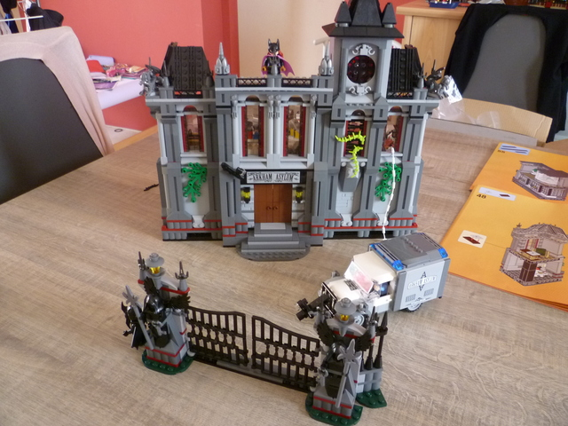](https://www.freelug.org/IMG/jpg/P1080281.jpg)

Et de l’intérieur.

J’ai beaucoup aimé le montage de ce set qui présente beaucoup de montages différents qui rentre bien dans des gammes destinées aux plus exigeants.

**Animations de montage** (Cliquez pour lancer l’animation)

L’ambulance

Le Portail

Le bâtiment principal

La première aile

La deuxième aile

