FreeLUG vous propose en avant-première la review du set [LEGO Ideas](https://ideas.lego.com/) n°21304 : Doctor Who qui sera disponible le 1er décembre 2015

Pour cette review en avant première nous vous proposons de découvrir le set LEGO Ideas n°21304 : Doctor Who.

## Pour commencer qu’est ce que [LEGO Ideas](https://ideas.lego.com/) ?

LEGO Ideas est un programme de la société LEGO qui permet à tout le monde de proposer des idées de modèles, soumis au vote du public.  
Si votre proposition atteint les 10 000 votes, LEGO étudiera la possibilité de réaliser votre modèle.

Cette initiative a permis à différents sets de sortir, notamment plusieurs sous licences, tel que "_Back to the futur_" ou "_Ghostbuster_".  
Ces deux exemples ne sont pas anodins de ma part, puisqu’ils touchent plutôt des adultes geeks (tel que moi-même). Et donc le set que je vous présente ici est dans la lignée de ceux-ci : le set basé sur la série de la BBC "_Doctor Who_"

## Docteur Qui ?

[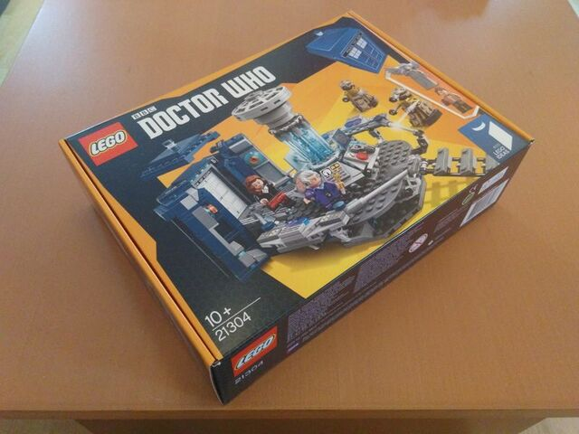](https://www.freelug.org/IMG/jpg/IMG_20151121_134034.jpg)

Voici quelques information sur le set :

-   n°21304
-   Date de sortie : 1er décembre, sur le [S@H](http://shop.lego.com/fr-FR/Doctor-Who-21304) et dans les LEGO Stores
-   Prix public : 54,99€ pour la France (à noter : 5€ de moins que chez nos voisins allemands)
-   623 pièces

## Partons à la découverte du set

Quelques photos de la boite :

[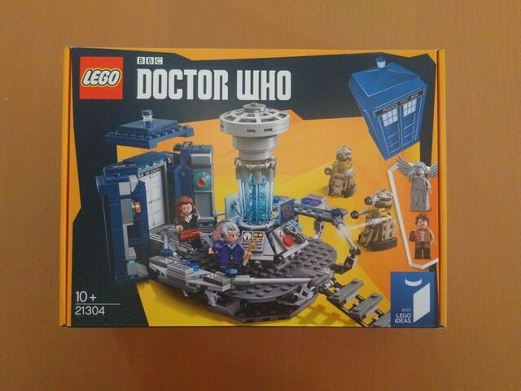](https://www.freelug.org/IMG/jpg/IMG_20151121_133959.jpg)

**L’avant de la boite**

[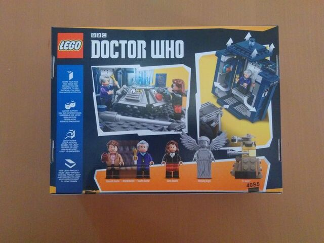](https://www.freelug.org/IMG/jpg/IMG_20151121_134008.jpg)

**L’arrière de la boite**

A l’intérieur, outre la notice, nous découvrons 6 sachets de pièces.

[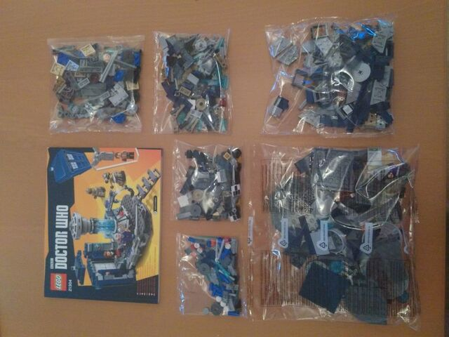](https://www.freelug.org/IMG/jpg/IMG_20151121_153014.jpg)

**Contenu de la boite**

Ceux-ci sont non numérotés, donc pas de construction par sous-ensembles comme dans d’autres gammes (comme City), ce qui est bien pour un set visant plutôt les adultes.

[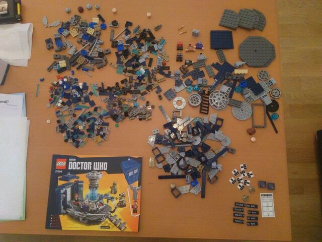](https://www.freelug.org/IMG/jpg/IMG_20151121_153904.jpg)

**Après ouverture !**

La notice est de belle facture, comme souvent dans cette gamme LEGO Ideas. Vous trouverez plus de détails sur le contenu informatif de la notice dans ma galerie, en fin d’article.

[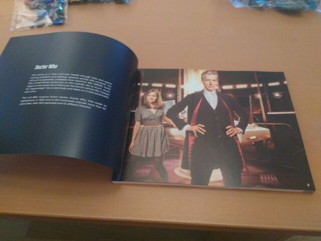](https://www.freelug.org/IMG/jpg/IMG_20151121_153108.jpg)

**Aperçu de la notice**

A noter aussi, ce set ne contient aucun stickers et contient donc de très belles pièces sérigraphiées. Les minifigs sont particulièrement réussies.

[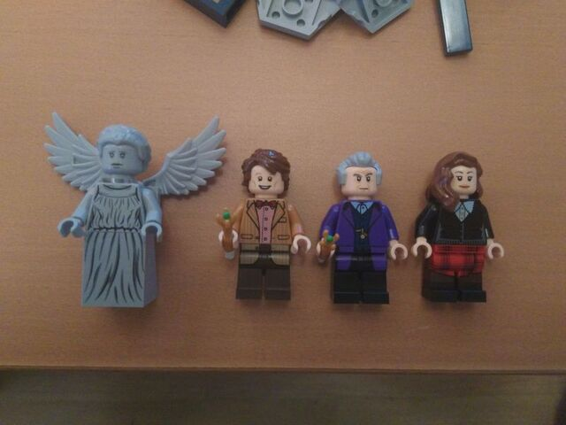](https://www.freelug.org/IMG/jpg/IMG_20151121_154305.jpg)

**Minifigs vue de face**

[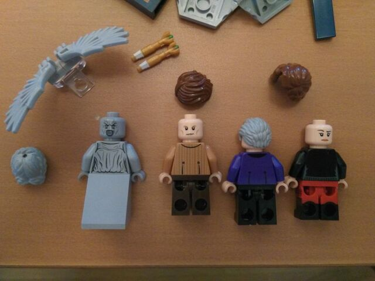](https://www.freelug.org/IMG/jpg/IMG_20151121_154430.jpg)

**Minifigs vue de dos**

L’ange ferait une très belle statue gothique ! Par contre, dommage, le 12ème docteur n’a pas deux visages à l’inverse des autres figurines.

[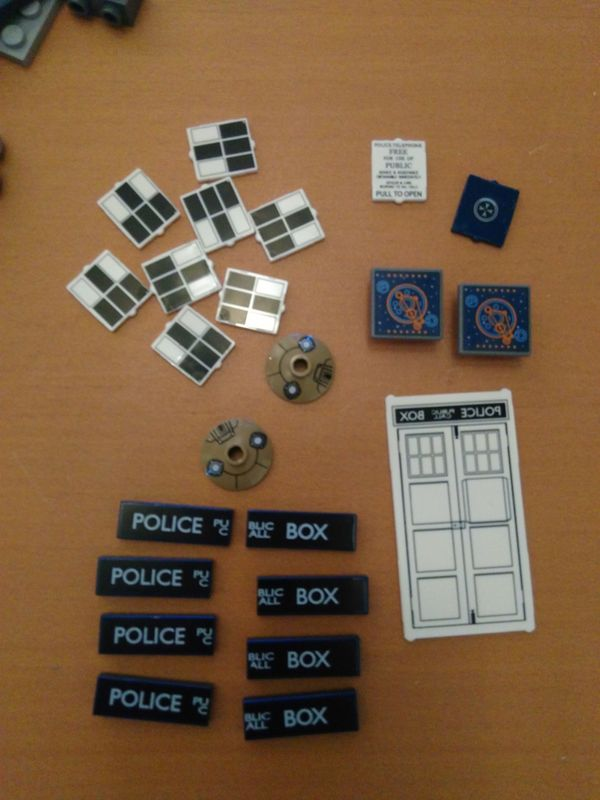](https://www.freelug.org/IMG/jpg/IMG_20151121_155049.jpg)

**Pièces sérigraphiées**

[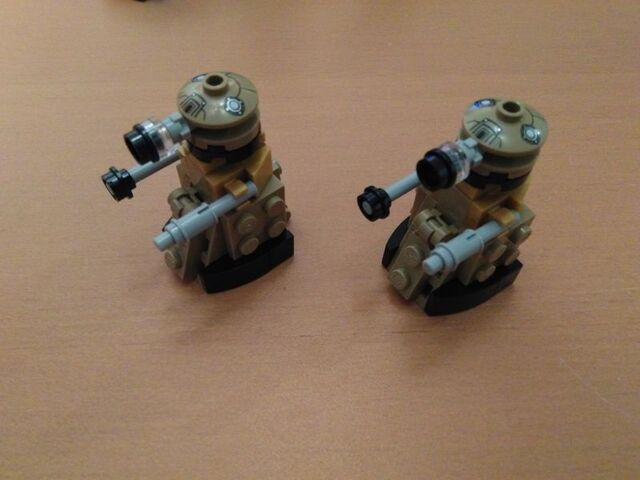](https://www.freelug.org/IMG/jpg/IMG_20151121_200755.jpg)

**Ahhhh des Daleks !**

## La construction

Pour ne pas trop vous en dire sur les techniques de construction ainsi que sur les détails de l’ensemble, je ne vous présenterai pas la construction pas-à-pas.

Dans un premier temps il faut construire l’intérieur du Tardis.  
C’est sans doute celui-ci qui concentre le plus de jus de cerveaux coté idées et détournement de pièces.

[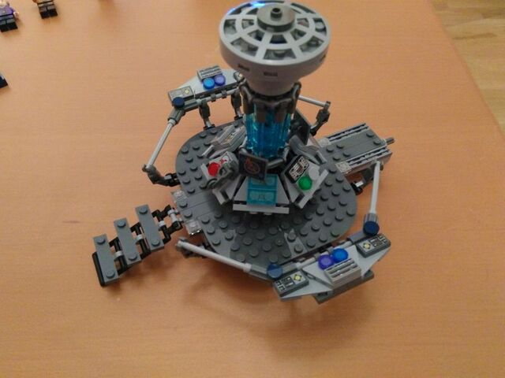](https://www.freelug.org/IMG/jpg/IMG_20151121_200818.jpg)

**L’intérieur du Tardis**

Ensuite, il faut monter la cabine téléphonique qui est ce que le vaisseau du docteur semble être vu de l’extérieur.

[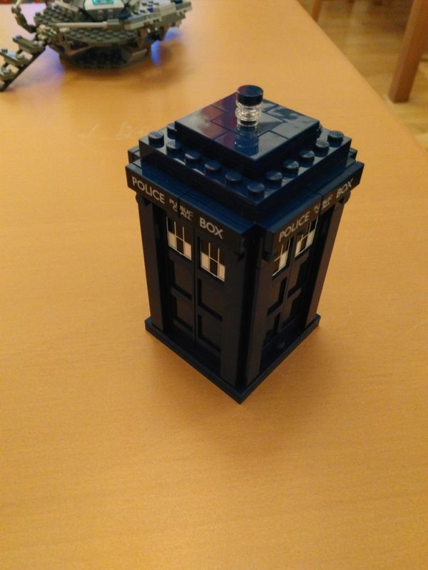](https://www.freelug.org/IMG/jpg/IMG_20151121_200845.jpg)

**Le Tardis refermé**

[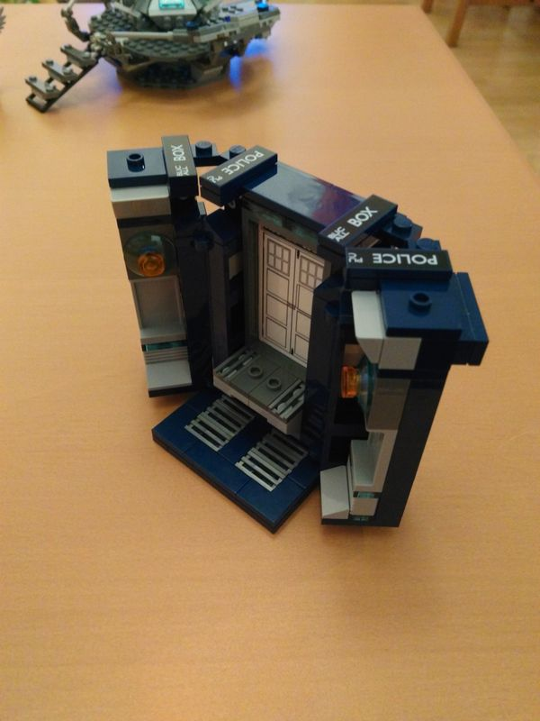](https://www.freelug.org/IMG/jpg/IMG_20151121_200831.jpg)

**Tardis ouvre-toi !**

L’ensemble donne un set sympa à construire et qui semble aussi laisser la possibilité aux plus jeunes de jouer avec.

[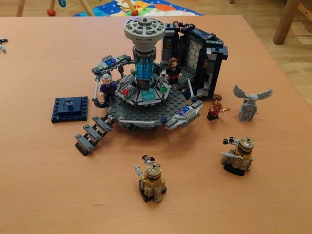](https://www.freelug.org/IMG/jpg/IMG_20151121_201148.jpg)

**Vue d’emsemble : il est bien plus grand à l’intéireur !**

L’ensemble des extra-parts laisse entrevoir toutes les petites pièces qui sont utilisées dans le set.

[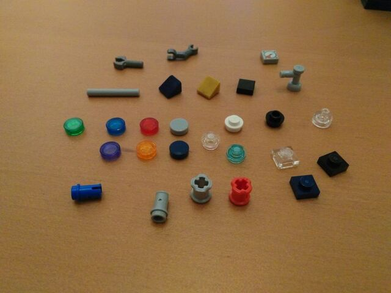](https://www.freelug.org/IMG/jpg/IMG_20151121_194114.jpg)

La notice finit sur une publicité pour LEGO Dimension, et surtout sur l’autre version du 12ème docteur qu’il est possible de se procurer avec un des ensembles de ce jeu vidéo.

[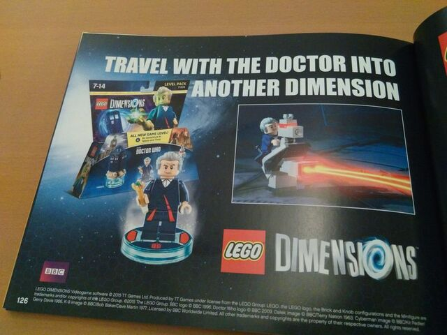](https://www.freelug.org/IMG/jpg/IMG_20151121_201244.jpg)

**Le Docteur dans une autre "Dimension"**

Pour finir je tiens à remercier mon fils qui m’a un peu aidé, puisqu’il est resté bien sage en écharpe avec moi pendant une partie du montage !

**Les constructeurs :)**

Je ne sais pas si cette review vous donnera l’envie d’acheter de set, mais en tout cas, pour moi ce fut un plaisir de le monter et de le découvrir.

**Pierre**

[Galerie Photo](http://photos.freelug.org/main.php/v/Pierre_13/Reviews/21304/)
