Mes filles ont monté avec plaisir deux boites Creator. Elles ont bien aimé mais il y a aussi des choses qui ne leur ont pas plu. Nous avons monté seulement un modèle de chaque boite, ce qui est déjà pas mal.

J’ai choisi une maison et le van de vacances. Ils sont prévus tous les deux pour des enfants un peu plus grands. Mes filles ont 6 et 4 ans. Mais j’avais prévu de les aider. Un œil d’un côté, un de l’autre, ça fait un peu jongler mais c’est possible. Tout s’est très bien déroulé, elles étaient même impatientes de terminer pour jouer, ça motive. Mais on a du prendre quelques pauses car l’air de rien, ça fatigue aussi.

Nous commençons par le point habituel sur les boites.

Les petites maisons 31009 :

-   Année de sortie 2013. Elle n’est plus disponible sur le "shop" à l’heure où j’écris ces lignes.
-   267 pièces
-   1 minifig.
-   Les sachets ne sont pas numérotés.
-   Temps de montage, ma fille a mis environ 2h30mn.

Les véhicules plage 31079 :

-   Année de sortie 2018. Elle n’est plus disponible sur le "shop" à l’heure où j’écris ces lignes.
-   371 pièces
-   2 minifigs.
-   Les sachets ne sont pas numérotés.
-   Temps de montage, ma fille a mis environ 3h.

Les 2 boites présentent le modèle principal avec deux encarts pour les constructions alternatives, sur la face avant. C’est la présentation habituelle de la gamme 3 en 1.

[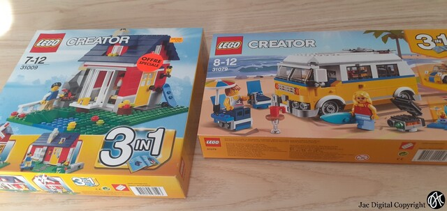](https://www.freelug.org/IMG/jpg/photo_1_-9.jpg)

A l’arrière nous découvrons les deux modèles supplémentaires avec quelques mises en situations. Les filles ont envie de tout construire. Mais il faut détruire l’un pour faire l’autre, ou chercher les pièces dans son vrac personnel. D’ailleurs, on peut les construire en changeant des couleurs si on n’a pas toutes les pièces.

[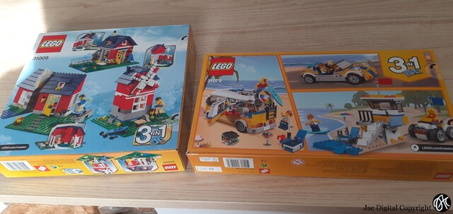](https://www.freelug.org/IMG/jpg/photo_2_-9.jpg)

Les parties en carton à appuyer pour ouvrir les boites sont très résistantes. Il a fallu que je le fasse à la place de mes filles.

La boite du van contient quelques sachets non numérotés. Les petites pièces sont séparées des plus grosses. Les trois notices ont aussi leur emballage.

[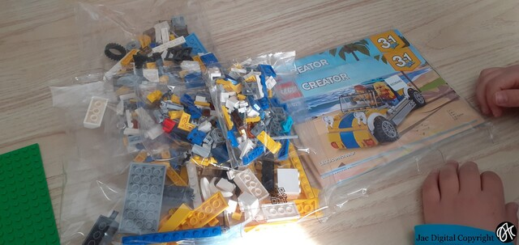](https://www.freelug.org/IMG/jpg/photo_3_-8.jpg)

Pour la maison qui est un peu plus âgée de conception, on a toujours les sachets pour séparer plus ou moins la taille des pièces. Mais les notices sont libres dans la boite.

[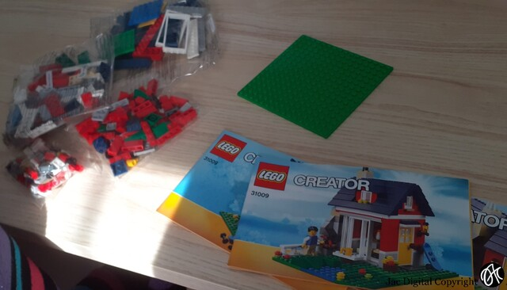](https://www.freelug.org/IMG/jpg/photo_4_-7.jpg)

Quand on a tout déballé, ça fait un bon petit paquet de pièces. Mais avec un peu d’aide, tout va bien se passer. Je suis même surpris, à certains moments, par la facilité que mes filles ont à trouver certaines pièces.

La grande plaque verte a bien plu.

[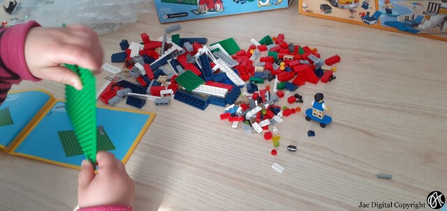](https://www.freelug.org/IMG/jpg/photo_5_-4.jpg)

Pas facile de retenir les petites mains, le temps de la photo, mes filles sont pressées... Mais ça veut dire que j’ai bien choisi les boites. Le montage va être d’autant plus intéressant pour elles.

[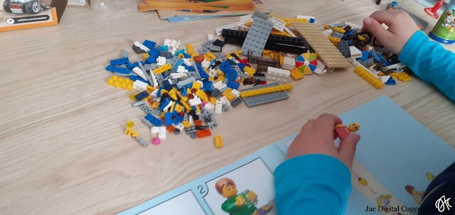](https://www.freelug.org/IMG/jpg/photo_6_-7.jpg)

Le fonctionnement des petites baies coulissantes a bien plu. Mais il faut attendre d’avancer un peu plus dans la construction pour vraiment les faire fonctionner. Il faut prendre patience.

Bon, j’avais oublié de mettre la poignée sur la porte. Heureusement que ma fille surveillait !

[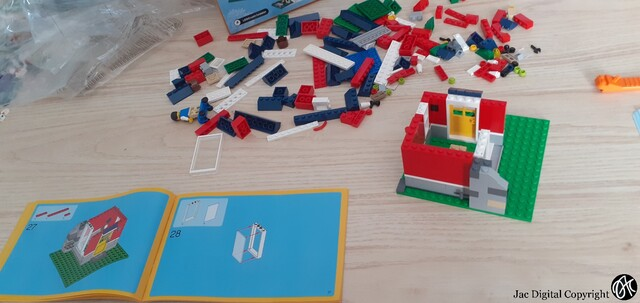](https://www.freelug.org/IMG/jpg/photo_8_-6.jpg)

De l’autre coté, pour le van, on est impatient de mettre les roues. Il faut attendre l’étape 73 pour le faire. Je ne vois pas vraiment ce qui gêne de mettre cette étape plus tôt. Peut-être éviter que la construction roule par terre. Mais ne vous inquiétez pas Monsieur LEGO, les petites mains ne lâchent pas longtemps le modèle…

[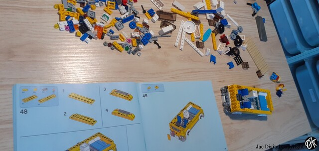](https://www.freelug.org/IMG/jpg/photo_11_-7.jpg)

Le toit de la maison est un empilage de pièces assez simple à monter. Il faut quand même faire attention à bien les placer. Il n’y a aucun aménagement intérieur dans cette partie.

[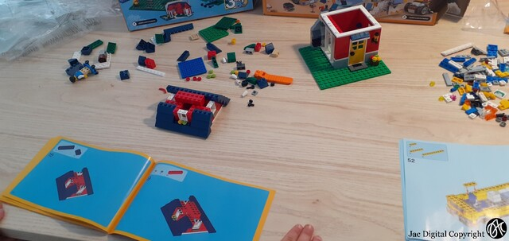](https://www.freelug.org/IMG/jpg/photo_15_-6.jpg)

De l’autre coté la construction du van avance bien. Il y a des aménagements sympa et modulable à l’intérieur. Le coffre sous le lit à l’arrière est bien pensé et a bien plu.

[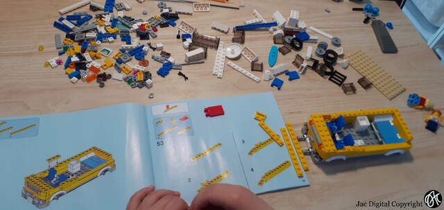](https://www.freelug.org/IMG/jpg/photo_16_-4.jpg)

La petite maison est terminée bien avant le van. Elle va pouvoir prendre place sur le diorama de jeu. Le petit bonhomme sur le skate est bien amusant. Ma fille termine sans soucis l’assemblage des petits détails.

Il reste pas mal de pièces, mais elles sont prévues pour les deux autres constructions.

[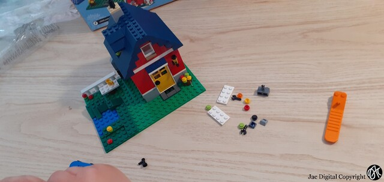](https://www.freelug.org/IMG/jpg/photo_19_-4.jpg)

J’ai du finaliser la construction moi-même. C’est un peu long pour cet âge quand même. Mais je n’ai pas eu grand chose à terminer et le van plaît bien. Il reste aussi pas mal de pièces.

Le van fini avec l’aménagement et les accessoires placés sur le toit est vraiment bien. Il promet des phases de jeux intéressantes et d’ailleurs il rejoint le diorama de mes filles sans tarder. J’ai donné un peu d’explications pour se servir du barbecue, déplier le transat avec son parasol, pour le reste, pas de soucis.

Ne vous attendez pas à trouver le moteur dans le van, il n’y en a pas du tout. On peut l’imaginer où on veut ou comme on veut. Du coup, on aurait pu penser à un Combi, mais il n’en est rien, même s’il en est un peu inspiré pour l’aménagement.

Petite anecdote, ma fille a essayé d’ouvrir la porte latérale du van, sans succès. On s’est rendu compte qu’il fallait enlever le toit pour pouvoir ouvrir la porte. J’ai fait une petite modification, juste déplacé une pièce pour ne plus être obligé de faire ça.

[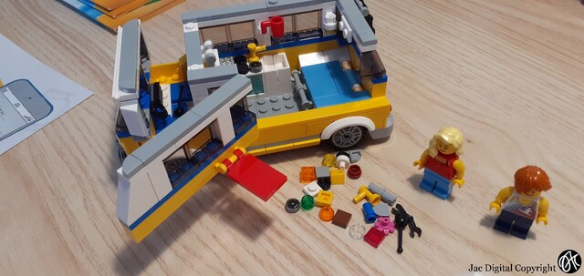](https://www.freelug.org/IMG/jpg/photo_21_-3.jpg)

[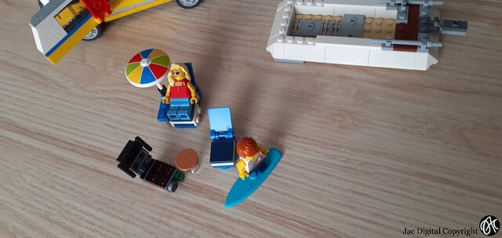](https://www.freelug.org/IMG/jpg/photo_24_-3.jpg)

J’ai voulu mettre des roues plus larges à la place de celles qui sont fournies. Je les trouve un peu fines. Ca fait un look plus sympa. Mais le van ne roule plus. Ca touche trop les garde-boues. Ca n’a pas plu du tout. Alors j’ai remis comme sur la notice...

[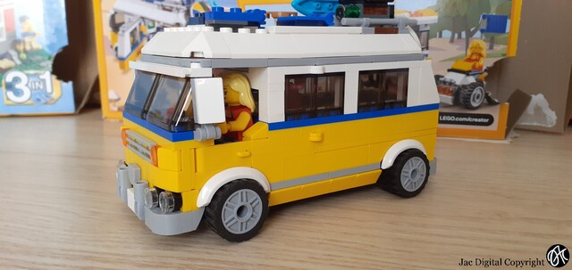](https://www.freelug.org/IMG/jpg/photo_26_-2.jpg)

J’ai monté le deuxième modèle de la boite du van, avec mes pièces. A part quelques couleurs, c’est un très bel engin pour rouler sur la plage...

[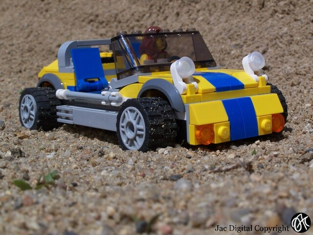](https://www.freelug.org/IMG/jpg/photo_27_-5.jpg)

Ce fut un moment agréable à passer avec mes filles. Il a fallu prendre des pauses, mais c’est tout à fait normal. On se rend compte aussi de l’évolution des sets. Il y a plus de possibilités de jeux avec le van. Les deux boites n’ont pas le même nombre de pièces et n’ont pas le même thème, mais on sent tout de même l’évolution.

[Toutes les photos ici](https://photos.freelug.org/main.php/v/JAC/review/Creator/31009-79/)
