Aujourd’hui je vous propose la boîte _31031_, **Les animaux de la forêt tropicale**.

Sortie en 2015, cette boîte comporte 215 pièces pour 14,99 €, soit 7 centime par pièce.

L’avant présente les animaux pouvant être construits, à savoir un ensemble perroquet, grenouille et mouche, un caméléon et un poisson tropical ressemblant fortement à un piranha. Les habituels logos LEGO, Creator et « 3 in 1 » sont présents.

[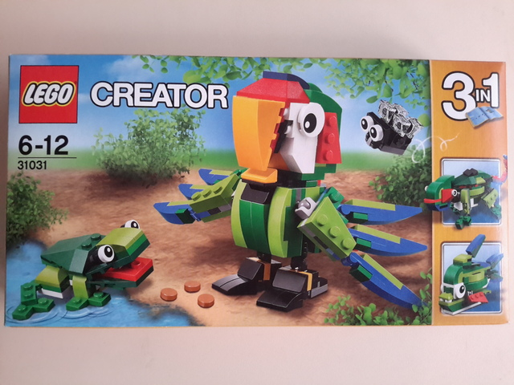](https://www.freelug.org/IMG/jpg/20170708_210109.jpg)

L’arrière, comme habituel également, met en scène tous les animaux simultanément, avec une indication sur le fait que le perroquet peut avaler des graines, ce que nous reverrons plus tard.

[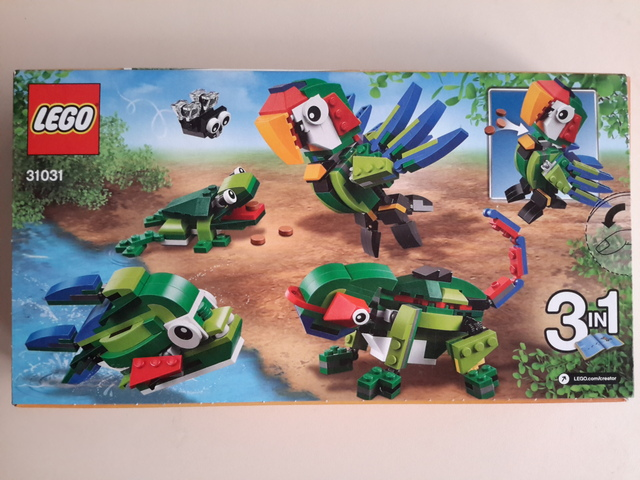](https://www.freelug.org/IMG/jpg/20170708_210124.jpg)

La boîte contient 3 sachets, et trois notices.

[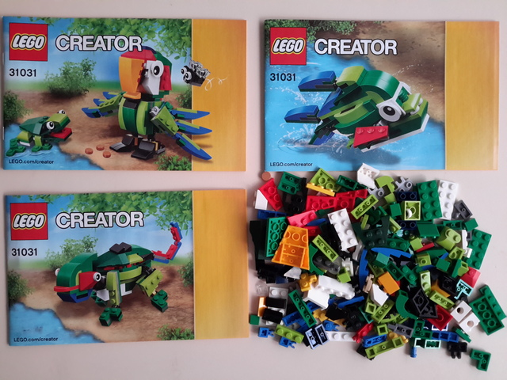](https://www.freelug.org/IMG/jpg/20170708_202748.jpg)

* * *

La construction de la mouche se fait en trois étapes, avec 11 pièces compteur en main, et pourtant je la trouve particulièrement expressive.

[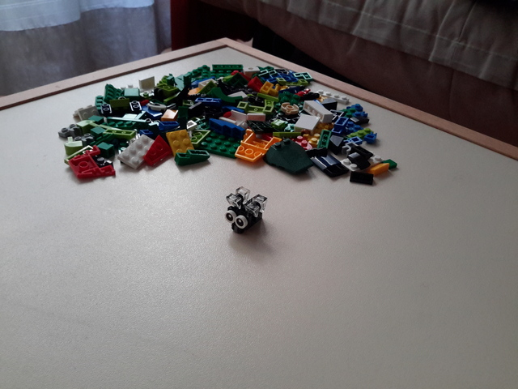](https://www.freelug.org/IMG/jpg/20170708_203042.jpg)

La construction de la grenouille commence par un corps plutôt simple, avec chose rare des pièces attachées via un seul tenon à une charnière, et pouvant donc pivoter selon un axe vertical.

[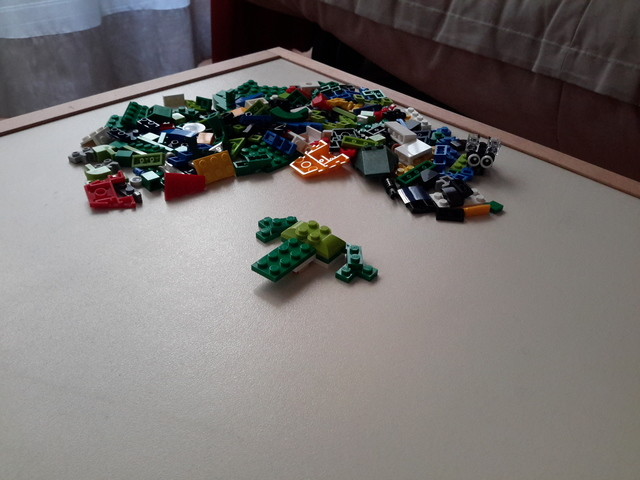](https://www.freelug.org/IMG/jpg/20170708_203232.jpg)

Les yeux sont amusants, avec une bouche qui peut s’ouvrir bien sûr. Les tons verts sont bien représentés, et donnent une certaine personnalité à la grenouille.

[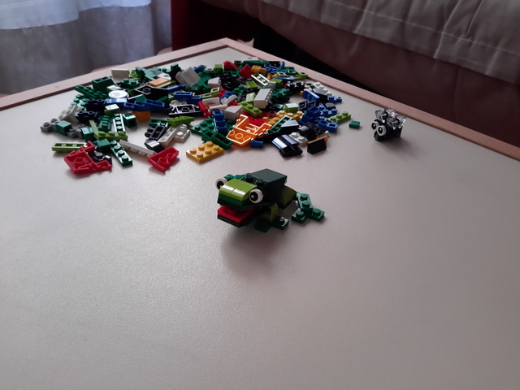](https://www.freelug.org/IMG/jpg/20170708_203611.jpg)

Le montage du perroquet débute par le corps, avec les attaches pour les ailes, et les deux attaches, en noir, pour les pattes.

[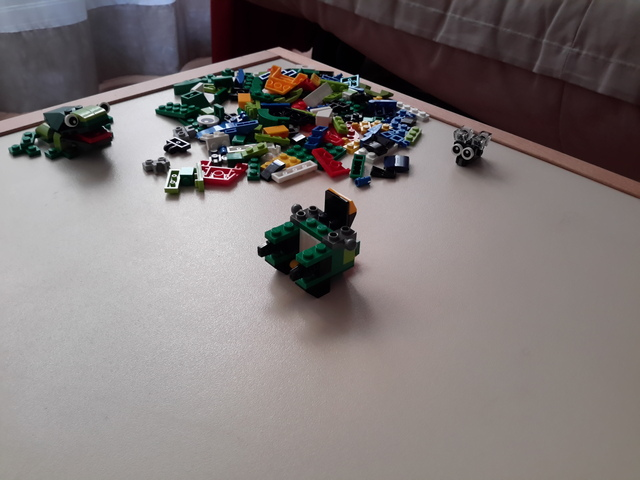](https://www.freelug.org/IMG/jpg/20170708_204020.jpg)

Le corps assemblé, avec les pattes, qui ont deux parties indépendantes et peuvent tourner selon un axe vertical, on s’attaque à la tête, en vert, blanc et jaune foncé.

[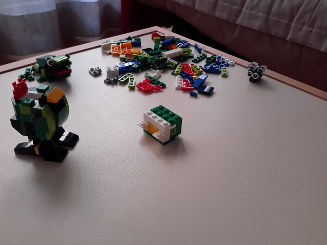](https://www.freelug.org/IMG/jpg/20170708_204715.jpg)

La tête presque complétée, avec les deux grands yeux, qui peuvent tourner, et le magnifique bec jaune foncé.

[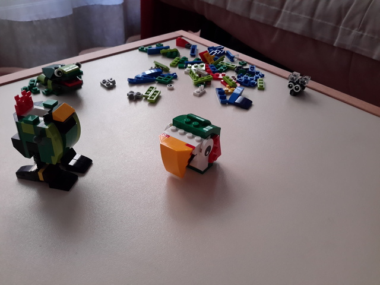](https://www.freelug.org/IMG/jpg/20170708_205111.jpg)

Que serait un perroquet sans sa queue ? Pas grand-chose, c’est pourquoi on continue avec celle-ci, en teintes bleues, et deux attaches qui lui permettront de se raccorder au corps tout en pivotant.

[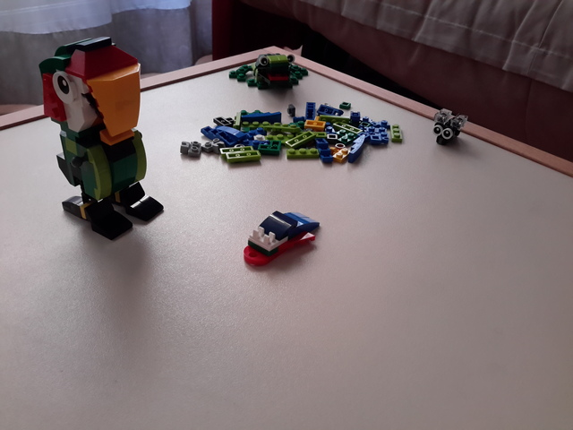](https://www.freelug.org/IMG/jpg/20170708_205311.jpg)

Les supports des ailes sont symétriques, avec des clips pour attacher les plumes, trois de chaque côté. Les ailes pourront bouger selon deux axes, et permettre pas mal de mouvements.

[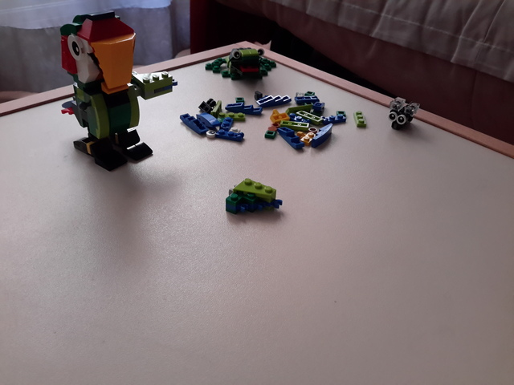](https://www.freelug.org/IMG/jpg/20170708_205532.jpg)

Et voici le perroquet complété, avec ses belles ailes bleu-vert.

[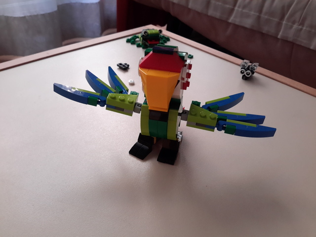](https://www.freelug.org/IMG/jpg/20170708_205732.jpg)

Et les graines, me direz-vous ? Et bien le perroquet peut, comme vous l’aurez deviné en voyant le montage, ouvrir grand la bouche, pour avaler des graines (pièces rondes 1x1 brun)...

[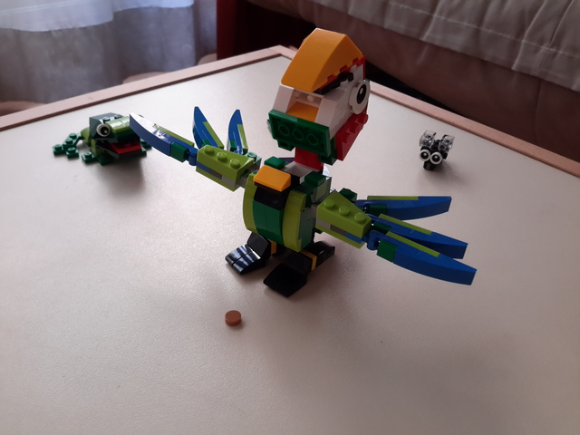](https://www.freelug.org/IMG/jpg/20170708_205808.jpg)

... qui peuvent être stockées dans le corps creux de l’animal, et être récupérées en bougeant la queue, qui libère le contenu de l’estomac.

[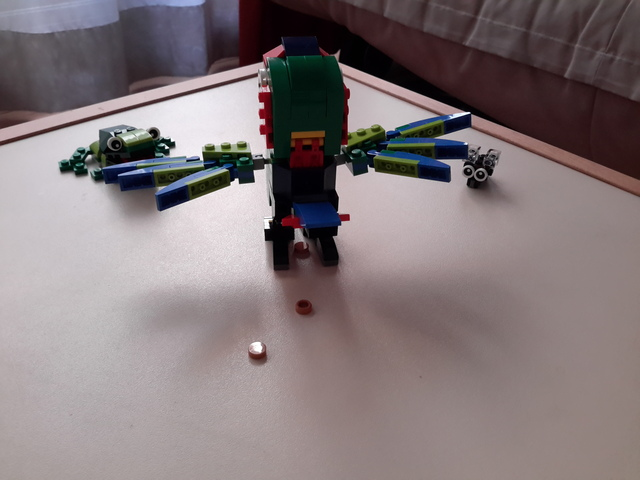](https://www.freelug.org/IMG/jpg/20170708_205819.jpg)

Pour terminer une petite vue des trois animaux ensemble, avec à gauche les trois graines, et la grenouille contemplant les pièces bonus.

[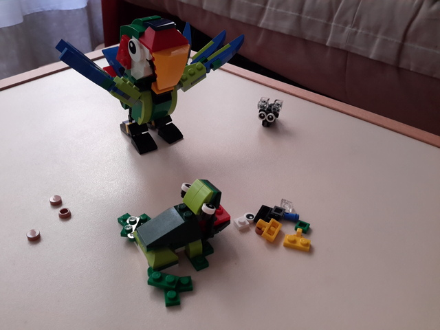](https://www.freelug.org/IMG/jpg/20170708_205853.jpg)

Et là je suis très perplexe, car les deux pièces jaunes visibles ne sont utilisées dans aucun des animaux, dans aucune notice... Et pourtant elles sont bien listées dans l’inventaire officiel de la boîte : 4 pièces, dont 2 utilisées pour le perroquet... C’est la première fois que je vois deux pièces bonus identiques. Un mystère à résoudre dans la jungle ?

* * *

**Avis :** un petit set sympathique, dans la lignée des Creator avec animaux. Le rendu est agréable, et la construction comporte quelques techniques un peu plus avancées que la base.

**Bonus 1 :** quelques images du caméléon, dont j’aime bien la forme...

[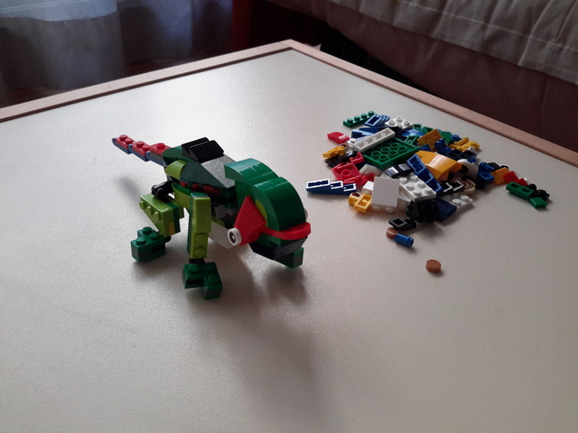](https://www.freelug.org/IMG/jpg/20170708_200843.jpg)

[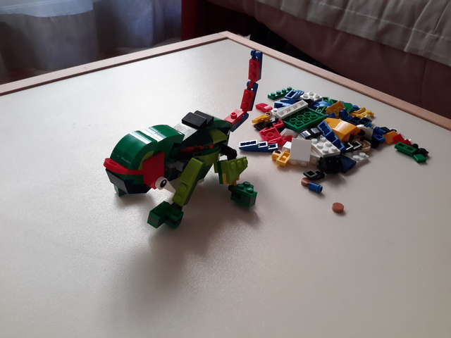](https://www.freelug.org/IMG/jpg/20170708_200900.jpg)

[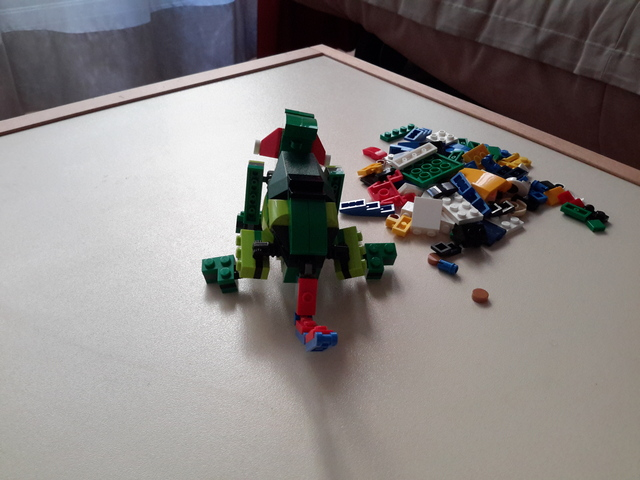](https://www.freelug.org/IMG/jpg/20170708_200925.jpg)

... et du poisson que je n’aimerais pas croiser dans une rivière.

[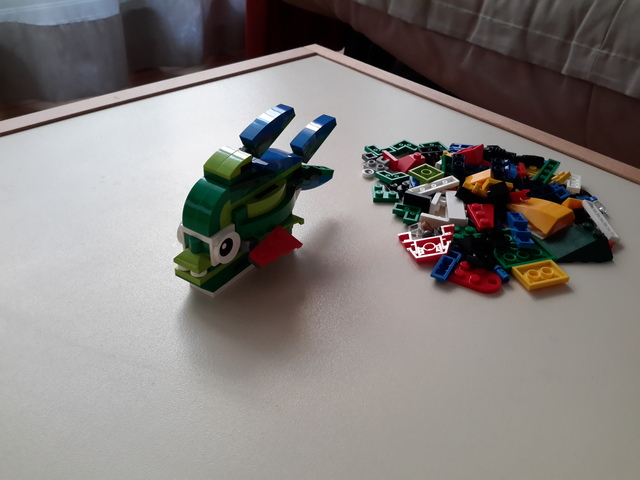](https://www.freelug.org/IMG/jpg/20170708_202214.jpg)

[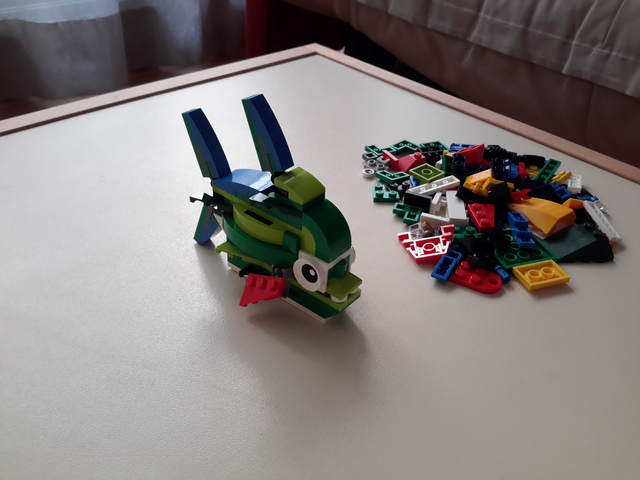](https://www.freelug.org/IMG/jpg/20170708_202233.jpg)

[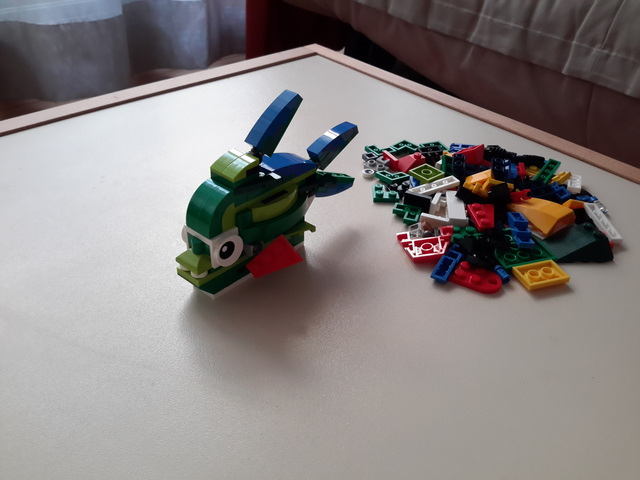](https://www.freelug.org/IMG/jpg/20170708_202250.jpg)

**Bonus 2 :** animation de toutes les étapes du montage du trio perroquet, mouche et grenouille.

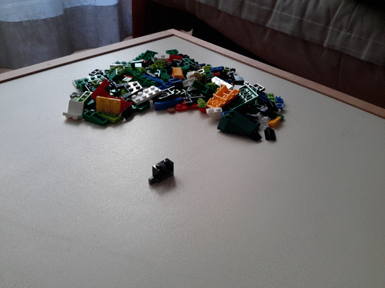
