En préparation de l’hiver et du temps froid qui s’approchent, je vous propose une review d’un set, le _31032_, _Les créatures rouges_, permettant de construire un dragon cracheur de feu, susceptible donc de réchauffer une pièce plus efficacement qu’un radiateur ordinaire, un scorpion ou un cobra.

Ce set de la gamme _Creator_, sorti en 2015, comporte 221 pièces pour un coût de 14,99 €, soit un bon ratio d’un peu moins de 7 centimes.

* * *

L’avant de la boîte, classique pour la gamme, présente le modèle principal, le dragon (en plein vol devant une forêt), avec sur le côté droit les modèles secondaires, le scorpion et le cobra, ainsi que la mention « 3 in 1 ».

[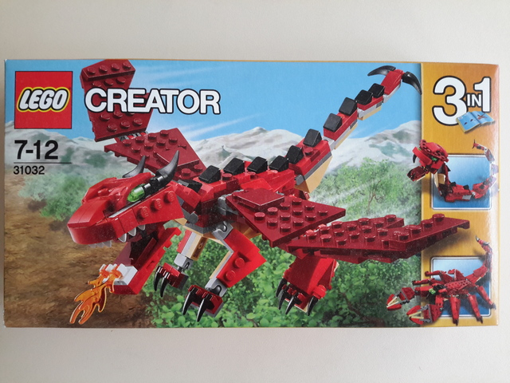](https://www.freelug.org/IMG/jpg/20170611_132127.jpg)

Le dos, également classique pour la gamme, montre les trois créatures dans le même environnement.

[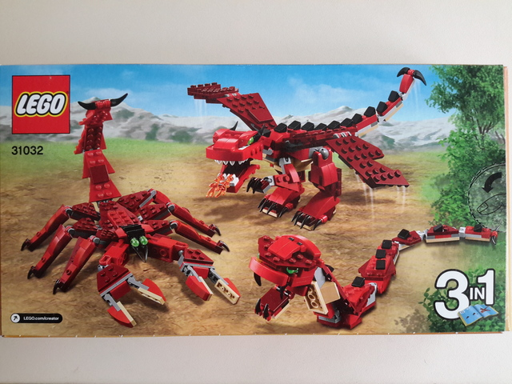](https://www.freelug.org/IMG/jpg/20170611_132143.jpg)

La boîte contient deux notices, une pour le dragon et la seconde pour les autres modèles, et trois sachets, qui ouverts font une petite pile de pièces quand même. Sans surprise elles sont à dominante rouge, plus foncé que clair.

[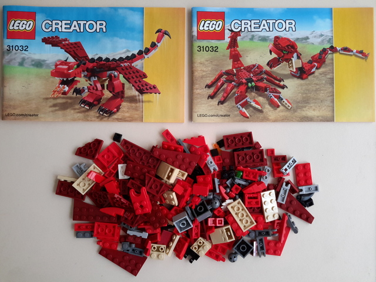](https://www.freelug.org/IMG/jpg/20170611_132051.jpg)

Je me concentrerai ici sur la construction du dragon.

Celle-ci commence par le corps, sur lequel viendront se fixer ailes, queue, tête, pattes. Deux articulations à deux degrés de chaque côté, plus des supports de crans devant et derrière, l’on pourra donc fixer 8 éléments.

[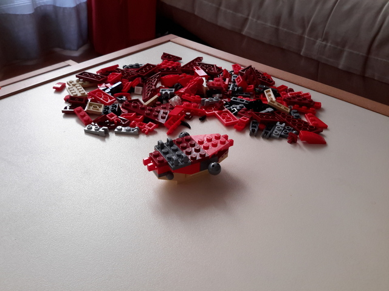](https://www.freelug.org/IMG/jpg/20170611_192016.jpg)

On continue par les pattes avant, qui auront de magnifiques griffes visibles sur les photos suivantes, et quelques ailerons sur le dessus.

[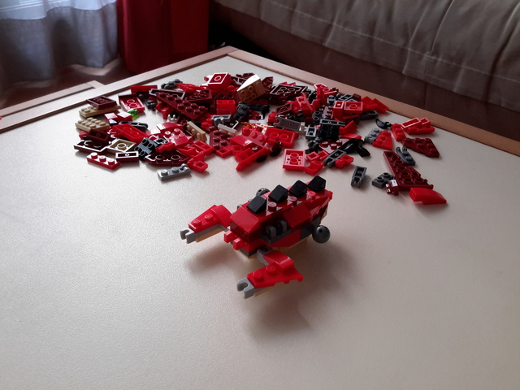](https://www.freelug.org/IMG/jpg/20170611_192458.jpg)

On termine les pattes puis on se lance dans le montage de la queue. Celle-ci comporte quatre éléments reliés par des charnières dont une à deux degrés, permettant de nombreuses positions.

[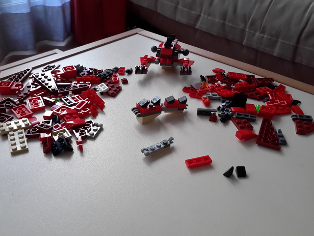](https://www.freelug.org/IMG/jpg/20170611_193018.jpg)

Et voici la queue terminée et attachée. L’étape suivante est de construire les pattes de support du dragon, qui comporteront également de belles griffes. Les pattes sont, sans surprise, symétriques.

[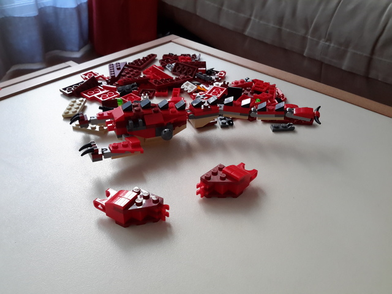](https://www.freelug.org/IMG/jpg/20170611_193444.jpg)

Les pattes complétées et assemblées au corps, ici en position latérale. Quatre griffes à chaque extrémité permettent de bien agripper une proie avant de la carboniser.

[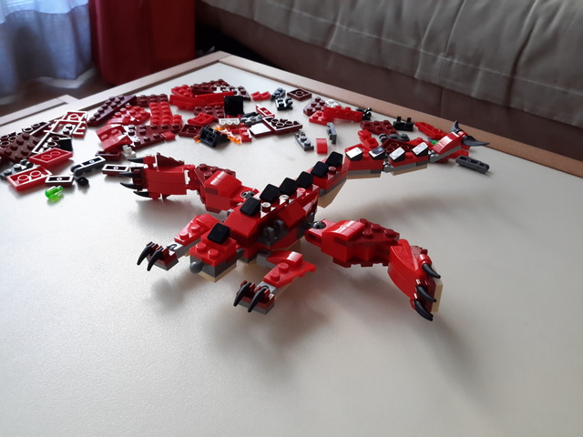](https://www.freelug.org/IMG/jpg/20170611_195606.jpg)

Que serait un dragon sans tête ? Pas grand-chose, n’est-ce pas, c’est pourquoi l’on continue par celle-ci. Les supports noirs permettront de fixer les yeux d’un magnifique vert.

[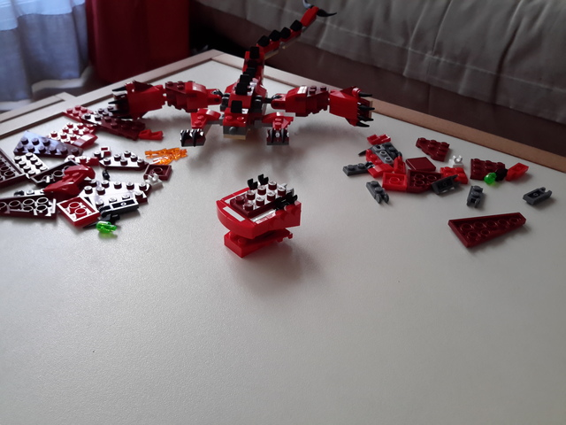](https://www.freelug.org/IMG/jpg/20170611_200041.jpg)

Et il ne faut pas oublier l’indispensable feu craché par le dragon, sinon je vous aurais menti sur l’utilisation comme radiateur !

[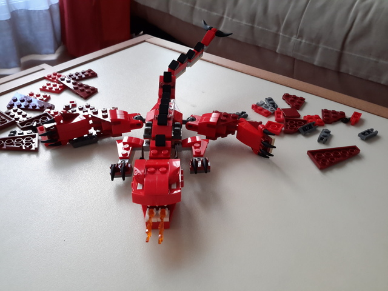](https://www.freelug.org/IMG/jpg/20170611_200323.jpg)

Pour terminer, passons aux ailes. Elles se composent de deux parties, pour mieux se déployer et replier.

[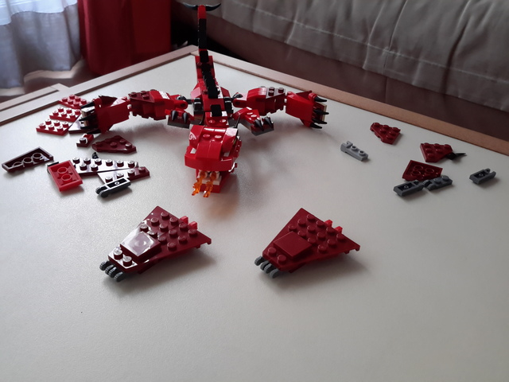](https://www.freelug.org/IMG/jpg/20170611_200457.jpg)

Les morceaux à l’extérieur sont symétriques également, d’une belle couleur rouge foncé.

[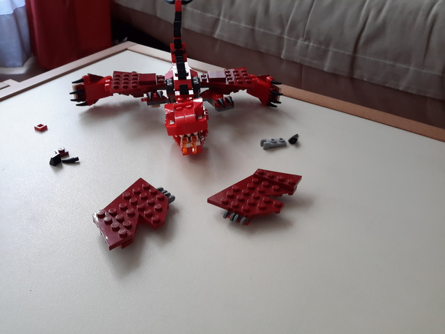](https://www.freelug.org/IMG/jpg/20170611_200828.jpg)

Et voici le dragon terminé, en position « neutre »...

[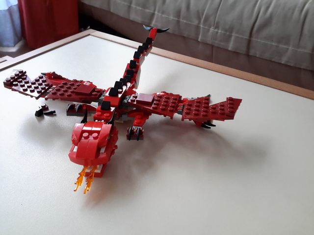](https://www.freelug.org/IMG/jpg/20170611_200904.jpg)

... et en support sur ses pattes avec les ailes partiellement pliées. Notez les magnifiques yeux vert.

[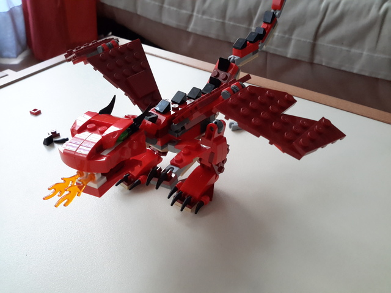](https://www.freelug.org/IMG/jpg/20170611_200942.jpg)

Comme tout dragon qui se respecte, celui-ci a son trésor, les pièces bonus restant dans la boîte. D’ailleurs je vais éviter de lui prendre, il a l’air furieux !

[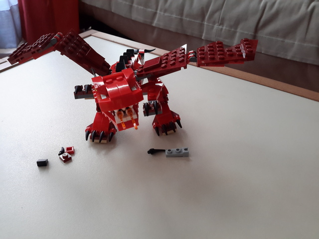](https://www.freelug.org/IMG/jpg/20170611_201002.jpg)

Pour terminer une vue de dos.

[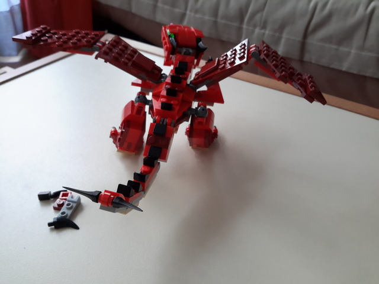](https://www.freelug.org/IMG/jpg/20170611_201018.jpg)

* * *

**Avis :** un set très sympathique, avec un bon rendu pour le dragon et les autres créatures que l’on peut construire. Les couleurs sont agréables à l’œil, et le dragon peut prendre de nombreuses positions avec toutes ses articulations.

**Bonus 1 :** voici le scorpion...

[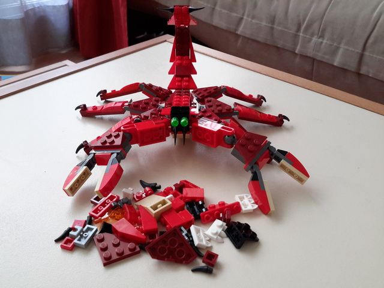](https://www.freelug.org/IMG/jpg/20170611_145256.jpg)

[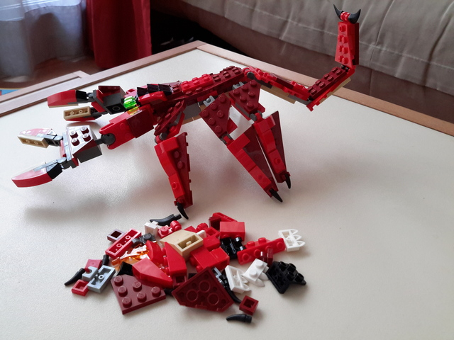](https://www.freelug.org/IMG/jpg/20170611_145314.jpg)

[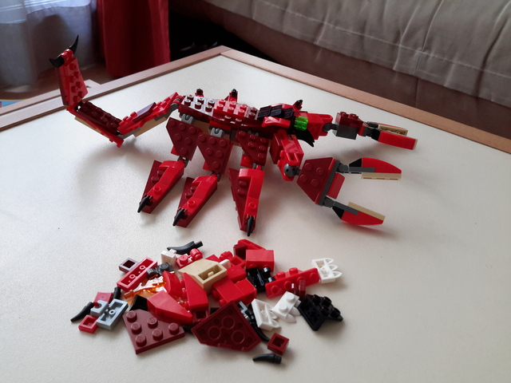](https://www.freelug.org/IMG/jpg/20170611_145331.jpg)

... et le cobra.

[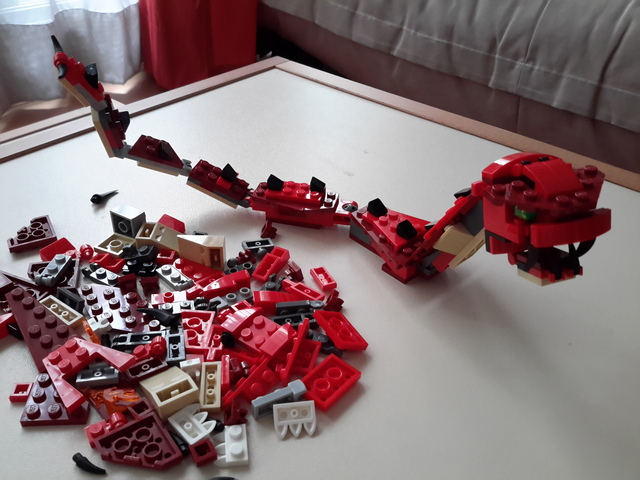](https://www.freelug.org/IMG/jpg/20170611_190939.jpg)

[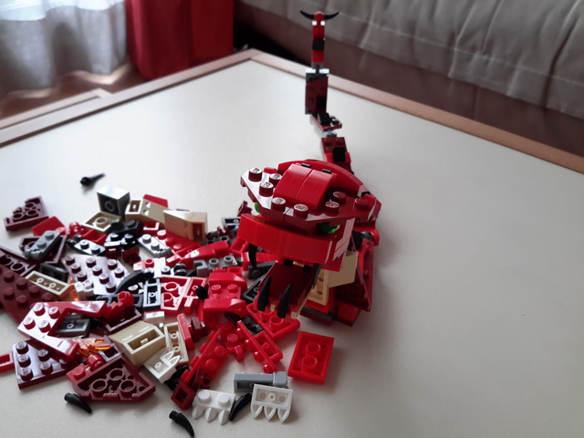](https://www.freelug.org/IMG/jpg/20170611_191002.jpg)

[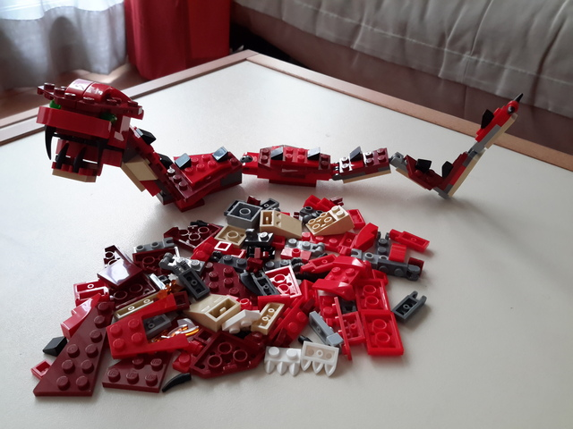](https://www.freelug.org/IMG/jpg/20170611_191034.jpg)

Notez que comme d’habitude dans la gamme Creator ils n’utilisent pas toutes les pièces du modèle principal.

**Bonus 2 :** animation de toutes les étapes de montage (cliquer pour lancer).

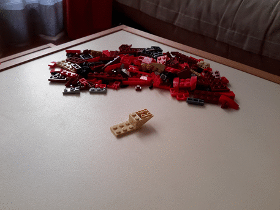
